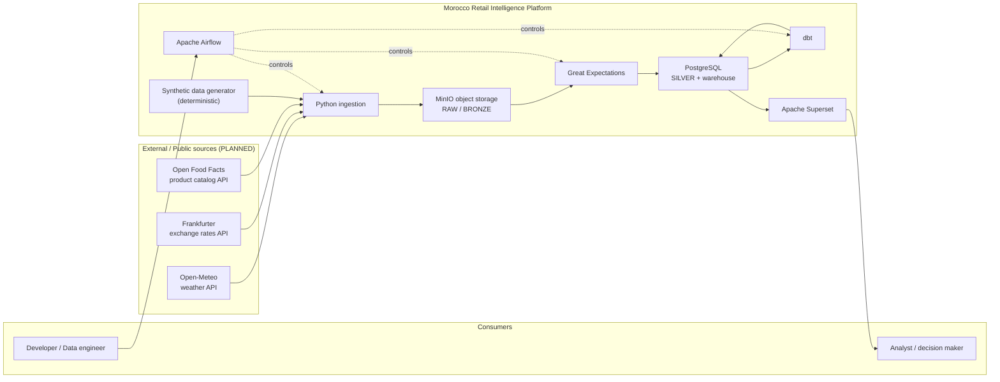
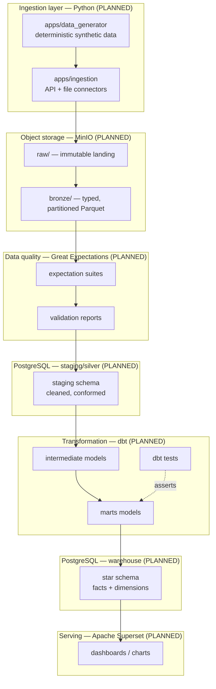
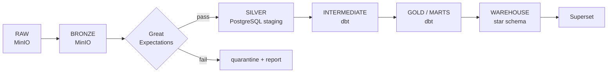

# Architecture — Morocco Retail Intelligence Data Platform

> **Status: PARTIALLY IMPLEMENTED (through Phase 03).** This document describes the
> **target architecture** of the platform. The repository/docs foundation, the
> Python project, the deterministic synthetic data generator and the **local
> container foundation (PostgreSQL 16 + MinIO)** exist and are validated. Every
> component marked **PLANNED** — ingestion connectors, Great Expectations, dbt
> models, the warehouse/business schema, Airflow, Superset, CI/CD — is *not yet
> implemented*. The containers run, but no business schema or bucket has been
> created.

---

## 1. System context

The platform is a local, batch-oriented data system. It ingests external/public APIs
and controlled synthetic retail data, validates it, transforms it into a dimensional
warehouse, and serves BI dashboards. Everything runs on one developer machine through
Docker Compose; GitHub Actions provides CI/CD.

---

## 2. Logical architecture

---

## 3. End-to-end data flow

| # | Stage | Technology | Output |
|---|-------|-----------|--------|
| 1 | Source acquisition | REST APIs (Open-Meteo, Frankfurter, Open Food Facts) | JSON/CSV responses |
| 1 | Synthetic generation | Python (`apps/data_generator`, seeded RNG) | CSV/JSON files |
| 2 | Ingestion | Python (`apps/ingestion`), `requests`, `pandas` | raw payloads |
| 3 | Landing | **MinIO** `raw/` | immutable files (JSON/CSV/Parquet) |
| 4 | Bronze | Python + **PyArrow** | typed, partitioned Parquet in `bronze/` |
| 5 | Validation | **Great Expectations** | expectation suites + validation reports |
| 6 | Staging / Silver | Python load → **PostgreSQL** | `staging` schema tables |
| 7 | Transformation | **dbt** (SQL) | `intermediate` models |
| 8 | Business models | **dbt** (SQL) | `marts` models |
| 9 | Warehouse | **dbt** → **PostgreSQL** star schema | facts + dimensions |
| 10 | BI | **Apache Superset** | charts, dashboards |

Orchestration of stages 2–10: **Apache Airflow** (PLANNED).
Testing: **pytest** (Python) + **dbt test** (SQL) + **Great Expectations** (data).
CI/CD: **GitHub Actions** (PLANNED).

---

## 4. Architectural principles

| Principle | What it means in this project |
|-----------|------------------------------|
| **Reproducibility** | Same commands, same pinned versions (`uv.lock`), same seeds → same result on any machine. |
| **Idempotence** | Re-running an ingestion or load overwrites/upserts the same result; no duplicate state. |
| **Incremental processing** | Later phases process new partitions/rows instead of reprocessing everything. |
| **Data quality before loading** | Validation (Great Expectations) gates the data **before** it is trusted in Silver. |
| **Immutable raw data** | Objects under `raw/` are never updated in place; corrections create new versions downstream. |
| **Explicit source contracts** | Every source has a versioned contract in `data_contracts/` (schema + guarantees). |
| **Separation of ingestion and analytics transformations** | Python moves/cleans data; **dbt** owns analytics-shaped SQL models. |
| **Observability** | Structured logs now; Prometheus/Grafana metrics later (PLANNED). |
| **Testability** | Every layer has a test hook: pytest (code), GE (data), dbt test (models). |
| **Least privilege** | Separate database roles for ingestion, transformation and BI; no root usage in containers. |
| **No silent data loss** | Failed rows/files are counted, reported and quarantined — never dropped quietly. |
| **Deterministic synthetic data** | Fixed seeds make generated datasets byte-reproducible for tests and demos. |
| **No secrets in Git** | Only `.env.example` placeholders are committed; real `.env` is git-ignored. |
| **Infrastructure reproducibility** | Containers and pinned image tags recreate the whole stack from `docker compose`. |

---

## 5. Technology responsibilities

| Technology | Responsibility | Not responsible for |
|------------|----------------|---------------------|
| **Python** | Ingestion, connectors, preprocessing, loaders, synthetic generation | Analytics SQL modelling |
| **Pandas** | Tabular transformations where appropriate (wrangling, typing, joins at ingest) | Large-scale compute (stays out of the warehouse's way) |
| **PyArrow** | Parquet read/write, columnar schema handling | Business logic |
| **MinIO** | Object storage: raw landing zone + intermediate/bronze files | Querying, transformations |
| **PostgreSQL** | Staging (Silver) + analytical warehouse / star schema | File storage |
| **dbt** | SQL transformations, analytics models, data tests, documentation | Orchestration of external systems |
| **Great Expectations** | Data quality expectation suites and validation reports | Transformations |
| **pytest** | Python unit/integration tests | Data assertions (that is GE/dbt test) |
| **Apache Airflow** | Orchestration, scheduling, retries, run visibility | Data processing itself |
| **Apache Superset** | BI, charts, dashboards | Data transformation |
| **GitHub Actions** | CI/CD: lint, typecheck, tests on every push/PR | Deployment to production (not in scope yet) |
| **Prometheus / Grafana** | Future metrics and dashboards for pipeline observability (**PLANNED**) | Logging (logs stay in Airflow/files) |

---

## 6. Data layers

| Layer | Location | Purpose | Ownership |
|-------|----------|---------|-----------|
| **RAW** | MinIO `raw/` | Immutable landing of exactly what the source returned. | Ingestion (Python) |
| **BRONZE** | MinIO `bronze/` | Typed, partitioned Parquet; source-faithful but queryable. | Ingestion (Python + PyArrow) |
| **SILVER / Staging** | PostgreSQL `staging` schema | Cleaned, conformed, deduplicated business records. | Python load + Great Expectations gate |
| **INTERMEDIATE** | dbt `models/intermediate` | Intermediate SQL cleaning/conforming steps reused by marts. | dbt |
| **GOLD / MARTS** | dbt `models/marts` | Business-friendly, marts-shaped models per domain. | dbt |
| **WAREHOUSE** | PostgreSQL star schema | Facts + dimensions consumed by Superset. | dbt |

---

## 7. Supporting documents

| Document | Contents |
|----------|----------|
| [`docs/architecture/ingestion.md`](docs/architecture/ingestion.md) | Ingestion + storage architecture (MinIO layout, source connectors) |
| [`docs/architecture/transformation.md`](docs/architecture/transformation.md) | Transformation + warehouse architecture (dbt layers, star schema) |
| [`docs/architecture/orchestration.md`](docs/architecture/orchestration.md) | Orchestration, testing and CI/CD architecture (Airflow, pytest, GitHub Actions) |
| [`docs/architecture/observability.md`](docs/architecture/observability.md) | Future observability architecture (Prometheus/Grafana) |
| [`docs/development-environment.md`](docs/development-environment.md) | PHASE 00 environment audit and installation record |
| [`data_contracts/README.md`](data_contracts/README.md) | Data contract policy (source contracts, versioning, evolution) |

---

## 8. Implementation status

| Area | Status |
|------|--------|
| Repository skeleton, Python project (`uv`, lint, types, tests) | **IMPLEMENTED** |
| Environment audit + dependency lock (`uv.lock`) | **IMPLEMENTED** |
| Deterministic synthetic data generator (`src/mri/synthetic`, `apps/data_generator`) | **IMPLEMENTED** |
| Local container foundation — PostgreSQL 16 + MinIO (Docker Compose, health, persistence) | **IMPLEMENTED** |
| Object-storage buckets, `staging`/warehouse schema | **PLANNED** |
| Ingestion, GE, dbt, Airflow, Superset, CI/CD | **PLANNED** — not implemented |

See [`docs/decisions/ADR-001-local-container-foundation.md`](docs/decisions/ADR-001-local-container-foundation.md)
for the container-stack rationale and the MinIO registry caveat.
