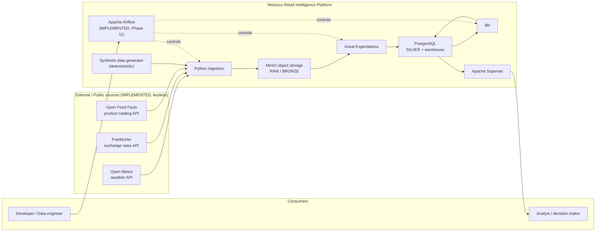
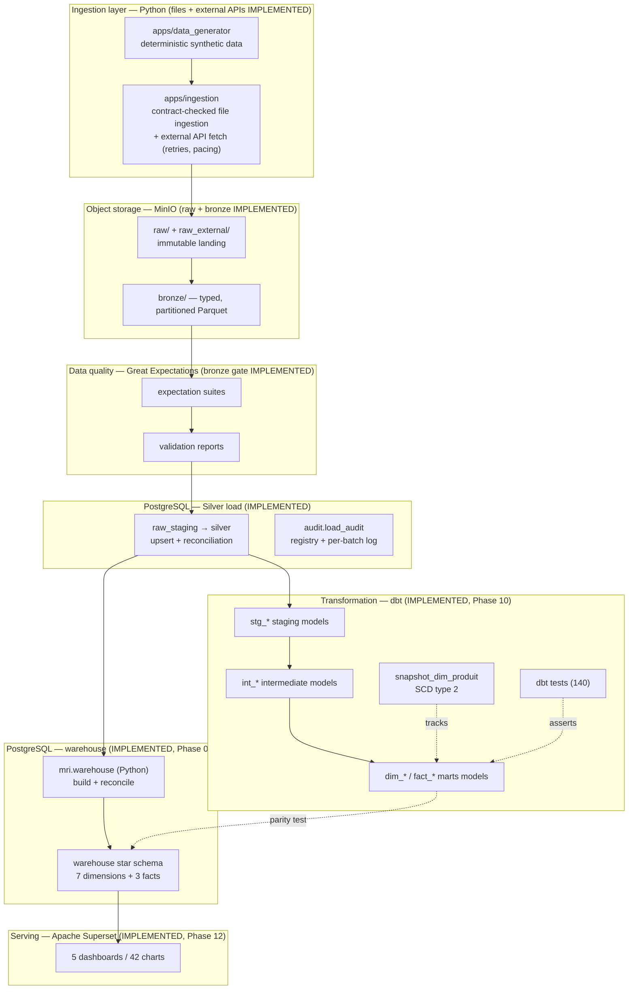
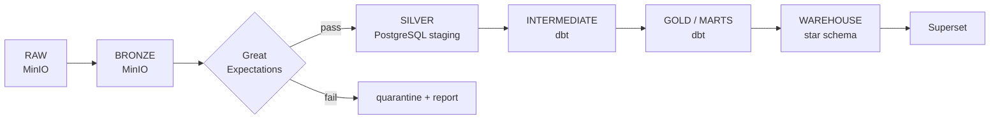

# Architecture — Morocco Retail Intelligence Data Platform

> **Status: IMPLEMENTED (through Phase 28).** Every component described below is
> implemented and validated locally. The repository/docs foundation, the Python
> project, the deterministic synthetic data generator, the **local container
> foundation (PostgreSQL 16 + MinIO)**, the **versioned source contracts**, the
> **file ingestion layer** (CSV/JSON → MinIO `raw/`), the **external API
> connectors** (keyless Open-Meteo / Frankfurter / Open Food Facts →
> `raw_external/`), the **Bronze layer** (contract-governed RAW → partitioned
> Parquet behind a Great Expectations gate), the **Silver layer** (promoted
> Bronze → PostgreSQL `raw_staging`/`silver`/`audit`), the **star schema
> warehouse** (7 dimensions + 3 facts in the PostgreSQL `warehouse` schema), the
> **dbt analytics layer** (staging → intermediate → marts + SCD type 2
> `dim_produit` snapshot + 140 dbt tests, with a row-level parity test against
> the Python warehouse), the **Apache Airflow orchestration layer** (official
> 3.3.2 containers, `LocalExecutor`, one end-to-end DAG `morocco_retail_pipeline`
> with 8 tasks), the **Apache Superset BI layer** (Phases 12), **GitHub Actions
> CI/CD** (Phase 13), **structured audit logging + `ops` metrics** (Phase 16),
> **data lineage** (Phase 18) and the **Prometheus + Grafana observability
> profile** (Phase 19) all exist and are tested.
> Only items explicitly marked **PLANNED** in the tables remain future work
> (e.g. `holidays` calendar enrichment, MinIO object versioning, production
> deployment). The CI workflow is **configured but has not yet been validated by
> a remote GitHub Actions run** — see [`README.md`](README.md).

---

## 1. System context

The platform is a local, batch-oriented data system. It ingests external/public APIs
and controlled synthetic retail data, validates it, transforms it into a dimensional
warehouse, and serves BI dashboards. Everything runs on one developer machine through
Docker Compose; GitHub Actions provides CI/CD.

---

## 2. Logical architecture

---

## 3. End-to-end data flow

| # | Stage | Technology | Output |
|---|-------|-----------|--------|
| 1 | Source acquisition | REST APIs (Open-Meteo, Frankfurter, Open Food Facts) — keyless, **implemented** | verbatim JSON in `raw_external/` |
| 1 | Synthetic generation | Python (`apps/data_generator`, seeded RNG) | CSV/JSON files |
| 2 | Ingestion | Python (`apps/ingestion`), `httpx`, `pandas` | raw payloads |
| 3 | Landing | **MinIO** `raw/` + `raw_external/` | immutable files (JSON/CSV) + API responses |
| 4 | Bronze | Python + **PyArrow** | typed, partitioned Parquet in `bronze/` — **implemented** |
| 5 | Validation | **Great Expectations** | expectation suites + validation reports — **implemented at Bronze** (Silver adds structural constraints + reconciliation) |
| 6 | Staging / Silver | Python load → **PostgreSQL** | `raw_staging` → `silver` + `audit` schemas — **implemented** |
| 7 | Transformation | **dbt** (SQL) | `stg_*` staging + `int_*` intermediate models — **implemented (Phase 10)** |
| 8 | Business models | **dbt** (SQL) | `dim_*`/`fact_*` marts models (Star Schema) — **implemented (Phase 10)** |
| 9 | Warehouse | **Python** (`mri.warehouse`) → **PostgreSQL** star schema | facts + dimensions — **implemented** |
| 9b | Warehouse (dbt re-expression) | **dbt** (SQL) | star-schema marts + SCD2 `dim_produit` — **implemented (Phase 10)**, guarded parity test |
| 10 | BI | **Apache Superset** — **implemented (Phase 12)** | 5 dashboards, 42 charts |

Orchestration of stages 2–10: **Apache Airflow** — **implemented (Phase 11)**,
official 3.3.2 containers with `LocalExecutor`, DAG `morocco_retail_pipeline`
(8 correlated tasks, retries, daily UTC schedule).
Testing: **pytest** (Python) + **dbt test** (SQL) + **Great Expectations** (data).
CI/CD: **GitHub Actions** (IMPLEMENTED, Phase 13).

---

## 4. Architectural principles

| Principle | What it means in this project |
|-----------|------------------------------|
| **Reproducibility** | Same commands, same pinned versions (`uv.lock`), same seeds → same result on any machine. |
| **Idempotence** | Re-running an ingestion or load overwrites/upserts the same result; no duplicate state. |
| **Incremental processing** | Later phases process new partitions/rows instead of reprocessing everything. |
| **Data quality before loading** | Validation (Great Expectations) gates the data **before** it is trusted in Silver. |
| **Immutable raw data** | Objects under `raw/` are never updated in place; corrections create new versions downstream. |
| **Explicit source contracts** | Every source has a versioned contract in `data_contracts/` (schema + guarantees). |
| **Separation of ingestion and analytics transformations** | Python moves/cleans data; **dbt** owns analytics-shaped SQL models. |
| **Observability** | Structured audit events + `ops` metrics (Phase 16) and a Prometheus/Grafana stack (Phase 19) — both implemented. |
| **Testability** | Every layer has a test hook: pytest (code), GE (data), dbt test (models). |
| **Least privilege** | Separate database roles for ingestion, transformation and BI; no root usage in containers. |
| **No silent data loss** | Failed rows/files are counted, reported and quarantined — never dropped quietly. |
| **Deterministic synthetic data** | Fixed seeds make generated datasets byte-reproducible for tests and demos. |
| **No secrets in Git** | Only `.env.example` placeholders are committed; real `.env` is git-ignored. |
| **Infrastructure reproducibility** | Containers and pinned image tags recreate the whole stack from `docker compose`. |

---

## 5. Technology responsibilities

| Technology | Responsibility | Not responsible for |
|------------|----------------|---------------------|
| **Python** | Ingestion, connectors, preprocessing, loaders, synthetic generation | Analytics SQL modelling |
| **Pandas** | Tabular transformations where appropriate (wrangling, typing, joins at ingest) | Large-scale compute (stays out of the warehouse's way) |
| **PyArrow** | Parquet read/write, columnar schema handling | Business logic |
| **MinIO** | Object storage: raw landing zone + intermediate/bronze files | Querying, transformations |
| **PostgreSQL** | Staging (Silver) + analytical warehouse / star schema | File storage |
| **dbt** | SQL transformations, analytics models, data tests, documentation | Orchestration of external systems |
| **Great Expectations** | Data quality expectation suites and validation reports | Transformations |
| **pytest** | Python unit/integration tests | Data assertions (that is GE/dbt test) |
| **Apache Airflow** | Orchestration, scheduling, retries, run visibility | Data processing itself |
| **Apache Superset** | BI, charts, dashboards | Data transformation |
| **GitHub Actions** | CI/CD: 8-job pipeline (lint, mypy, unit, Postgres/dbt/MinIO integration, Airflow DAG, compose + image builds) on every push/PR | Deployment to production (not in scope yet) |
| **Prometheus / Grafana** | Pipeline observability metrics + 4 provisioned dashboards (**IMPLEMENTED, Phase 19**) | Logging (logs stay in Airflow/files) |

---

## 6. Data layers

| Layer | Location | Purpose | Ownership |
|-------|----------|---------|-----------|
| **RAW** | MinIO `raw/` + `raw_external/` | Immutable landing of exactly what the source returned (files and API responses + provenance). | Ingestion (Python) |
| **BRONZE** | MinIO `bronze/` | Typed, partitioned Parquet; source-faithful but queryable. | Ingestion (Python + PyArrow) |
| **SILVER / Staging** | PostgreSQL `silver` schema (loaded via `raw_staging`) | Cleaned, conformed, deduplicated business records. | Python load (`apps.ingestion load`), keys/FKs + audit registry |
| **INTERMEDIATE** | dbt `models/intermediate` | Intermediate SQL cleaning/conforming steps reused by marts. | dbt |
| **GOLD / MARTS** | dbt `models/marts` | Business-friendly, marts-shaped models per domain. | dbt |
| **WAREHOUSE** | PostgreSQL `warehouse` schema (Python build, Phase 09) + `dbt_marts` schema (dbt build, Phase 10) | Facts + dimensions consumed by Superset. | Python (`mri.warehouse`) = reference implementation; dbt = analytics layer, proven equivalent by a row-level parity test |

---

## 7. Supporting documents

| Document | Contents |
|----------|----------|
| [`docs/architecture/ingestion.md`](docs/architecture/ingestion.md) | Ingestion + storage architecture (MinIO layout, source connectors) |
| [`docs/architecture/transformation.md`](docs/architecture/transformation.md) | Transformation + warehouse architecture (dbt layers, star schema) |
| [`docs/architecture/orchestration.md`](docs/architecture/orchestration.md) | Orchestration, testing and CI/CD architecture (Airflow, pytest, GitHub Actions) |
| [`docs/architecture/observability.md`](docs/architecture/observability.md) | Future observability architecture (Prometheus/Grafana) |
| [`docs/development-environment.md`](docs/development-environment.md) | PHASE 00 environment audit and installation record |
| [`data_contracts/README.md`](data_contracts/README.md) | Data contract policy (source contracts, versioning, evolution) |
| [`docs/data-model/source-contracts.md`](docs/data-model/source-contracts.md) | Rendered reference of the 14 contracts (columns, types, keys) |
| [`docs/data-model/star-schema.md`](docs/data-model/star-schema.md) | Warehouse star schema: ER diagram, grains, constraints, indexes, build + reconciliation |
| [`docs/data-model/facts-and-dimensions.md`](docs/data-model/facts-and-dimensions.md) | Per-table column reference for the 7 dimensions and 3 facts |
| [`docs/data-model/dbt.md`](docs/data-model/dbt.md) | dbt project: layers, model inventory, lineage, tests, CLI wrapper |
| [`docs/data-model/scd2.md`](docs/data-model/scd2.md) | SCD type 2 `dim_produit`: snapshot mechanics, as-of joins, history guarantees |
| [`docs/pipeline/file-ingestion.md`](docs/pipeline/file-ingestion.md) | File ingestion: validation, raw/rejected layout, manifests, CLI |
| [`docs/pipeline/external-apis.md`](docs/pipeline/external-apis.md) | External API ingestion: sources, retry/rate-limit policy, provenance, CLI |
| [`docs/pipeline/bronze-layer.md`](docs/pipeline/bronze-layer.md) | Bronze layer: standardization, partitioned Parquet, provenance, failure handling, benchmarks |
| [`docs/pipeline/external-bronze.md`](docs/pipeline/external-bronze.md) | External Bronze: raw_external normalization, external contracts, sidecar gating, live validation |
| [`docs/pipeline/silver-layer.md`](docs/pipeline/silver-layer.md) | Silver layer: staging/silver/audit schemas, transactional upsert, audit registry, reconciliation, benchmarks |
| [`docs/pipeline/data-quality.md`](docs/pipeline/data-quality.md) | Great Expectations gate: suite composition, report schema, GX implementation notes |
| [`docs/decisions/ADR-002-source-contracts-and-raw-ingestion.md`](docs/decisions/ADR-002-source-contracts-and-raw-ingestion.md) | Why YAML contracts and content-addressed raw keys |
| [`docs/decisions/ADR-003-external-enrichment-apis.md`](docs/decisions/ADR-003-external-enrichment-apis.md) | Why keyless providers, verbatim caching and bounded retries |
| [`docs/decisions/ADR-004-bronze-parquet-and-quality-gate.md`](docs/decisions/ADR-004-bronze-parquet-and-quality-gate.md) | Why Parquet Bronze and a programmatic GX gate |
| [`docs/decisions/ADR-005-external-bronze-contracts.md`](docs/decisions/ADR-005-external-bronze-contracts.md) | Why external sources get dedicated contracts and sidecar-gated normalization |
| [`docs/decisions/ADR-006-postgresql-silver.md`](docs/decisions/ADR-006-postgresql-silver.md) | Why Silver uses contract-derived schemas, staging upserts and the audit table as registry |
| [`docs/decisions/ADR-007-star-schema.md`](docs/decisions/ADR-007-star-schema.md) | Why the star schema is Python-built with identity surrogate keys and rebuild semantics |
| [`docs/decisions/ADR-008-dbt-and-scd2.md`](docs/decisions/ADR-008-dbt-and-scd2.md) | Why dbt owns the analytics layer and only `dim_produit` is SCD2 |

---

## 8. Implementation status

| Area | Status |
|------|--------|
| Repository skeleton, Python project (`uv`, lint, types, tests) | **IMPLEMENTED** |
| Environment audit + dependency lock (`uv.lock`) | **IMPLEMENTED** |
| Deterministic synthetic data generator (`src/mri/synthetic`, `apps/data_generator`) | **IMPLEMENTED** |
| Local container foundation — PostgreSQL 16 + MinIO (Docker Compose, health, persistence) | **IMPLEMENTED** |
| Versioned source contracts (`data_contracts/*.yml`, 14 sources, v1.0.0) | **IMPLEMENTED** |
| File ingestion — contracts + CSV/JSON → MinIO `raw/`, quarantine, run manifests | **IMPLEMENTED** |
| External API connectors — Open-Meteo, Frankfurter, Open Food Facts → `raw_external/` (verbatim + provenance, retries, rate limits) | **IMPLEMENTED** |
| Bronze — RAW → partitioned Parquet + provenance + Great Expectations gate (internal `raw/` **and** external `raw_external/` sources) | **IMPLEMENTED** |
| Silver — promoted Bronze → `raw_staging`/`silver`/`audit` (bulk COPY upsert, contract keys/FKs, `load_audit` registry, reconciliation) | **IMPLEMENTED** |
| Warehouse — PostgreSQL `warehouse` star schema: 7 dimensions + 3 facts from Silver, surrogate keys, constraints, indexes, business reconciliation (`mri.warehouse`, `python -m apps.warehouse`) | **IMPLEMENTED** |
| dbt analytics layer — 26 models (`stg_*`/`int_*`/`dim_*`/`fact_*`), SCD type 2 `dim_produit` snapshot, 140 tests incl. warehouse parity, source freshness, `python -m apps.dbt` wrapper | **IMPLEMENTED (Phase 10)** |
| Apache Airflow orchestration — official 3.3.2 containers (`LocalExecutor`, dedicated metadata DB, UI :8080), DAG `morocco_retail_pipeline` with 8 correlated tasks, in-container DagBag validation, E2E + idempotence runs | **IMPLEMENTED (Phase 11)** |
| Superset BI layer — official 6.1.0 image + psycopg2, read-only `superset_bi` role, 4 virtual datasets, 5 dashboards / 42 charts with native filters, seed + verify tooling | **IMPLEMENTED (Phase 12)** |
| GitHub Actions CI/CD — `.github/workflows/ci.yml` (8 jobs), status badge, no secrets, `uv sync --frozen` | **IMPLEMENTED (Phase 13) — configured, not yet validated by a remote run** |
| Audit logging + pipeline metrics — canonical JSONL event log mirrored into the PostgreSQL `ops` schema (`v_run_facts`/`v_pipeline_metrics`/`v_freshness`), crash-honest metrics | **IMPLEMENTED (Phase 16)** |
| Data lineage — evidence-labelled graph (observed/inferred/declared/unavailable), JSON + OpenLineage JSONL + Mermaid | **IMPLEMENTED (Phase 18)** |
| Prometheus + Grafana observability — zero-dependency exporter over `ops`/PostgreSQL/Airflow metadata, 4 provisioned dashboards, optional compose profile | **IMPLEMENTED (Phase 19)** |
| Security & hardening — secrets audit, read-only BI role, digest-pinned images, vulnerability scan | **IMPLEMENTED (Phase 20)** |
| Final end-to-end acceptance audit — 2 green DAG runs, idempotency + parity proof, Superset/monitoring/lineage verification | **IMPLEMENTED (Phase 21)** |
| Portfolio packaging — rewritten README, CONTRIBUTING/CHANGELOG, troubleshooting runbook, data-dictionary landing page, screenshots | **IMPLEMENTED (Phase 22)** |
| Credential rotation + stale-schema inventory (warehouse app user, MinIO root, Grafana admin; 162 schemas inventoried, none dropped) | **IMPLEMENTED (Phase 23)** |
| Least-privilege PostgreSQL roles — `retail_app` non-superuser owner, `retail_admin` break-glass, `superset_bi` SELECT-only + security tests | **IMPLEMENTED (Phase 24)** |
| Superset native-filter fix (`filter_select` emits `datasetId`/`datasetUuid`) + E2E browser-smoke suite | **IMPLEMENTED (Phase 25)** |
| Clean-start reproduction on an isolated, non-destructive scratch stack (pipeline + Airflow + Superset green from scratch) | **IMPLEMENTED (Phase 26)** |
| Git & release-readiness audit — secret scan, license decision, commit plan, docs/risk reconciliation | **IMPLEMENTED (Phase 27)** |
| Final security & release-readiness remediation — Fernet/JWT/admin credential rotation, BI credential rotation, docs reconciliation | **IMPLEMENTED (Phase 28)** |

See [`docs/decisions/ADR-001-local-container-foundation.md`](docs/decisions/ADR-001-local-container-foundation.md)
for the container-stack rationale and the MinIO registry caveat,
[`docs/decisions/ADR-002-source-contracts-and-raw-ingestion.md`](docs/decisions/ADR-002-source-contracts-and-raw-ingestion.md)
for the contract format and content-addressed raw storage,
[`docs/decisions/ADR-003-external-enrichment-apis.md`](docs/decisions/ADR-003-external-enrichment-apis.md)
for the keyless-provider and verbatim-caching decisions, and
[`docs/decisions/ADR-004-bronze-parquet-and-quality-gate.md`](docs/decisions/ADR-004-bronze-parquet-and-quality-gate.md)
for the Bronze format and quality-gate decisions, and
[`docs/decisions/ADR-005-external-bronze-contracts.md`](docs/decisions/ADR-005-external-bronze-contracts.md)
for the dedicated external contracts and sidecar-gated normalization, and
[`docs/decisions/ADR-006-postgresql-silver.md`](docs/decisions/ADR-006-postgresql-silver.md)
for the Silver loading, upsert and audit-registry decisions, and
[`docs/decisions/ADR-007-star-schema.md`](docs/decisions/ADR-007-star-schema.md)
for the star-schema build, surrogate-key and reconciliation decisions, and
[`docs/decisions/ADR-008-dbt-and-scd2.md`](docs/decisions/ADR-008-dbt-and-scd2.md)
for the dbt analytics-layer and SCD type 2 decisions, and
[`docs/decisions/ADR-009-airflow-orchestration.md`](docs/decisions/ADR-009-airflow-orchestration.md)
for the Apache Airflow orchestration decisions.
