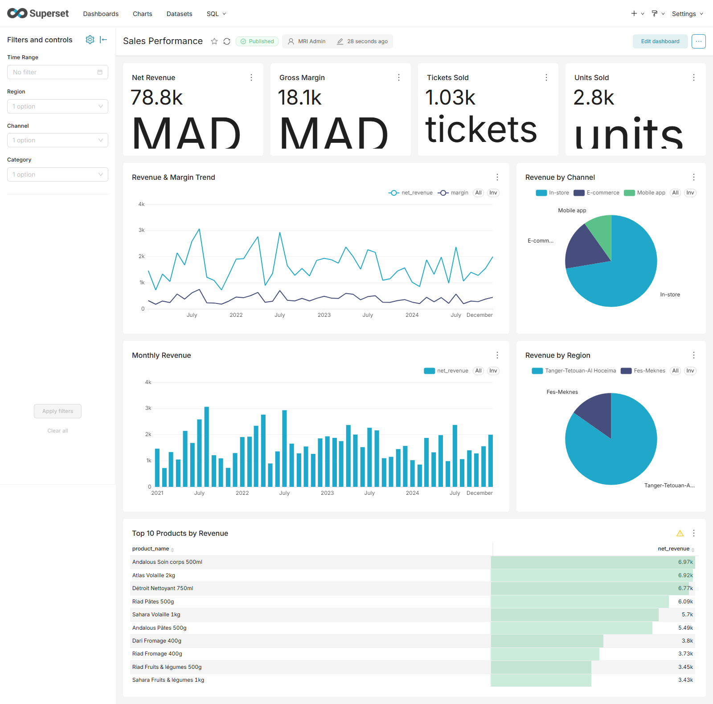
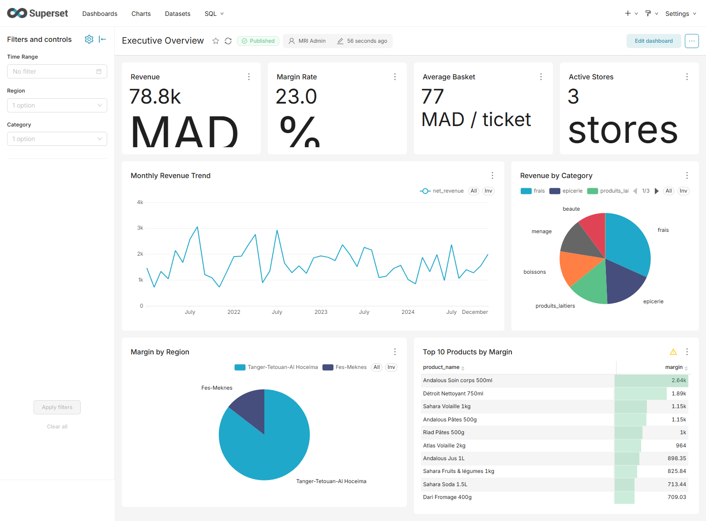
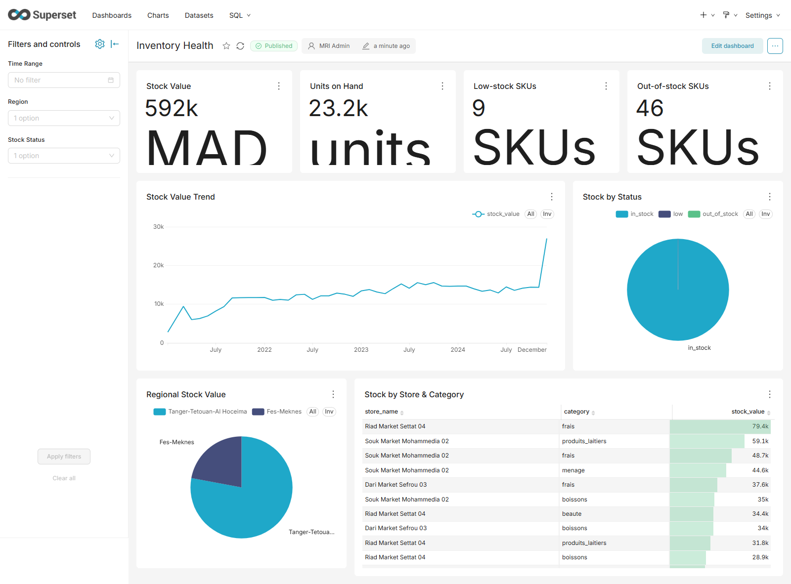
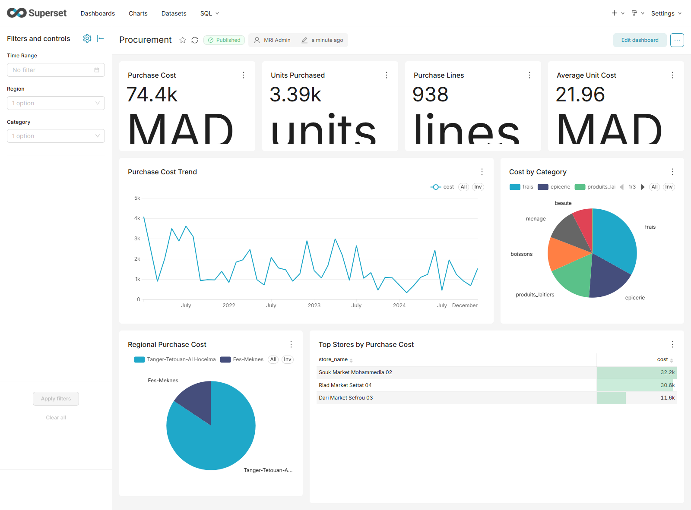
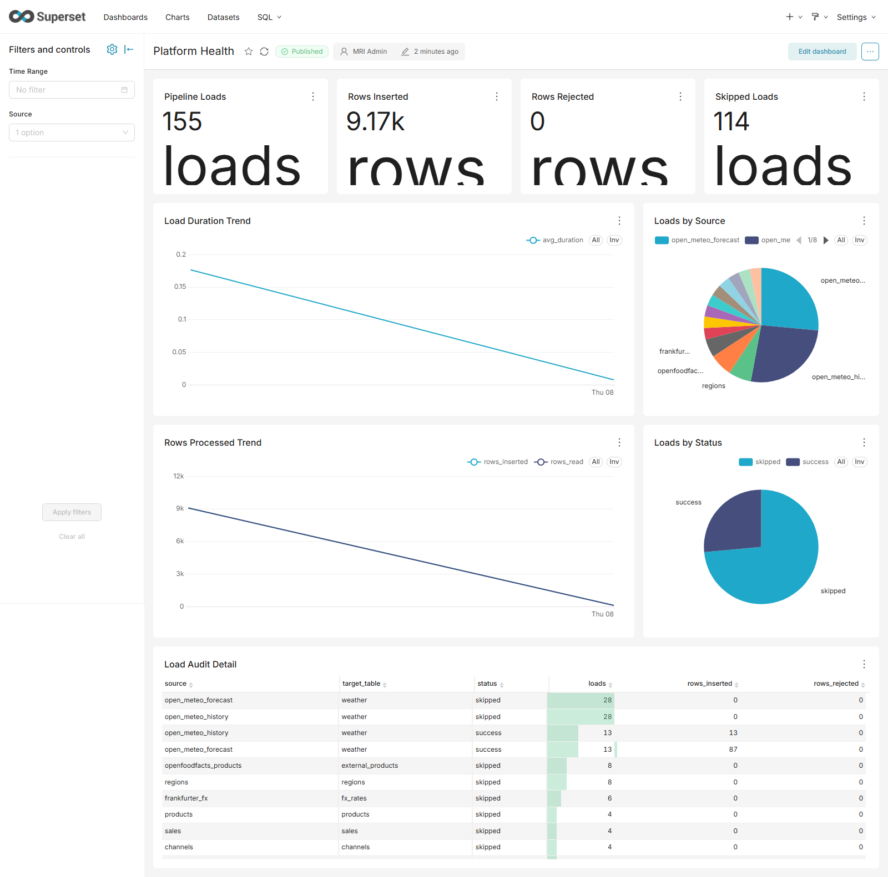

# Morocco Retail Intelligence Data Platform

**End-to-end batch Data Engineering, Data Warehouse & Business Intelligence platform.**

[](https://github.com/OWNER/morocco-retail-intelligence/actions/workflows/ci.yml)


> **Two-minute overview.** This project simulates a Moroccan retail/distribution
> company (stores, e-commerce, customers, products, promotions, inventory,
> purchases) and builds a complete, reproducible **data platform** around it. It
> ingests deterministic **synthetic** files plus three keyless **public APIs**,
> validates everything through contractual **quality gates**, lands it in object
> storage and PostgreSQL, transforms it with **dbt** into a **Kimball star
> schema** with a **Type-2 slowly-changing dimension**, orchestrates the whole
> chain with **Apache Airflow**, and serves **5 Superset dashboards (42 charts)**
> — with **data lineage**, **structured audit/metrics** and a **Prometheus +
> Grafana** monitoring profile. Everything runs locally on one machine via
> Docker Compose and is exercised by **pytest, Great Expectations and dbt tests**.
> All data is **synthetic** — no real customer, transaction or proprietary data.

This repository is a **portfolio project** (Master II-BDCC). It is written to
show engineering discipline — reproducibility, quality gates, idempotence,
observability, testing and honest status reporting — rather than to ship a
product.

---

## Business context & objective

A mid-size Moroccan retailer needs to turn heterogeneous, daily batch data
(files, weather, FX rates, product catalogue) into trustworthy analytics:
revenue and margin by region/month, inventory health, procurement cost, and
pipeline/platform health. The platform provides that end to end:

- **Target users:** data engineers who run it, analysts/decision-makers who
  consume the dashboards, and reviewers who evaluate the engineering.
- **Objective:** a defensible, reproducible reference implementation of a modern
  batch data stack — ingestion → quality gate → storage → warehouse → BI — under
  local resource constraints.

---

## Architecture

Full design and rationale: [`ARCHITECTURE.md`](ARCHITECTURE.md).

```text
External APIs + Deterministic synthetic generator        Public sources
        │
        ▼
Python ingestion  ──▶  MinIO object storage  (RAW → BRONZE Parquet)
        │                       │
        │                       ▼
        │              Great Expectations quality gate
        │                       │
        ▼                       ▼
                 PostgreSQL  (SILVER: raw_staging / silver / audit)
                                  │
                                  ▼
                 dbt  (staging → intermediate → marts + SCD2 snapshot)
                                  │
                                  ▼
                 PostgreSQL Star Schema  (WAREHOUSE: 7 dims + 3 facts)
                                  │
                                  ▼
                 Apache Superset  (5 dashboards · 42 charts · filters)
                                  │
                                  ▼
        Apache Airflow  ── orchestrates the full chain
        Prometheus + Grafana  ── live platform metrics
        GitHub Actions  ── CI (8 jobs)
```

The star schema exists **twice by design**: the Python builder (`mri.warehouse`)
is the Phase 09 reference implementation, and the dbt project re-expresses it as
the analytics layer; a guarded parity test inside `dbt build` proves the two
agree **row for row**.

---

## Technology stack

| Layer | Technology | Status |
|-------|-----------|--------|
| Language / tooling | Python 3.12, `uv`, ruff, mypy, pytest | Implemented |
| Object storage | MinIO (Chainguard rebuild, digest-pinned) | Implemented |
| Data quality | Great Expectations (Bronze gate) | Implemented |
| Warehouse | PostgreSQL 16 | Implemented |
| Transformation | dbt-core 1.12 + dbt-postgres | Implemented |
| Orchestration | Apache Airflow 3.3.2 (LocalExecutor) | Implemented |
| BI | Apache Superset 6.1.0 (read-only role) | Implemented |
| Observability | Prometheus + Grafana (optional profile) | Implemented |
| CI/CD | GitHub Actions (8 jobs) | Implemented (not yet run remotely) |
| Local stack | Docker Desktop (WSL2 backend) + Compose v2 | Implemented |

---

## Data sources

| Source | Type | Provides |
|--------|------|----------|
| Synthetic generator | Internal, seeded RNG | customers, products, stores, regions, sales, inventory, purchases, promotions, channels, calendar |
| Open-Meteo | Public REST API (no key) | historical + forecast daily weather for Moroccan cities |
| Frankfurter | Public REST API (no key) | EUR/MAD, USD/MAD, GBP/MAD exchange rates |
| Open Food Facts | Public REST API (no key) | product-catalogue enrichment (exact-barcode mapping) |

All sources are covered by versioned contracts in
[`data_contracts/`](data_contracts/README.md) (14 contracts, v1.0.0) — see
[`docs/data-model/source-contracts.md`](docs/data-model/source-contracts.md).

> **All generated content is entirely synthetic** — no real customer,
> transaction or proprietary data is used or implied. Generated output is
> git-ignored. The API sources are public and keyless; responses are cached
> locally so tests never depend on live availability.

---

## Data layers

| Layer | Store | Purpose |
|-------|-------|---------|
| RAW | MinIO `raw/` + `raw_external/` | immutable landing of exactly what the source returned (+ provenance) |
| BRONZE | MinIO `bronze/` | typed, date-partitioned Parquet behind a Great Expectations gate |
| SILVER | PostgreSQL `raw_staging` → `silver` | cleaned, conformed records + `audit.load_audit` registry |
| INTERMEDIATE | dbt `int_*` | reusable SQL conforming steps |
| GOLD / MARTS | dbt `dim_*` / `fact_*` + SCD2 snapshot | business models per domain |
| WAREHOUSE | PostgreSQL `warehouse` (Python) + `dbt_marts` (dbt) | star schema consumed by Superset, proven equivalent by a parity test |

Details: [`docs/architecture/transformation.md`](docs/architecture/transformation.md).

---

## Star schema

A Kimball star schema in the PostgreSQL `warehouse` schema — **7 dimensions**
(`dim_date`, `dim_client`, `dim_produit`, `dim_magasin`, `dim_region`,
`dim_canal`, `dim_promotion`) and **3 facts** (`fact_ventes` per sale line,
`fact_achats` per receipt line, `fact_stock` per date/store/product snapshot).
Dimensions use `IDENTITY` surrogate keys over `UNIQUE` business keys (deterministic
across rebuilds); facts carry documented grains, foreign keys, indexes and are
built from Silver with set-based SQL and a business reconciliation.

References: [`docs/data-model/star-schema.md`](docs/data-model/star-schema.md) ·
[`docs/data-model/facts-and-dimensions.md`](docs/data-model/facts-and-dimensions.md) (the
**data dictionary**) · [`ADR-007`](docs/decisions/ADR-007-star-schema.md).

---

## SCD Type 2

`dim_produit` is a **Type-2 slowly-changing dimension** driven by a dbt `check`
snapshot (`snapshot_dim_produit`). Product attribute history is tracked with
`valid_from` / `valid_to` and a single `is_current` row; facts join the dimension
**as of each event date**, so historical events resolve to the attributes that
were true at the time while `product_id` / `produit_sk` stays stable. Invariants
(single current row, contiguous versions) are asserted by singular dbt tests.

Reference: [`docs/data-model/scd2.md`](docs/data-model/scd2.md) ·
[`ADR-008`](docs/decisions/ADR-008-dbt-and-scd2.md).

---

## Orchestration (Apache Airflow)

One end-to-end DAG, `morocco_retail_pipeline` (Apache Airflow 3.3.2,
`LocalExecutor`, schedule `0 4 * * *` UTC), runs **8 correlated tasks** that call
the existing CLIs: `ingest_internal`, `ingest_external`,
`bronze_internal_external`, `silver_load`, `warehouse_build_reference`,
`dbt_build`, `reconcile`, `audit_airflow_run`. Every task carries
`--dag-run-id "{{ dag_run.run_id }}"` for end-to-end correlation. Retries are
`2 × 5 min`.

```powershell
# start base stack + Airflow (UI: http://localhost:8080)
docker compose --env-file .env -f infrastructure/docker/docker-compose.yml `
  -f infrastructure/docker/docker-compose.airflow.yml up -d

docker exec mri-airflow-scheduler airflow dags trigger morocco_retail_pipeline
docker exec mri-airflow-scheduler airflow dags list-runs morocco_retail_pipeline
```

Details, acceptance-run evidence and troubleshooting:
[`docs/orchestration/airflow.md`](docs/orchestration/airflow.md) ·
[`ADR-009`](docs/decisions/ADR-009-airflow-orchestration.md).

---

## BI dashboards (Apache Superset)

Superset 6.1.0 serves the `warehouse` + `audit` schemas through the **read-only**
`superset_bi` role (SELECT-only) and exposes **4 virtual datasets**, **42 charts**
and **5 interactive dashboards** with native filters. UI: `http://localhost:8088`.

| Dashboard | Charts | Native filters |
|-----------|:------:|----------------|
| Sales Performance | 9 | Time Range, Region, Channel, Category |
| Executive Overview | 8 | Time Range, Region, Category |
| Inventory Health | 8 | Time Range, Region, Stock Status |
| Procurement | 8 | Time Range, Region, Category |
| Platform Health | 9 | Time Range, Source |

**Real screenshots** (headless Edge render of the live dashboards):

| Sales Performance | Executive Overview | Inventory Health |
|-------------------|--------------------|------------------|
|  |  |  |

| Procurement | Platform Health |
|-------------|-----------------|
|  |  |

```powershell
# start base stack + Superset (UI: http://localhost:8088)
docker compose --env-file .env -f infrastructure/docker/docker-compose.yml `
  -f infrastructure/docker/docker-compose.superset.yml up -d
uv run python dashboards/superset/seed.py all     # idempotent
uv run python dashboards/superset/verify.py       # asserts 4 datasets / 42 charts / 5 dashboards
```

Details and caveats: [`docs/bi/superset.md`](docs/bi/superset.md) ·
[`ADR-010`](docs/decisions/ADR-010-superset-bi-layer.md).

---

## Data quality

Quality is a **gate, not a report**: data must pass Great Expectations suites
before it is trusted into Silver, and dbt tests must pass before marts are
consumed. Failed rows are counted and quarantined — never dropped silently.

- Bronze gate: contract volume, type, nullability, uniqueness, declared
  range/set rules and cross-source referential checks.
- Silver: contract primary keys, foreign keys, structural checks and
  reconciliation.
- dbt: **140 tests** (generic + 7 singular SCD2/parity tests), plus a
  row-level parity test against the Python warehouse.

Policy: [`data_contracts/README.md`](data_contracts/README.md) ·
[`docs/pipeline/data-quality.md`](docs/pipeline/data-quality.md).

---

## Testing & CI

| Level | Tool | Scope |
|-------|------|-------|
| Unit / integration | pytest | environment, generator, ingestion (+MinIO), external clients (+MinIO), Bronze, Silver (+PostgreSQL), warehouse (+PostgreSQL), dbt/SCD2 (+PostgreSQL), observability, metrics, security |
| Live API smoke | pytest `tests/smoke` (`MRI_LIVE_SMOKE=1`) | one tiny call per provider (skipped by default) |
| Model tests | dbt tests | **140 tests**, run inside `python -m apps.dbt build` |
| Data quality | Great Expectations | Bronze gate |
| Lint / format / types | ruff, mypy | whole repo |

```bash
uv run pytest                 # tests
uv run ruff check .           # lint
uv run ruff format --check .  # format
uv run mypy                   # types
```

**CI/CD** — `.github/workflows/ci.yml` defines **8 jobs** (lint, typecheck, unit,
PostgreSQL integration, dbt CI, MinIO integration, static Airflow DAG validation,
Docker compose + image builds). No secrets are required (disposable dummy
credentials only).

> **CI status: configured, not yet validated remotely.** The badge above still
> contains the placeholder owner `OWNER`; it turns green only after the
> repository is pushed to GitHub (see **Project status**).

---

## Performance & measured results

All figures below are **measured** on the development machine
(Windows 11, 8 vCPU, Docker VM ≈ 3.7 GiB RAM, PostgreSQL 16 container) with a
**synthetic** dataset, and are stored under `benchmarks/`. They are illustrative
order-of-magnitude numbers, not production SLAs.

**Data volume (synthetic):**

| Profile | Sales rows | Rows through Bronze | Dataset on disk |
|---------|-----------:|--------------------:|----------------:|
| small | 60 000 | 126 348 | 8.8 MB |
| medium | 600 000 | 1 397 019 | 92.7 MB |
| 1m | 1 000 000 | — | 116 MB |

**Throughput / runtime:**

| Stage | Measured |
|-------|----------|
| Bronze (Parquet + quality gate) | ~5 700 rows/s small · **~10 400 rows/s** medium |
| Silver (constrained upsert + audit + reconcile) | ~2 250 rows/s small · **~2 300 rows/s** medium |
| Full cold pipeline (medium, end to end) | ≈ **12.6 min** (ingest → dbt) |
| Parquet vs raw CSV (medium) | 92.7 MB → **23.6 MB** (≈ **3.9×** smaller) |

**dbt incremental materialization** (property proven equal to full refresh):

| Scale | Full refresh | Incremental (2 % delta) |
|-------|-------------:|------------------------:|
| 100k sales | 43.1 s | **21.7 s** (2 000 rows) |
| 1m sales | 76.5 s | **29.5 s** (20 000 rows) |

**Warehouse query latency (median of 3):**

| Query | small | medium | 1m |
|-------|------:|-------:|----:|
| revenue_by_month_region | 92.6 ms | 479.7 ms | 1 217 ms |
| margin_by_category | 48.9 ms | 266.3 ms | 590.7 ms |
| top_products_by_revenue | 84.4 ms | 298.6 ms | 1 008 ms |

Evidence: `benchmarks/{bronze,silver,dbt,queries,pipeline}/results.json`.

---

## Project status

| State | Scope |
|-------|-------|
| **Implemented** | ingestion, external connectors, Bronze + GX gate, Silver, Python star schema, dbt analytics layer (+SCD2, incremental), Airflow DAG, Superset BI, audit logging + `ops` metrics, data lineage, Prometheus/Grafana profile, GitHub Actions CI config |
| **Validated locally** | full test suite (**504 passed, 3 skipped**), 4 Compose combinations, **two green end-to-end DAG runs** (idempotent), Superset verify (4/42/5), Prometheus targets up, lineage build + trace — see [`docs/reports/final-acceptance.md`](docs/reports/final-acceptance.md) |
| **Validated by GitHub Actions** | **not yet** — workflows are committed but no remote run has succeeded; the badge owner is still a placeholder |
| **Planned / future** | calendar `holidays` enrichment, MinIO object versioning, production deployment (TLS, multi-host), browser-automation filter smoke, dedicated `LICENSE` |
| **Known limitations** | host is RAM-constrained (services are started in groups, and the two full stacks cannot run at once); a clean start was proved on an isolated, non-destructive scratch stack (Phase 26) but a destructive rebuild of an existing data volume was still not performed; interactive Superset native-filter UI behaviour is unverified without browser automation; MinIO community images were withdrawn upstream (a digest-pinned Chainguard rebuild is used) |

### Configuring the CI badge after publishing

1. Push the repository to GitHub (owner: replace `OWNER`).
2. Edit the two `OWNER` occurrences in the badge URL in this README to the real
   `owner/repo`.
3. The badge above no longer pins a branch, so it tracks the repository's
   default branch automatically. The workflow triggers on **both** `master`
   (this repository's current branch) and `main`, so no rename is required.

---

## Quick start (Windows 11 + WSL2 + Docker)

Tested target: **Windows 11 with Docker Desktop using the WSL2 backend**, Git,
and [`uv`](https://docs.astral.sh/uv/). (Linux/macOS behave the same; on
Windows, run the PowerShell forms from the repository root.)

### 1. Prerequisites

- Git, Docker Desktop (WSL2 backend) **running**, `uv` on `PATH`.
- Ports free on the host: `5433`, `9000`, `9001`, `8080`, `8088`, `9090`, `3001`,
  `9245` (the native PostgreSQL 16 service often owns `5432` — this stack avoids it).

### 2. Environment file

```powershell
Copy-Item .env.example .env
```

Fill `.env` with **locally generated** values — **never commit `.env`** (it is
git-ignored). Generate secrets, for example:

```powershell
python -c "import secrets; print(secrets.token_urlsafe(48))"           # passwords / secrets
python -c "from cryptography.fernet import Fernet; print(Fernet.generate_key().decode())"  # AIRFLOW__CORE__FERNET_KEY
```

### 3. Python environment

```powershell
uv python install 3.12
uv sync
```

### 4. Start the stack (in groups — the host is RAM-constrained)

```powershell
# 4a. base: PostgreSQL + MinIO
docker compose --env-file .env -f infrastructure/docker/docker-compose.yml up -d

# 4b. Airflow (UI :8080)
docker compose --env-file .env -f infrastructure/docker/docker-compose.yml `
  -f infrastructure/docker/docker-compose.airflow.yml up -d

# 4c. Superset (UI :8088)
docker compose --env-file .env -f infrastructure/docker/docker-compose.yml `
  -f infrastructure/docker/docker-compose.superset.yml up -d

# 4d. monitoring (optional; profile) — Prometheus :9090, Grafana :3001
docker compose --env-file .env -f infrastructure/docker/docker-compose.yml `
  -f infrastructure/docker/docker-compose.observability.yml --profile observability up -d
```

> `down` keeps the named volumes (data survives); `down -v` deletes them.

### 5. Generate data and run the pipeline

```powershell
uv run python -m apps.data_generator --scale tiny --seed 42 --out data/generated
uv run python -m apps.ingestion ingest  --path data/generated/tiny --recursive   # RAW
uv run python -m apps.ingestion external --source all                            # public APIs
uv run python -m apps.ingestion bronze  --source all                             # Bronze + GX gate
uv run python -m apps.ingestion load    --source all                             # Silver
uv run python -m apps.warehouse build                                            # star schema
uv run python -m apps.dbt build                                                  # dbt + tests

# create the read-only Superset role (REQUIRED before seeding the BI layer)
Get-Content infrastructure/sql/bi-reader-readonly.sql | docker exec -i mri-postgres `
  psql -U retail_app -d retail -v ON_ERROR_STOP=1 `
  -v reader_user="$env:BI_READER_USER" -v reader_password="$env:BI_READER_PASSWORD" -f -
```

> The role in the last command is **not** created by the pipeline. Superset connects
> to the warehouse as the read-only `BI_READER_USER` (`superset_bi`), so `seed.py`
> fails its connection test until that role exists. The command is idempotent and
> must run **after** the pipeline has built the `warehouse` / `dbt_marts` / `audit`
> schemas. For the full least-privilege model (a separate break-glass
> `retail_admin` and a non-superuser `retail_app`) apply
> [`infrastructure/sql/least-privilege-roles.sql`](infrastructure/sql/least-privilege-roles.sql)
> first — see [`docs/security/security-hardening.md`](docs/security/security-hardening.md).

Or run the whole chain in one shot through Airflow:

```powershell
docker exec mri-airflow-scheduler airflow dags trigger morocco_retail_pipeline
docker exec mri-airflow-scheduler airflow dags list-runs morocco_retail_pipeline
```

### 6. Open the UIs

| UI | URL | Credentials |
|----|-----|-------------|
| Airflow | http://localhost:8080 | `AIRFLOW_ADMIN_USER` / `AIRFLOW_ADMIN_PASSWORD` (`.env`) |
| Superset | http://localhost:8088 | `SUPERSET_ADMIN_USER` / `SUPERSET_ADMIN_PASSWORD` (`.env`) |
| Grafana | http://localhost:3001 | `GRAFANA_ADMIN_USER` / `GRAFANA_ADMIN_PASSWORD` (`.env`) |
| Prometheus | http://localhost:9090 | — |
| MinIO console | http://localhost:9001 | `MINIO_ACCESS_KEY` / `MINIO_SECRET_KEY` (`.env`) |

Seed + verify the BI layer: `uv run python dashboards/superset/seed.py all` then
`uv run python dashboards/superset/verify.py`.

### 7. Shutdown

```powershell
docker compose --env-file .env -f infrastructure/docker/docker-compose.yml `
  -f infrastructure/docker/docker-compose.airflow.yml `
  -f infrastructure/docker/docker-compose.superset.yml down      # keep data
# add -v to delete volumes (database + MinIO data are lost)
```

Full troubleshooting: [`docs/runbooks/troubleshooting.md`](docs/runbooks/troubleshooting.md).

---

## Local development

```bash
uv sync                          # create .venv from uv.lock (Python 3.12)
uv run pytest                    # tests
uv run ruff check .              # lint
uv run ruff format .             # format
uv run mypy                      # type check
```

Equivalent `make` targets exist (`make help | install | test | lint | format |
typecheck | check`), but `make` is not installed on the Windows host, so run the
commands directly. `make` is also not installed on this host for the container
targets — use the `docker compose …` forms shown above.

Environment audit and version rationale: [`docs/development-environment.md`](docs/development-environment.md).

---

## Repository structure

```text
├── ARCHITECTURE.md               # target architecture (design)
├── CONTRIBUTING.md / CHANGELOG.md
├── Makefile / pyproject.toml / uv.lock
├── .env.example                  # placeholder environment variables
├── apps/{data_generator,ingestion,warehouse,dbt}/   # CLI entry points
├── src/mri/                      # shared Python package (governance, ingestion, lineage, metrics, observability, silver, warehouse)
├── airflow/dags/morocco_retail_pipeline.py          # the end-to-end DAG
├── dbt/                          # models/, macros/, snapshots/, tests/
├── data_contracts/               # 14 versioned source contracts
├── dashboards/superset/          # seed.py + verify.py
├── infrastructure/docker|sql     # compose overlays, Dockerfiles, BI role grants
├── monitoring/{prometheus,grafana}                  # config, rules, provisioning
├── benchmarks/                   # bronze, silver, dbt, queries, pipeline
├── tests/{unit,integration,smoke,airflow}/
├── docs/                         # architecture, data-model, pipeline, bi, lineage, observability, security, decisions (ADRs), reports, runbooks, archive
└── .github/workflows/ci.yml      # 8-job CI pipeline
```

---

## Documentation

| Topic | Start here |
|-------|------------|
| Architecture (design + status) | [`ARCHITECTURE.md`](ARCHITECTURE.md) |
| Data dictionary (layers, contracts, star schema) | [`docs/data-model/data-dictionary.md`](docs/data-model/data-dictionary.md) |
| Orchestration (Airflow) | [`docs/orchestration/airflow.md`](docs/orchestration/airflow.md) |
| BI (Superset) | [`docs/bi/superset.md`](docs/bi/superset.md) |
| Observability (audit + Prometheus/Grafana) | [`docs/observability/`](docs/observability/) |
| Data lineage | [`docs/lineage/data-lineage.md`](docs/lineage/data-lineage.md) |
| Design decisions (ADRs) | [`docs/decisions/`](docs/decisions/) |
| Troubleshooting runbook | [`docs/runbooks/troubleshooting.md`](docs/runbooks/troubleshooting.md) |
| Limitations & roadmap | [`docs/limitations-and-roadmap.md`](docs/limitations-and-roadmap.md) |
| Phase reports | [`docs/reports/`](docs/reports/) |
| Contributing | [`CONTRIBUTING.md`](CONTRIBUTING.md) · [`CHANGELOG.md`](CHANGELOG.md) |

---

## Roadmap

| Phase | Content | Status |
|-------|---------|--------|
| 00–13 | Environment, foundation, generator, containers, ingestion, external APIs, Bronze, external Bronze, Silver, star schema, dbt, Airflow, Superset, CI | Done |
| 14 | Incremental dbt materialization + benchmarks | Done |
| 15 | Data-contract drift detection | Done |
| 16 | Structured audit logging + pipeline metrics (`ops` schema) | Done |
| 18 | Data lineage (evidence-labelled graph) | Done |
| 19 | Prometheus + Grafana observability | Done |
| 20 | Security & hardening pass | Done |
| 21 | Final end-to-end acceptance audit | Done |
| 22 | Portfolio packaging | Done |
| 23 | Credential rotation (warehouse app user, MinIO root, Grafana admin) + stale-schema inventory | Done |
| 24 | Least-privilege PostgreSQL roles (`retail_app`, `retail_admin`, `superset_bi`) + security tests | Done |
| 25 | Superset native-filter fix + E2E browser-smoke suite | Done |
| 26 | Clean-start reproduction on an isolated, non-destructive scratch stack | Done |
| 27 | Git & release-readiness audit (license decision, commit plan) | Done |
| 28 | Final security & release-readiness remediation (credential rotation, docs reconciliation) | Done |
| future | `holidays` calendar enrichment, MinIO object versioning, deployment hardening, browser-automation filter smoke | Planned |

---

## License & data disclaimer

**No open-source license has been chosen yet.** The repository is therefore
"all rights reserved" pending the owner's decision; a recommendation (e.g. MIT or
Apache-2.0) is recorded in [`docs/reports/license-decision.md`](docs/reports/license-decision.md)
(Phase 27) for the owner to approve. No license terms have been invented.

The project uses **simulated business data only** and public, keyless APIs. It is
a Master II-BDCC portfolio project and is **not** intended for production use.
