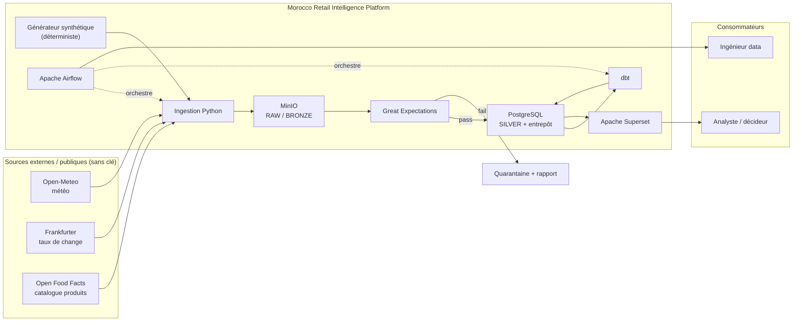
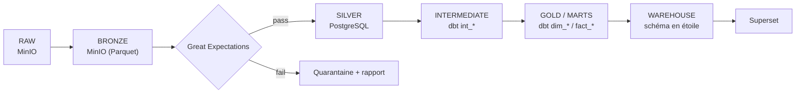
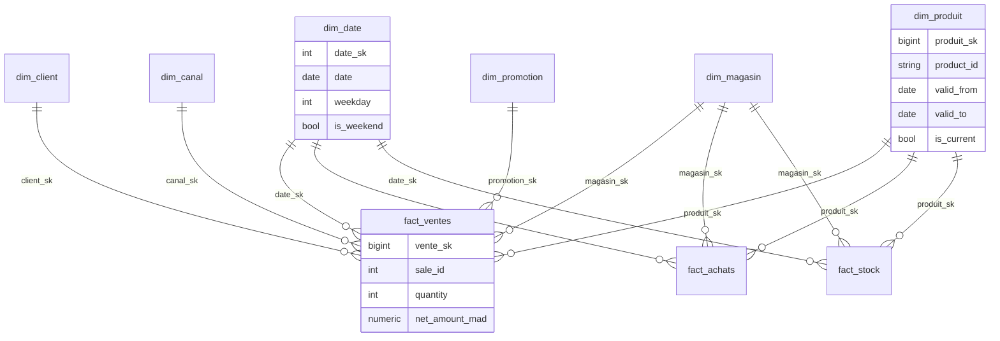
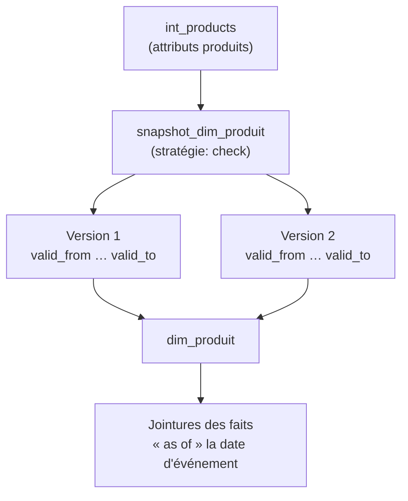
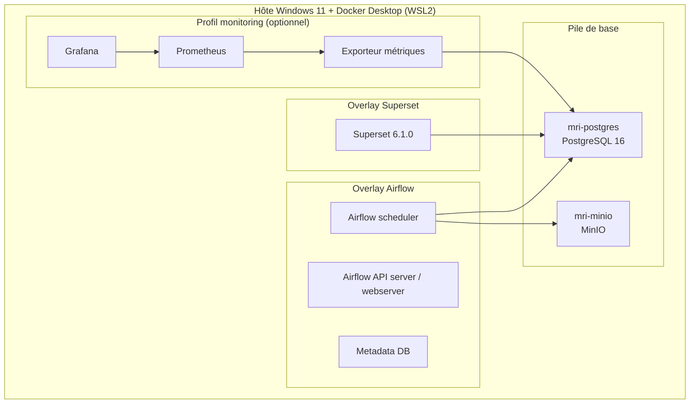
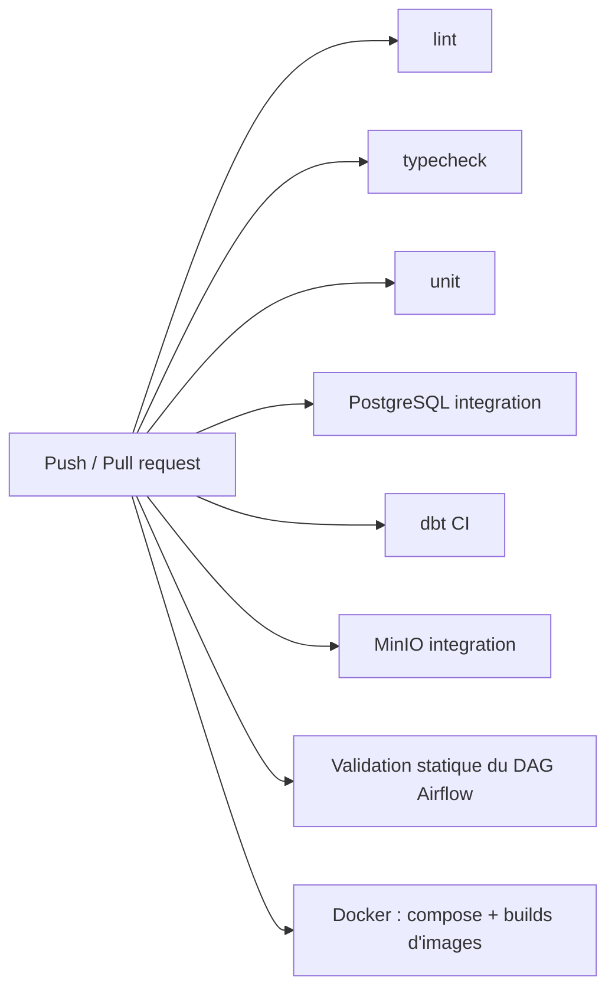
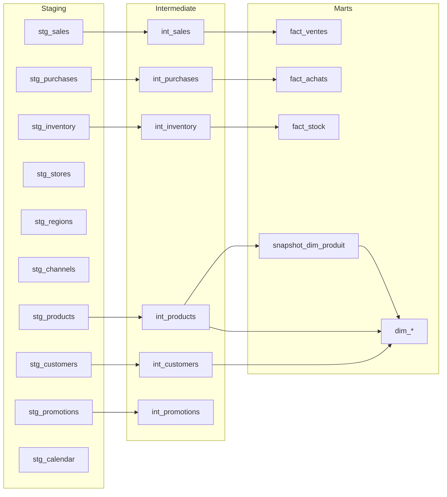
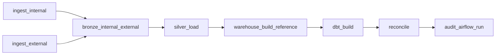

# Rapport de Mini-Projet Informatique

<div style="text-align: center;">

# Morocco Retail Intelligence Data Platform

## Conception et mise en œuvre d'une plateforme de données retail de bout en bout : ingestion, qualité, modélisation analytique, orchestration et Business Intelligence

</div>

---

## Page de couverture

| | |
|---|---|
| **Établissement** | École Normale Supérieure de l'Enseignement Technique (ENSET) |
| **Formation** | Ingénierie Informatique, Big Data et Cloud Computing (II-BDCC) |
| **Nature du document** | Rapport de mini-projet informatique |
| **Titre** | Morocco Retail Intelligence Data Platform |
| **Sous-titre** | Conception et mise en œuvre d'une plateforme de données retail de bout en bout : ingestion, qualité, modélisation analytique, orchestration et Business Intelligence |
| **Auteur** | Youssef El Bajoury |
| **Date de soumission** | 16 octobre 2026 |
| **Année universitaire** | 2026-2027 |

> *[Emplacement réservé au logo officiel de l'ENSET — aucun fichier de logo n'étant présent dans le dépôt du projet, cet emplacement est laissé vide.]*

---

## Dédicace

À mes proches, pour leur soutien et leur patience tout au long de ce travail.

---

## Remerciements

Je tiens à remercier l'équipe pédagogique de la formation **II-BDCC** de l'**ENSET** pour les enseignements qui ont permis la réalisation de ce projet, ainsi que toutes les personnes ayant contribué, de près ou de loin, à son aboutissement.

---

## Résumé

Le présent rapport décrit la conception et la mise en œuvre de la **Morocco Retail Intelligence Data Platform**, une plateforme de données de bout en bout simulant un distributeur marocain de taille moyenne. L'objectif est de démontrer une implémentation reproductible, traçable et orientée qualité d'un Modern Data Stack (MDS) sur une seule machine, dans un environnement contraint.

La plateforme ingère des fichiers synthétiques déterministes ainsi que trois API publiques sans clé (Open-Meteo, Frankfurter, Open Food Facts), contrôle la qualité via des contrats versionnés et Great Expectations, stocke les données dans MinIO (couches RAW et BRONZE en Parquet) et PostgreSQL 16 (SILVER, audit, entrepôt dimensionnel). Les transformations analytiques sont réalisées avec dbt-core (staging → intermediate → marts, avec un snapshot SCD Type 2 sur `dim_produit` et 140 tests dbt), et un test de parité ligne-à-ligne prouve l'équivalence entre l'entrepôt Python de référence et les modèles dbt. L'orchestration est assurée par Apache Airflow 3.3.2 (LocalExecutor, DAG `morocco_retail_pipeline`, 8 tâches corrélées), la restitution par Apache Superset 6.1.0 (4 datasets virtuels, 42 graphiques, 5 tableaux de bord), et l'observabilité par un profil Prometheus + Grafana optionnel.

L'ensemble est conteneurisé (Docker Compose), testé (pytest, dbt test, Great Expectations) et intégré à une chaîne CI/CD GitHub Actions à 8 jobs. La validation locale documentée fait état de **504 tests réussis et 3 tests ignorés**, de deux exécutions vertes et idempotentes du DAG de bout en bout, et d'une vérification de la couche BI (4 datasets / 42 graphiques / 5 tableaux de bord). Toutes les données sont **synthétiques** : aucune donnée réelle ou propriétaire n'est utilisée.

**Mots-clés :** Modern Data Stack, Data Engineering, ELT, dbt, Apache Airflow, Apache Superset, MinIO, PostgreSQL 16, Great Expectations, Schéma en étoile, SCD Type 2, Qualité des données, Business Intelligence, Observabilité, CI/CD.

---

## Abstract

This report presents the design and implementation of the **Morocco Retail Intelligence Data Platform**, an end-to-end data platform simulating a mid-size Moroccan retailer. Its goal is to demonstrate a reproducible, traceable and quality-oriented implementation of a Modern Data Stack on a single machine under tight resource constraints.

The platform ingests deterministic synthetic files plus three keyless public APIs (Open-Meteo, Frankfurter, Open Food Facts), enforces quality through versioned contracts and Great Expectations, and stores data in MinIO (RAW/BRONZE Parquet) and PostgreSQL 16 (SILVER, audit, dimensional warehouse). Analytical transformations are implemented with dbt-core (staging → intermediate → marts, a Type-2 SCD snapshot on `dim_produit`, and 140 dbt tests), and a row-level parity test proves equivalence between the Python reference warehouse and the dbt models. Orchestration is handled by Apache Airflow 3.3.2 (LocalExecutor, `morocco_retail_pipeline` DAG, 8 correlated tasks); serving by Apache Superset 6.1.0 (4 virtual datasets, 42 charts, 5 dashboards); observability by an optional Prometheus + Grafana profile.

Everything is containerized (Docker Compose), tested (pytest, dbt tests, Great Expectations), and wired into an 8-job GitHub Actions CI/CD pipeline. The documented local validation reports **504 passed tests and 3 skipped**, two green and idempotent end-to-end DAG runs, and a verified BI layer (4 datasets / 42 charts / 5 dashboards). All data is **synthetic** — no real or proprietary data is used.

**Keywords:** Modern Data Stack, Data Engineering, ELT, dbt, Apache Airflow, Apache Superset, MinIO, PostgreSQL 16, Great Expectations, Star Schema, SCD Type 2, Data Quality, Business Intelligence, Observability, CI/CD.

---

## Table des matières

- [Introduction générale](#introduction-générale)
- [Chapitre 1 — Contexte, besoins et spécifications](#chapitre-1--contexte-besoins-et-spécifications)
- [Chapitre 2 — État de l'art et concepts fondamentaux](#chapitre-2--état-de-lart-et-concepts-fondamentaux)
- [Chapitre 3 — Analyse et conception de la plateforme](#chapitre-3--analyse-et-conception-de-la-plateforme)
- [Chapitre 4 — Architecture technique et environnement](#chapitre-4--architecture-technique-et-environnement)
- [Chapitre 5 — Implémentation technique et réalisation](#chapitre-5--implémentation-technique-et-réalisation)
- [Conclusion générale et perspectives](#conclusion-générale-et-perspectives)
- [Bibliographie et références](#bibliographie-et-références)
- [Annexes](#annexes)

---

## Liste des figures

| N° | Titre | Section |
|----|-------|---------|
| Figure 1 | Architecture générale de la plateforme | 3.1 |
| Figure 2 | Flux de données et couches (RAW → MARTS) | 3.2.1 |
| Figure 3 | Modèle dimensionnel en étoile | 3.2.2 |
| Figure 4 | Historisation SCD Type 2 de `dim_produit` | 3.2.3 |
| Figure 5 | Architecture de déploiement (Docker Compose) | 4.2 |
| Figure 6 | DAG Airflow `morocco_retail_pipeline` | 5.4 |
| Figure 7 | Chaîne d'intégration continue (GitHub Actions) | 4.4 |
| Figure 8 | Graphe de dépendances des modèles dbt | 5.3 |
| Figure 9 | Tableau de bord Superset « Sales Performance » | 5.5 |
| Figure 10 | Tableau de bord Superset « Executive Overview » | 5.5 |
| Figure 11 | Tableau de bord Superset « Inventory Health » | 5.5 |
| Figure 12 | Tableau de bord Superset « Procurement » | 5.5 |
| Figure 13 | Tableau de bord Superset « Platform Health » | 5.5 |

> **Note sur les captures d'écran.** Le dépôt ne contient **pas** de répertoire nommé `ScreenShoots/`. Les captures réelles des tableaux de bord sont stockées sous `docs/bi/screenshots/` (`01-sales-performance.png`, `02-executive-overview.png`, `03-inventory-health.png`, `04-procurement.png`, `05-platform-health.png`). Les figures 9 à 13 renvoient à ces fichiers.

---

## Liste des tableaux

| N° | Titre | Section |
|----|-------|---------|
| Tableau 1 | Besoins fonctionnels et non fonctionnels | 1.3 |
| Tableau 2 | Stack technologique et responsabilités | 4.1 |
| Tableau 3 | Services conteneurisés (Docker Compose) | 4.2 |
| Tableau 4 | Couches de données | 3.3 |
| Tableau 5 | Sources de données (interne et externes) | 3.3 |
| Tableau 6 | Dimensions et tables de faits | 3.5 |
| Tableau 7 | Modèles dbt | 5.3 |
| Tableau 7 bis | Tâches du DAG Airflow | 5.4 |
| Tableau 8 | Tableaux de bord Superset | 5.5 |
| Tableau 9 | Résultats mesurés (débit, latence, volumétrie) | 5.6 |
| Tableau 12 | Synthèse des difficultés et solutions | 5.6 |

---

## Liste des acronymes et abréviations

| Acronyme | Signification |
|----------|---------------|
| **ADR** | Architecture Decision Record (journal de décision d'architecture) |
| **API** | Application Programming Interface |
| **BI** | Business Intelligence |
| **CI/CD** | Intégration Continue / Livraison Continue |
| **CLI** | Command Line Interface |
| **CSV** | Comma-Separated Values |
| **DAG** | Directed Acyclic Graph |
| **ELT** | Extract, Load, Transform |
| **ETL** | Extract, Transform, Load |
| **GX / GE** | Great Expectations |
| **JSON** | JavaScript Object Notation |
| **JSONL** | JSON Lines |
| **KPI** | Key Performance Indicator |
| **MDS** | Modern Data Stack |
| **SCD** | Slowly Changing Dimension |
| **SQL** | Structured Query Language |
| **UTC** | Coordinated Universal Time |
| **YAML** | YAML Ain't Markup Language |

---

## Introduction générale

### Contexte

Dans un environnement commercial de plus en plus concurrentiel, un distributeur marocain de taille moyenne doit transformer des données quotidiennes hétérogènes (fichiers, météo, taux de change, catalogue produits) en informations fiables pour piloter son activité : chiffre d'affaires et marge par région et par mois, santé des stocks, coût des approvisionnements et santé de la plateforme.

### Problématique

Comment concevoir une plateforme de données retail **unifiée, reproductible, traçable et orientée qualité**, capable d'intégrer plusieurs sources (fichiers et API publiques), de fiabiliser les transformations, de modéliser un entrepôt analytique et de fournir une restitution décisionnelle exploitable, le tout sur une seule machine et dans un cadre pédagogique ?

### Objectifs

Ce projet est un **projet de portfolio** de Master II-BDCC. Il vise à démontrer une mise en œuvre défendable d'un **Modern Data Stack** orientée ingénierie : reproductibilité, barrières de qualité, idempotence, observabilité, tests et communication honnête du statut — plutôt que la livraison d'un produit. Les objectifs spécifiques sont détaillés au chapitre 1.

### Organisation du rapport

- **Chapitre 1** : contexte métier, besoins et spécifications.
- **Chapitre 2** : état de l'art (Modern Data Stack, modélisation dimensionnelle, qualité, orchestration).
- **Chapitre 3** : analyse et conception (architecture, flux, modèle en étoile, SCD Type 2).
- **Chapitre 4** : architecture technique et environnement d'exécution.
- **Chapitre 5** : implémentation, tests et exploitation.
- **Conclusion générale et perspectives**.

### Méthodologie et honnêteté intellectuelle

Ce rapport s'appuie **exclusivement** sur le dépôt réel du projet. Les affirmations sont fondées sur des éléments de preuve présents dans le dépôt (code, configurations, tests, rapports de phase, `README.md`, `ARCHITECTURE.md`). Toute information non vérifiable est explicitement signalée. Aucune donnée, métrique, fonctionnalité ou statistique n'a été inventée.

---

## Chapitre 1 — Contexte, besoins et spécifications

### 1.1 Contexte métier

Le projet simule une **entreprise marocaine de distribution / vente au détail** : magasins physiques, canal e-commerce, clients, produits, promotions, stocks et achats. Les données proviennent de deux familles de sources :

1. un **générateur synthétique déterministe** (RNG à graine fixe) produisant l'ensemble du modèle métier interne ;
2. trois **API publiques sans clé** apportant un enrichissement externe : Open-Meteo (météo), Frankfurter (taux de change) et Open Food Facts (catalogue produits).

### 1.2 Objectif du système

Fournir une chaîne **de bout en bout** : `ingestion → barrière qualité → stockage → entrepôt → BI`, sous contraintes de ressources locales. Le système cible trois profils d'utilisateurs :

- **les ingénieurs data** qui l'exécutent ;
- **les analystes / décideurs** qui consomment les tableaux de bord ;
- **les évaluateurs** qui jugent la qualité d'ingénierie.

### 1.3 Besoins

**Tableau 1 — Besoins fonctionnels et non fonctionnels**

| Type | Besoin | Traduction dans le projet |
|------|--------|---------------------------|
| Fonctionnel | Ingérer des fichiers hétérogènes (CSV/JSON) | `apps.ingestion` valide et dépose dans MinIO `raw/` |
| Fonctionnel | Ingérer des API publiques | Connecteurs Open-Meteo / Frankfurter / Open Food Facts → `raw_external/` |
| Fonctionnel | Contrôler la qualité avant usage | Barrière Great Expectations à la couche Bronze + contraintes Silver |
| Fonctionnel | Modéliser un entrepôt analytique | Schéma en étoile Kimball : 7 dimensions + 3 faits |
| Fonctionnel | Historiser les attributs produits | Snapshot dbt SCD Type 2 sur `dim_produit` |
| Fonctionnel | Orchestrer le pipeline | DAG Airflow `morocco_retail_pipeline` (8 tâches) |
| Fonctionnel | Restituer les KPI | 5 tableaux de bord Superset (42 graphiques) |
| Non fonctionnel | Reproductibilité | Versions épinglées (`uv.lock`), graines fixes |
| Non fonctionnel | Idempotence | Clés adressées par contenu, upserts, reconstruction déterministe |
| Non fonctionnel | Traçabilité / audit | Journal d'événements JSONL + schéma `ops` + `audit.load_audit` |
| Non fonctionnel | Observabilité | Exporteur Prometheus + 4 tableaux de bord Grafana (profil optionnel) |
| Non fonctionnel | Testabilité | pytest, dbt test, Great Expectations |
| Non fonctionnel | Sécurité / moindre privilège | Rôles PostgreSQL séparés, images épinglées, pas de secrets dans Git |
| Non fonctionnel | Absence de perte silencieuse | Lignes en échec comptées, rapportées et mises en quarantaine |

### 1.4 Périmètre et exclusions

Le périmètre couvre un **traitement par lots** (batch) local. Sont explicitement **hors périmètre** (état « Planned / future » dans le dépôt) : l'enrichissement calendaire `holidays`, le versioning d'objets MinIO, un déploiement de production (TLS, multi-hôtes) et un smoke test automatisé des filtres navigateur. Le dépôt est **allégé de toute donnée réelle** : les sorties générées sont ignorées par Git.

### 1.5 Spécifications techniques clés

- **Langage / outillage** : Python 3.12, `uv`, ruff, mypy, pytest.
- **Contraintes d'exécution** : une seule machine (Windows 11 + Docker Desktop / WSL2), mémoire limitée (services démarrés par groupes).
- **Ports hôtes** : PostgreSQL `5433`, MinIO `9000`/`9001`, Airflow `8080`, Superset `8088`, Prometheus `9090`, Grafana `3001`, exporteur métriques `9245`.
- **Aucun secret versionné** : seuls des placeholders `.env.example` sont commités.

---

## Chapitre 2 — État de l'art et concepts fondamentaux

### 2.1 Du data warehouse au Modern Data Stack

L'architecture de données analytiques a évolué d'un entrepôt monolithique (ETL vers un entrepôt relationnel) vers un **Modern Data Stack** découplant ingestion, stockage, transformation, orchestration et restitution. Les principes retenus dans ce projet sont : séparation des responsabilités, élasticité logique du stockage objet, transformation déclarative en SQL (ELT), orchestration as code et observabilité.

### 2.2 Architecture en médaillon (RAW / BRONZE / SILVER / GOLD)

Le projet adopte une stratification inspirée de l'architecture dite **« en médaillon »** :

- **RAW** : atterrissage immuable, fidèle à ce que la source a renvoyé (+ provenance) ;
- **BRONZE** : données typées en Parquet partitionné, gouvernées par un contrat et une barrière qualité ;
- **SILVER** : enregistrements nettoyés, conformés, dédoublonnés, avec contraintes de clés ;
- **GOLD / MARTS / WAREHOUSE** : modèles métier (faits et dimensions) consommés par la BI.

### 2.3 Modélisation dimensionnelle (Kimball)

Le modèle retenu est un **schéma en étoile** au sens de Kimball : des **dimensions** décrivant le contexte (qui, quoi, où, quand) et des **faits** portant les mesures et les clés étrangères. Les dimensions utilisent des **clés de substitution** (`IDENTITY`) au-dessus de clés métier `UNIQUE`, ce qui rend la construction déterministe entre deux reconstructions.

### 2.4 Dimensions à évolution lente (SCD)

Les **Slowly Changing Dimensions** décrivent la gestion de l'historique des attributs. Le **Type 2** conserve chaque version avec des bornes de validité (`valid_from` / `valid_to`) et un indicateur de version courante. Le projet applique le SCD Type 2 à la dimension `dim_produit`.

### 2.5 Qualité des données comme barrière

La qualité est traitée comme une **barrière, non comme un rapport** : les données doivent franchir des suites Great Expectations avant d'être fiabilisées, et les tests dbt doivent passer avant que les marts soient consommés. Les lignes en échec sont comptées et mises en quarantaine — jamais supprimées silencieusement.

### 2.6 Transformation déclarative avec dbt

**dbt** apporte une couche de transformation SQL versionnée, testable et documentée, avec gestion des dépendances (`ref`), matérialisations (vues, tables, incrémentiel) et tests génériques (not-null, unique, relations, valeurs acceptées) et singuliers (assertions métier).

### 2.7 Orchestration

L'**orchestration** consiste à planifier, séquencer et surveiller l'exécution du pipeline, avec retries et corrélation des exécutions. **Apache Airflow** modélise le pipeline comme un graphe acyclique dirigé (DAG) de tâches.

### 2.8 Observabilité et traçabilité

L'observabilité combine : journalisation structurée des événements, métriques d'exploitation, fraîcheur des données et tableau de bord de santé. Le projet implémente un journal d'événements canonique (JSONL) reflété dans un schéma PostgreSQL `ops`, ainsi qu'un exporteur Prometheus.

### 2.9 Intégration et livraison continues

La **CI/CD** automatise le contrôle qualité à chaque changement : lint, typage, tests unitaires et d'intégration, validation statique du DAG, et validation des fichiers Compose.

---

## Chapitre 3 — Analyse et conception de la plateforme

### 3.1 Architecture générale

**Figure 1 — Architecture générale de la plateforme**



### 3.2 Conception des flux et du modèle de données

#### 3.2.1 Flux de données et couches

**Figure 2 — Flux de données (RAW → MARTS)**



**Tableau 4 — Couches de données**

| Couche | Stockage | Rôle | Responsable |
|--------|----------|------|-------------|
| RAW | MinIO `raw/` + `raw_external/` | Atterrissage immuable (+ provenance) | Ingestion (Python) |
| BRONZE | MinIO `bronze/` | Parquet typé et partitionné, fidèle à la source mais interrogeable | Ingestion (Python + PyArrow) |
| SILVER | PostgreSQL (`raw_staging` → `silver`) | Enregistrements nettoyés, conformés, dédoublonnés + registre `audit.load_audit` | Chargement Python |
| INTERMEDIATE | dbt `int_*` | Étapes SQL de conformation réutilisables | dbt |
| GOLD / MARTS | dbt `dim_*` / `fact_*` + snapshot SCD2 | Modèles métier par domaine | dbt |
| WAREHOUSE | PostgreSQL `warehouse` (Python) + `dbt_marts` (dbt) | Schéma en étoile consommé par Superset | Python (référence) et dbt (analytique), équivalence prouvée |

#### 3.2.2 Modèle dimensionnel en étoile

**Tableau 5 — Dimensions et tables de faits**

| Type | Objet | Grain / rôle |
|------|-------|--------------|
| Dimension | `dim_date` | Calendrier |
| Dimension | `dim_client` | Clients |
| Dimension | `dim_produit` | Produits (SCD Type 2) |
| Dimension | `dim_magasin` | Magasins |
| Dimension | `dim_region` | Régions |
| Dimension | `dim_canal` | Canaux (physique / digital) |
| Dimension | `dim_promotion` | Promotions |
| Fait | `fact_ventes` | Ligne de vente |
| Fait | `fact_achats` | Ligne de réception d'achat |
| Fait | `fact_stock` | Instantané par date / magasin / produit |

**Figure 3 — Modèle en étoile**



> Le schéma existe **deux fois par conception** : l'implémentation Python (`mri.warehouse`) est la référence (Phase 09), et le projet dbt ré-exprime le schéma comme couche analytique ; un **test de parité** prouve l'égalité ligne à ligne.

#### 3.2.3 Historisation SCD Type 2

**Figure 4 — Historisation SCD Type 2 de `dim_produit`**



Le suivi est assuré par `valid_from` / `valid_to` et une unique ligne courante (`is_current`). Les faits rejoignent la dimension **à la date de chaque événement**, de sorte qu'un événement historique se résout sur les attributs alors en vigueur, tandis que `product_id` / `produit_sk` reste stable. Les invariants (une seule ligne courante, versions contiguës) sont assertés par des tests dbt singuliers (`assert_scd2_single_current`, `assert_scd2_contiguous_versions`).

### 3.3 Sources et contrats de données

**Tableau 5bis — Sources de données**

| Source | Type | Fournit |
|--------|------|---------|
| Générateur synthétique | Interne, RNG à graine | clients, produits, magasins, régions, ventes, stocks, achats, promotions, canaux, calendrier |
| Open-Meteo | API REST publique (sans clé) | météo quotidienne historique et prévisionnelle pour des villes marocaines |
| Frankfurter | API REST publique (sans clé) | taux de change EUR/MAD, USD/MAD, GBP/MAD |
| Open Food Facts | API REST publique (sans clé) | enrichissement du catalogue produits (correspondance exacte par code-barres) |

Toutes les sources sont couvertes par des **contrats versionnés** dans `data_contracts/` (**14 contrats, v1.0.0**), qui spécifient schéma, types, clés et garanties.

### 3.4 Politique de qualité

La politique de qualité impose : volume contractuel, typage, nullabilité, unicité, règles de plage / ensemble déclarées et vérifications de références croisées à la couche Bronze ; clés primaires et étrangères, contrôles structurels et réconciliation en Silver ; et, côté dbt, **140 tests** génériques et singuliers, dont le test de parité avec l'entrepôt Python.

### 3.5 Architecture logicielle (modules Python)

Le paquet partagé `src/mri/` regroupe les responsabilités suivantes :

- `governance` : contrats et gouvernance ;
- `ingestion` : ingestion de fichiers, connecteurs externes, couche Bronze ;
- `silver` : chargement et conformité Silver ;
- `warehouse` : construction du schéma en étoile (référence Python) ;
- `observability` : journalisation et événements ;
- `metrics` : métriques d'exploitation (`ops`) ;
- `lineage` : graphe de lignage de données ;
- `synthetic` : générateur synthétique déterministe.

---

## Chapitre 4 — Architecture technique et environnement

### 4.1 Stack technologique

**Tableau 2 — Stack technologique et responsabilités**

| Couche | Technologie | Responsabilité |
|--------|-------------|----------------|
| Langage / outillage | Python 3.12, `uv`, ruff, mypy, pytest | Développement, qualité, tests |
| Stockage objet | MinIO (image Chainguard épinglée par digest) | RAW et BRONZE |
| Qualité des données | Great Expectations | Barrière Bronze |
| Entrepôt | PostgreSQL 16 | SILVER, entrepôt, audit, `ops` |
| Transformation | dbt-core 1.12 + dbt-postgres | Modèles analytiques |
| Orchestration | Apache Airflow 3.3.2 (LocalExecutor) | Exécution du pipeline |
| BI | Apache Superset 6.1.0 (rôle lecture seule) | Tableaux de bord |
| Observabilité | Prometheus + Grafana (profil optionnel) | Métriques de plateforme |
| CI/CD | GitHub Actions (8 jobs) | Intégration continue |
| Stack locale | Docker Desktop (WSL2) + Compose v2 | Exécution locale |

### 4.2 Services conteneurisés

**Tableau 3 — Services (Docker Compose)**

| Service | Image / rôle | Port(s) |
|---------|--------------|---------|
| `mri-postgres` | PostgreSQL 16 | 5433 |
| `mri-minio` | MinIO (S3 compatible) | 9000 / 9001 |
| `mri-airflow-scheduler` / `mri-airflow-apiserver` etc. | Apache Airflow 3.3.2 | 8080 |
| Airflow metadata DB | PostgreSQL dédié | 5434 |
| `mri-superset` | Apache Superset 6.1.0 (+ psycopg2) | 8088 |
| Prometheus | Scraping métriques | 9090 |
| Grafana | Tableaux de bord | 3001 |
| Exporteur métriques | Exporteur zéro-dépendance sur `ops`/PostgreSQL/Airflow | 9245 |

**Figure 5 — Architecture de déploiement (Docker Compose)**



> Les piles sont démarrées **par groupes** car l'hôte est contraint en mémoire vive ; les deux piles complètes ne peuvent pas tourner simultanément.

### 4.3 Rôles PostgreSQL et moindre privilège

Le projet applique le principe de moindre privilège avec des rôles distincts :

- `retail_app` : propriétaire applicatif non superutilisateur ;
- `retail_admin` : rôle de secours (« break-glass ») ;
- `superset_bi` : rôle **SELECT-only** utilisé par la couche BI.

La description des rôles se trouve dans `infrastructure/sql/least-privilege-roles.sql` et le rôle BI en lecture seule dans `infrastructure/sql/bi-reader-readonly.sql`.

### 4.4 Intégration continue

**Figure 7 — Chaîne d'intégration continue (GitHub Actions)**



Le workflow `.github/workflows/ci.yml` définit **8 jobs** : lint, typecheck, unit, intégration PostgreSQL, dbt CI, intégration MinIO, validation statique du DAG Airflow, et validation Docker (syntaxe des 4 fichiers Compose + builds d'images). **Aucun secret n'est requis** (identifiants factices jetables). Les dépendances sont installées via `uv sync --frozen` (le `uv.lock` est la source unique de vérité).

> **Statut CI** : la configuration est **committée mais non encore validée par une exécution distante**. Le badge du `README.md` contient encore le propriétaire factice `OWNER` et ne passe au vert qu'après publication du dépôt sur GitHub.

---

## Chapitre 5 — Implémentation technique et réalisation

### 5.1 Ingestion et qualité

**Ingestion interne.** Le générateur synthétique (`apps/data_generator`, `src/mri/synthetic`) produit des fichiers CSV/JSON **déterministes** à partir d'une graine. L'ingestion (`apps.ingestion`) valide chaque fichier contre son contrat versionné (`data_contracts/`, 14 contrats v1.0.0), puis dépose les fichiers sous `raw/` avec des clés **adressées par contenu** (immutables). Les fichiers non conformes sont mis en **quarantaine** et un manifeste d'exécution est écrit.

**Ingestion externe.** Trois connecteurs sans clé (`httpx`) interrogent Open-Meteo, Frankfurter et Open Food Facts. Les réponses sont stockées **verbatim** dans `raw_external/` avec provenance, en appliquant une politique de **retries bornés** et de respect des limites de débit. Un marqueur `already_fetched` garantit l'idempotence, et les réponses sont mises en cache localement afin que les tests ne dépendent jamais de la disponibilité en ligne.

**Tableau 8 — Règles de qualité (Great Expectations, barrière Bronze)**

| Famille de contrôle | Exemples |
|---------------------|----------|
| Volume | volume attendu par contrat |
| Type | types déclarés par contrat |
| Nullabilité | colonnes obligatoires non nulles |
| Unicité | clés primaires uniques |
| Plage / ensemble | plages déclarées, ensembles de valeurs autorisés |
| Référentiel croisé | clés étrangères inter-sources |

La politique est décrite dans `data_contracts/README.md` et `docs/pipeline/data-quality.md`. **Aucune ligne en échec n'est supprimée silencieusement** : elles sont comptées, rapportées et mises en quarantaine.

### 5.2 Couche Silver (PostgreSQL)

La couche Silver promeut les données Bronze vers PostgreSQL via un **upsert transactionnel par lot** (`COPY`/upsert) dans les schémas `raw_staging` puis `silver`. Elle applique les **clés primaires et étrangères dérivées des contrats**, tient un registre d'audit `audit.load_audit`, et exécute une **réconciliation** métier. Un exemple de logique de promotion est la filtration ciblée des enregistrements d'un lot (correction appliquée pour que la promotion se limite aux enregistrements du lot traité).

### 5.3 Transformation dbt

Le projet dbt (`dbt/`) contient **26 modèles** répartis en trois couches : `stg_*` (staging), `int_*` (intermediate) et `dim_*` / `fact_*` (marts), complétés par un snapshot SCD2 et **140 tests**.

**Tableau 6 — Modèles dbt**

| Couche | Modèles |
|--------|---------|
| Staging | `stg_calendar`, `stg_channels`, `stg_customers`, `stg_inventory`, `stg_products`, `stg_promotions`, `stg_purchases`, `stg_regions`, `stg_sales`, `stg_stores` |
| Intermediate | `int_customers`, `int_inventory`, `int_products`, `int_promotions`, `int_purchases`, `int_sales` |
| Marts (dimensions) | `dim_date`, `dim_client`, `dim_produit`, `dim_magasin`, `dim_region`, `dim_canal`, `dim_promotion` |
| Marts (faits) | `fact_ventes`, `fact_achats`, `fact_stock` |
| Snapshot | `snapshot_dim_produit` (SCD Type 2) |

**Figure 8 — Graphe de dépendances des modèles dbt**



**Extrait de code — snapshot SCD Type 2** (`dbt/snapshots/snapshot_dim_produit.sql`) :

```sql

{{ config(
    unique_key="product_id",
    strategy="check",
    check_cols=[
        "product_name", "category", "subcategory", "brand",
        "unit_cost_mad", "unit_price_mad", "margin_pct",
        "launch_date", "is_active",
    ],
) }}
select product_id, product_name, category, subcategory, brand,
       unit_cost_mad, unit_price_mad, margin_pct, launch_date, is_active
from {{ ref('int_products') }}

```

**Extrait de code — matérialisation de `dim_produit`** (`dbt/models/marts/dim_produit.sql`) :

```sql
-- attribue un numéro de version par produit (SCD2)
row_number() over (
    partition by product_id
    order by dbt_valid_from
) as version_no
...
select
    {{ text_hash_sk("product_id || '|' || version_no || '|' || valid_from::text") }} as produit_sk,
    product_id, product_name, category, subcategory, brand,
    unit_cost_mad, unit_price_mad, margin_pct, launch_date, is_active,
    valid_from, valid_to,
    valid_to is null as is_current
from effective
```

> La couche dbt inclut aussi une **matérialisation incrémentielle** dont l'égalité avec le rafraîchissement complet a été prouvée (voir 5.7, performances).

### 5.4 Orchestration Apache Airflow

Le DAG `morocco_retail_pipeline` (Airflow 3.3.2, `LocalExecutor`, planification `0 4 * * *` UTC) exécute **8 tâches corrélées** qui appellent les CLI existants. Chaque tâche porte `--dag-run-id "{{ dag_run.run_id }}"` pour corréler tous les stades d'une exécution. Les retries sont configurés à 2 × 5 min.

**Tableau 7 — Tâches du DAG**

| Ordre | Tâche | Appel | Délai max |
|-------|-------|-------|-----------|
| 1 | `ingest_internal` | `python -m apps.ingestion` | 45 min |
| 1 | `ingest_external` | `python -m apps.ingestion` | 45 min |
| 2 | `bronze_internal_external` | `python -m apps.ingestion` | 60 min |
| 3 | `silver_load` | `python -m apps.ingestion` | 60 min |
| 4 | `warehouse_build_reference` | `python -m apps.warehouse` | 45 min |
| 5 | `dbt_build` | `python -m apps.dbt` | 60 min |
| 6 | `reconcile` | `python -m apps.dbt test` | 20 min |
| 7 | `audit_airflow_run` | `python -m apps.observability` | 5 min |

**Figure 6 — DAG Airflow**



**Extrait de code — le DAG** (`airflow/dags/morocco_retail_pipeline.py`) :

```python
with DAG(
    dag_id="morocco_retail_pipeline",
    default_args=DEFAULT_ARGS,
):
    ingest_internal = _bash("ingest_internal", "apps.ingestion", "...")
    ingest_external = _bash("ingest_external", "apps.ingestion", "...")
    bronze = _bash("bronze_internal_external", "apps.ingestion", "...")
    silver_load = _bash("silver_load", "apps.ingestion", "...")
    warehouse_build = _bash("warehouse_build_reference", "apps.warehouse", "build", 45)
    dbt_build = _bash("dbt_build", "apps.dbt", "build", 60)
    reconcile = _bash("reconcile", "apps.dbt", "...")
    audit_airflow_run = _bash("audit_airflow_run", "apps.observability", "...")

    [ingest_internal, ingest_external] >> bronze
    bronze >> silver_load >> warehouse_build >> dbt_build >> reconcile >> audit_airflow_run
```

> L'idempotence est déléguée aux couches existantes (lots adressés par contenu, marqueur `already_fetched`, registre d'audit, reconstruction déterministe de l'entrepôt, modèles dbt déterministes).

### 5.5 Restitution BI (Apache Superset)

Superset 6.1.0 expose les schémas `warehouse` et `audit` via le rôle **lecture seule** `superset_bi` (SELECT uniquement) et met à disposition **4 datasets virtuels**, **42 graphiques** et **5 tableaux de bord** interactifs.

**Tableau 9 — Tableaux de bord Superset**

| Tableau de bord | Graphiques | Filtres natifs |
|-----------------|:----------:|----------------|
| Sales Performance | 9 | Période, Région, Canal, Catégorie |
| Executive Overview | 8 | Période, Région, Catégorie |
| Inventory Health | 8 | Période, Région, Statut de stock |
| Procurement | 8 | Période, Région, Catégorie |
| Platform Health | 9 | Période, Source |

Le seeding est idempotent (`uv run python dashboards/superset/seed.py all`) et une vérification asserte 4 datasets / 42 graphiques / 5 tableaux de bord (`verify.py`).

**Figures 9 à 13 — Captures réelles des tableaux de bord**

| Figure | Fichier (chemin relatif depuis la racine du dépôt) |
|--------|---------------------------------------------------|
| Figure 9 — Sales Performance | `docs/bi/screenshots/01-sales-performance.png` |
| Figure 10 — Executive Overview | `docs/bi/screenshots/02-executive-overview.png` |
| Figure 11 — Inventory Health | `docs/bi/screenshots/03-inventory-health.png` |
| Figure 12 — Procurement | `docs/bi/screenshots/04-procurement.png` |
| Figure 13 — Platform Health | `docs/bi/screenshots/05-platform-health.png` |

> Les captures ont été produites par rendu headless du navigateur Edge sur les tableaux de bord réels. Ces fichiers sont les seules captures présentes dans le dépôt.

### 5.6 Observabilité et métriques

La plateforme implémente :

- un **journal d'événements canonique** JSONL (`reports/observability/events.jsonl`), reflété dans le schéma PostgreSQL `ops` ;
- des vues d'exploitation : `ops.v_run_facts`, `v_pipeline_metrics`, `v_freshness` (métriques honnêtes en cas d'échec) ;
- un **exporteur Prometheus** zéro-dépendance exposant les métriques de `ops`, de PostgreSQL et des métadonnées Airflow ;
- **4 tableaux de bord Grafana** provisionnés (profil Compose optionnel).
- un **graphe de lignage** de données étiqueté par niveau de preuve (observé / inféré / déclaré / indisponible), exporté en JSON, JSONL OpenLineage et Mermaid.

### 5.7 Récapitulatif des performances mesurées

**Tableau 10 — Résultats mesurés** (machine de développement : Windows 11, 8 vCPU, VM Docker ≈ 3,7 Gio, PostgreSQL 16, jeu de données synthétique) :

| Étape | Mesure |
|-------|--------|
| Bronze (Parquet + barrière qualité) | ~5 700 lignes/s (small) · ~10 400 lignes/s (medium) |
| Silver (upsert contraint + audit + réconciliation) | ~2 250 lignes/s (small) · ~2 300 lignes/s (medium) |
| Pipeline complet à froid (medium) | ≈ 12,6 min (ingestion → dbt) |
| Parquet vs CSV brut (medium) | 92,7 Mo → 23,6 Mo (≈ 3,9× plus petit) |
| dbt incrémentiel (100k ventes) | 43,1 s (full) vs 21,7 s (incrémental, 2 000 lignes) |
| dbt incrémentiel (1m ventes) | 76,5 s (full) vs 29,5 s (incrémental, 20 000 lignes) |

**Latence des requêtes de l'entrepôt (médiane de 3)** :

| Requête | small | medium | 1m |
|---------|------:|-------:|----:|
| `revenue_by_month_region` | 92,6 ms | 479,7 ms | 1 217 ms |
| `margin_by_category` | 48,9 ms | 266,3 ms | 590,7 ms |
| `top_products_by_revenue` | 84,4 ms | 298,6 ms | 1 008 ms |

> Ces chiffres sont **mesurés** sur la machine de développement avec un jeu **synthétique** et stockés sous `benchmarks/` : ce sont des ordres de grandeur illustratifs, non des SLA de production.

**Volumes de données synthétiques** :

| Profil | Lignes de ventes | Lignes via Bronze | Taille sur disque |
|--------|-----------------:|------------------:|------------------:|
| small | 60 000 | 126 348 | 8,8 Mo |
| medium | 600 000 | 1 397 019 | 92,7 Mo |
| 1m | 1 000 000 | — | 116 Mo |

### 5.8 Tests et validation

**Tableau 9bis — Niveaux de tests**

| Niveau | Outil | Périmètre |
|--------|-------|-----------|
| Unitaire / intégration | pytest | environnement, générateur, ingestion (+MinIO), clients externes (+MinIO), Bronze, Silver (+PostgreSQL), entrepôt (+PostgreSQL), dbt/SCD2 (+PostgreSQL), observabilité, métriques, sécurité |
| Smoke API réelles | pytest `tests/smoke` (`MRI_LIVE_SMOKE=1`) | un petit appel par fournisseur (ignoré par défaut) |
| Tests de modèles | dbt tests | 140 tests, exécutés via `python -m apps.dbt build` |
| Qualité des données | Great Expectations | barrière Bronze |
| Lint / format / types | ruff, mypy | tout le dépôt |

**Résultats de validation locale documentés :**

- Suite de tests complète : **504 réussis, 3 ignorés**.
- 4 combinaisons Compose validées.
- **Deux exécutions vertes et idempotentes** du DAG de bout en bout.
- Vérification Superset : 4 datasets / 42 graphiques / 5 tableaux de bord.
- Cibles Prometheus « up » ; construction et trace du lignage.

> **Statut GitHub Actions** : la configuration CI est committée mais **aucune exécution distante réussie** n'est encore attestée dans le dépôt ; le badge porte encore un propriétaire factice.

### 5.9 Difficultés rencontrées et solutions

**Tableau 11 — Difficultés, causes, solutions et validations**

| Difficulté | Cause | Solution | Validation |
|------------|-------|----------|------------|
| Promotion Silver non bornée | Le test d'intégration promouvait tout le lot | Filtrage sur la clé du lot traité | Test ciblé réussi ; reproduction hors-ligne |
| Métriques vides côté entrepôt | Événements de réconciliation non seedés | Seed d'événements `warehouse`/`warehouse` par lot | Test d'intégration métriques : 2 réussis |
| Faux positifs du scanner de secrets | Recherche insensible à la casse matchant des accès env | Scanner sensible à la casse + exclusion des appels env | 9 tests de sécurité réussis |
| Images MinIO retirées en amont | Retrait communautaire upstream | Rebuild Chainguard épinglé par digest | Stack démarrée localement |
| RAM hôte contrainte | Deux piles complètes ne tiennent pas simultanément | Démarrage par groupes de services | Démarrage documenté et reproduit |
| Comportement des filtres natifs Superset | Non vérifiable sans automatisation navigateur | Suite de smoke E2E ajoutée (Phase 25) | Suite E2E présente |
| Discrepance volume entrepôt / générateur | Provenance des données, non bug | Analyse et documentation | Réconcilié (Phase 28 D) |

### 5.10 Reconstruction propre et limites connues

Une **reproduction de démarrage propre** a été validée (Phase 26) sur une pile isolée et non destructive. Une reconstruction **destructive** d'un volume de données existant n'a toutefois pas été exécutée. Les tests interactifs des filtres natifs Superset ne sont pas vérifiés sans automatisation navigateur. Ces limites sont documentées honnêtement dans `docs/reports/final-acceptance.md` et `docs/limitations-and-roadmap.md`.

---

## Conclusion générale et perspectives

### Bilan

Ce projet a permis de concevoir, implémenter et valider localement une plateforme de données retail **de bout en bout**, couvrant l'ensemble de la chaîne : ingestion interne et externe, barrière qualité, couches de stockage stratifiées, entrepôt dimensionnel avec historisation SCD Type 2, orchestration, restitution BI, observabilité, sécurité et intégration continue. La plateforme respecte les principes clés d'ingénierie : reproductibilité, idempotence, traçabilité, absence de perte silencieuse et moindre privilège. Les résultats locaux documentés (504 tests réussis, deux exécutions vertes du DAG, vérification BI) attestent d'un fonctionnement de bout en bout.

### Apports personnels

Le travail a mobilisé des compétences transverses : modélisation dimensionnelle (Kimball), transformation déclarative (dbt), orchestration (Airflow), qualité (Great Expectations), conteneurisation (Docker), observabilité (Prometheus/Grafana) et automatisation (GitHub Actions), ainsi qu'une discipline de communication honnête du statut du projet.

**Tableau 12 — Perspectives d'amélioration**

| Perspective | Description |
|-------------|-------------|
| Enrichissement calendaire | Ajouter les jours fériés (`holidays`) à `dim_date` |
| Versioning d'objets | Activer le versioning des objets MinIO |
| Durcissement production | TLS, déploiement multi-hôtes, secrets gérés |
| Smoke test navigateur | Automatiser le test des filtres natifs Superset |
| Licence ouverte | Décision de licence (MIT ou Apache-2.0) recommandée |
| Validation CI distante | Publier le dépôt et obtenir un premier passage vert des 8 jobs |

---

## Bibliographie et références

Les références ci-dessous proviennent exclusivement de la documentation interne du dépôt et des spécifications des technologies utilisées.

**Documentation du projet**

1. `README.md` — *Morocco Retail Intelligence Data Platform* (présentation, stack, statut, roadmap).
2. `ARCHITECTURE.md` — *Architecture — Morocco Retail Intelligence Data Platform* (principes, couches, statut d'implémentation).
3. `docs/reports/final-acceptance.md` — Rapport d'acceptation de bout en bout.
4. `docs/reports/p28.md` — Rapport de remédiation finale (sécurité et préparation de publication).
5. `docs/limitations-and-roadmap.md` — Limites connues et feuille de route.
6. `docs/data-model/star-schema.md`, `docs/data-model/facts-and-dimensions.md` — Dictionnaire de données et schéma en étoile.
7. `docs/data-model/scd2.md` — Mécanique SCD Type 2 de `dim_produit`.
8. `docs/data-model/dbt.md` — Projet dbt (couches, inventaire, lignage, tests).
9. `docs/orchestration/airflow.md` — Orchestration Airflow.
10. `docs/bi/superset.md` — Couche BI Superset.
11. `docs/decisions/ADR-002` à `ADR-010` — Décisions d'architecture (contrats, APIs externes, Bronze, Silver, schéma en étoile, dbt/SCD2, Airflow, Superset).
12. `docs/security/security-hardening.md` — Durcissement de sécurité.
13. `docs/pipeline/data-quality.md` — Barrière de qualité Great Expectations.
14. `benchmarks/` — Résultats de performance mesurés.

**Spécifications et ouvrages de référence (concepts)**

15. R. Kimball, M. Ross — *The Data Warehouse Toolkit* (modélisation dimensionnelle, schéma en étoile, SCD).
16. Documentation officielle Apache Airflow, dbt, Apache Superset, Great Expectations, MinIO, PostgreSQL.

> Les normes et ouvrages de référence (point 15–16) sont cités pour les concepts ; l'implémentation décrite provient du dépôt du projet.

---

## Annexes

### Annexe A — Structure du dépôt

```text
├── ARCHITECTURE.md               # architecture cible (conception)
├── CONTRIBUTING.md / CHANGELOG.md
├── Makefile / pyproject.toml / uv.lock
├── .env.example                  # variables d'environnement factices
├── apps/{data_generator,ingestion,warehouse,dbt}/   # points d'entrée CLI
├── src/mri/                      # package Python partagé
├── airflow/dags/morocco_retail_pipeline.py          # DAG de bout en bout
├── dbt/                          # models/, macros/, snapshots/, tests/
├── data_contracts/               # 14 contrats de sources versionnés
├── dashboards/superset/          # seed.py + verify.py
├── infrastructure/docker|sql     # overlays compose, Dockerfiles, rôles BI
├── monitoring/{prometheus,grafana}                  # config, règles, provisioning
├── benchmarks/                   # bronze, silver, dbt, queries, pipeline
├── tests/{unit,integration,smoke,airflow}/
├── docs/                         # architecture, data-model, pipeline, bi, lineage, observability, security, decisions, reports, runbooks
└── .github/workflows/ci.yml      # pipeline CI à 8 jobs
```

### Annexe B — Commandes d'exécution principales

```bash
uv sync                          # créer .venv depuis uv.lock (Python 3.12)
uv run pytest                    # tests
uv run ruff check .              # lint
uv run ruff format --check .     # vérification du format
uv run mypy                      # vérification de types
```

```powershell
# Séquence d'exécution du pipeline (extrait du README)
uv run python apps/data_generator          # générer les données synthétiques
uv run python apps/ingestion ...           # ingérer (raw / bronze / silver)
uv run python apps/warehouse build         # construire l'entrepôt de référence (Python)
uv run python apps/dbt build               # construire la couche analytique (dbt)
```

### Annexe C — Phases du projet

| Phase | Contenu | Statut |
|-------|---------|--------|
| 00–13 | Environnement, fondations, générateur, conteneurs, ingestion, APIs externes, Bronze, Bronze externe, Silver, schéma en étoile, dbt, Airflow, Superset, CI | Fait |
| 14 | Matérialisation incrémentielle dbt + benchmarks | Fait |
| 15 | Détection de dérive des contrats de données | Fait |
| 16 | Journalisation d'audit structurée + métriques (`ops`) | Fait |
| 18 | Lignage de données | Fait |
| 19 | Observabilité Prometheus + Grafana | Fait |
| 20 | Passe de sécurité et durcissement | Fait |
| 21 | Audit d'acceptation final de bout en bout | Fait |
| 22 | Packaging de portfolio | Fait |
| 23 | Rotation des identifiants + inventaire des schémas | Fait |
| 24 | Rôles PostgreSQL à moindre privilège + tests de sécurité | Fait |
| 25 | Correctif des filtres natifs Superset + suite E2E | Fait |
| 26 | Reproduction de démarrage propre (pile isolée) | Fait |
| 27 | Audit Git & préparation de release | Fait |
| 28 | Remédiation finale sécurité & préparation de release | Fait |

### Annexe D — Avertissement sur les données

Le projet utilise **uniquement des données simulées** et des API publiques sans clé. Il s'agit d'un projet de portfolio de Master II-BDCC et **il n'est pas destiné à une utilisation en production**. Aucun secret n'est versionné : seuls des placeholders figurent dans `.env.example`, le fichier `.env` réel étant ignoré par Git. Aucune licence open source n'a encore été choisie : le dépôt est « tous droits réservés » en attendant la décision du propriétaire.
