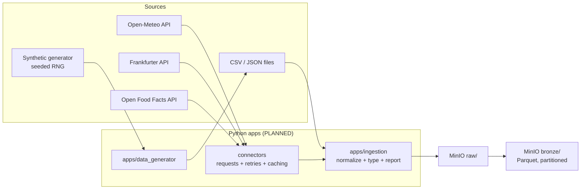

# Ingestion & Storage Architecture

> **Status: PARTIALLY IMPLEMENTED.** The synthetic generator (`apps/data_generator`)
> and the **MinIO container** (Phase 03) exist. Connectors, ingestion normalisation
> and the RAW/BRONZE **bucket layout** are still **PLANNED**; no bucket has been
> created yet.

---

## 1. Ingestion architecture

Two ingestion families feed the platform:

1. **External / public REST APIs** — no API keys required:
   - **Open-Meteo** — historical weather for Moroccan cities → calendar/weather attributes.
   - **Frankfurter** — EUR/MAD, USD/MAD, GBP/MAD exchange rates → cost normalization.
   - **Open Food Facts** — product catalog enrichment (mapped to the internal product dimension).
2. **Controlled synthetic retail data** — generated locally by `apps/data_generator`
   with a fixed seed: customers, products, stores, regions, sales, inventory,
   purchases, promotions, channels.



### Ingestion rules (designed)

| Rule | Detail |
|------|--------|
| API responses cached locally | Re-runs and tests never depend on API availability. |
| Seeded generation | Same seed ⇒ identical synthetic dataset (deterministic). |
| Idempotent writes | Re-ingesting a day/partition overwrites the same object key. |
| No silent data loss | Every run records fetched / written / rejected counts. |
| Contract check at entry | Payloads are checked against the source contract (see `data_contracts/`). |
| Raw is immutable | `raw/` objects are never edited; corrections happen downstream. |

---

## 2. Storage architecture (MinIO)

MinIO provides S3-compatible object storage. Planned bucket layout:

```
bucket: retail-raw
└── raw/
    ├── weather/       dt=YYYY-MM-DD/part-*.json      (Open-Meteo cache)
    ├── exchange/      dt=YYYY-MM-DD/part-*.json      (Frankfurter)
    ├── products_ext/  dt=YYYY-MM-DD/part-*.json      (Open Food Facts)
    ├── sales/         dt=YYYY-MM-DD/part-*.csv
    ├── customers/     dt=YYYY-MM-DD/part-*.csv
    ├── products/      dt=YYYY-MM-DD/part-*.csv
    ├── stores/        dt=YYYY-MM-DD/part-*.csv
    ├── inventory/     dt=YYYY-MM-DD/part-*.csv
    ├── purchases/     dt=YYYY-MM-DD/part-*.csv
    └── promotions/    dt=YYYY-MM-DD/part-*.csv

bucket: retail-bronze
└── bronze/
    └── <entity>/dt=YYYY-MM-DD/*.parquet              (typed, PyArrow)
```

| Concern | Decision |
|---------|----------|
| Format | JSON/CSV at RAW (source-faithful), **Parquet at BRONZE** (columnar, compressed) |
| Partitioning | `dt=` date partitions → cheap incremental loads |
| Access | Host applications use `MINIO_ENDPOINT`; containers reach `minio:9000` on the internal network |
| Credentials | From `.env` only — never committed |
| Versioning | Object versioning considered when the stack is created (PLANNED) |

Storage boundaries:

- **MinIO owns files.** Nothing analytical is queried from MinIO.
- **PostgreSQL owns tables.** No source payload is kept in Postgres beyond staging.
