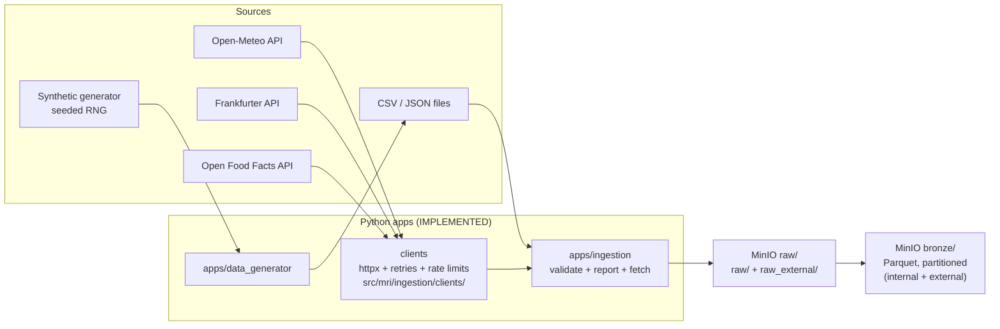

# Ingestion & Storage Architecture

> **Status: FILE + EXTERNAL API INGESTION + BRONZE + SILVER IMPLEMENTED (Phases 04–08).**
> The synthetic generator (`apps/data_generator`), the **MinIO container**
> (Phase 03), the **file ingestion layer** (`apps/ingestion`, Phase 04), the
> **external API clients** (Phase 05), the **Bronze layer** (Phase 06),
> **External Bronze** (Phase 07) and the **Silver load** (Phase 08) exist:
> CSV/JSON files are validated against
> `data_contracts/*.yml` and land under content-addressed keys; three keyless
> providers (Open-Meteo, Frankfurter, Open Food Facts) are fetched with bounded
> retries into `raw_external/` as verbatim JSON + provenance metadata; RAW
> batches (both families) are standardized into partitioned,
> provenance-carrying Parquet in `retail-bronze` behind a Great Expectations
> quality gate — external responses are normalized against their four dedicated
> contracts first, with the metadata sidecar as a required input; promoted
> batches are loaded into PostgreSQL through the `raw_staging → silver →
> audit` schemas with transactional upserts, an audit registry and
> reconciliation.
> See [`docs/pipeline/file-ingestion.md`](../pipeline/file-ingestion.md),
> [`docs/pipeline/external-apis.md`](../pipeline/external-apis.md),
> [`docs/pipeline/bronze-layer.md`](../pipeline/bronze-layer.md),
> [`docs/pipeline/external-bronze.md`](../pipeline/external-bronze.md),
> [`docs/pipeline/silver-layer.md`](../pipeline/silver-layer.md),
> [`docs/pipeline/data-quality.md`](../pipeline/data-quality.md),
> [`ADR-002`](../decisions/ADR-002-source-contracts-and-raw-ingestion.md),
> [`ADR-003`](../decisions/ADR-003-external-enrichment-apis.md),
> [`ADR-004`](../decisions/ADR-004-bronze-parquet-and-quality-gate.md),
> [`ADR-005`](../decisions/ADR-005-external-bronze-contracts.md) and
> [`ADR-006`](../decisions/ADR-006-postgresql-silver.md).

---

## 1. Ingestion architecture

Two ingestion families feed the platform:

1. **External / public REST APIs** — no API keys required:
   - **Open-Meteo** — historical weather for Moroccan cities → calendar/weather attributes.
   - **Frankfurter** — EUR/MAD, USD/MAD, GBP/MAD exchange rates → cost normalization.
   - **Open Food Facts** — product catalog enrichment (mapped to the internal product dimension).
2. **Controlled synthetic retail data** — generated locally by `apps/data_generator`
   with a fixed seed: customers, products, stores, regions, sales, inventory,
   purchases, promotions, channels.



### Ingestion rules

| Rule | Detail | Status |
|------|--------|--------|
| API responses cached verbatim | `raw_external/…/response.json` + `metadata.json`; same-day rerun = `already_fetched`, no HTTP. | implemented |
| Bounded, polite retries | max 4 attempts, backoff + jitter, `Retry-After` honoured, permanent 4xx never retried, per-provider pacing (Open Food Facts 4.1 s). | implemented |
| No API keys | all three providers are keyless; `auth: none` recorded in every metadata file. | implemented |
| Seeded generation | Same seed ⇒ identical synthetic dataset (deterministic). | implemented |
| Idempotent writes | The key contains the content hash, so a re-run is detected as `already_ingested` and writes nothing. | implemented |
| No silent data loss | Every run records ingested / already_ingested / rejected counts; rejected files are kept with a `.reason.json`. | implemented |
| Contract check at entry | Files are checked against `data_contracts/<source>.yml` (format, columns, types). | implemented |
| Raw is immutable | `raw/` and `raw_external/` objects are never edited; corrections happen downstream. | implemented |
| Strict standardization | Contract types applied per column; unparsable values exclude the row with a code — never a silent coercion. | implemented (Phase 06) |
| Quality gate | Every batch runs a Great Expectations suite (volume, types, nullability, declared rules, PK uniqueness, referential checks) before promotion. | implemented (Phase 06) |
| Never promote, never discard | Failed batches keep parts + quality report (and rejected rows), but get no `_promoted/` marker. | implemented (Phase 06) |
| External normalization | `raw_external/` responses are reshaped by dedicated normalizers against four external contracts (`open_meteo_history`, `open_meteo_forecast`, `frankfurter_fx`, `openfoodfacts_products`) before the same standardization/gate — never at fetch time. | implemented (Phase 07) |
| Sidecar is a gate condition | A response without its `metadata.json` provenance sidecar fails as a batch (no parts, no marker). | implemented (Phase 07) |
| Silver reads only promotions | `apps.ingestion load` discovers `_promoted/` markers; malformed markers become `failed` records, non-passing quality becomes `excluded` — never a crash, never an unpromoted read. | implemented (Phase 08) |
| Transactional per-batch upsert | `TRUNCATE` staging → `COPY` → `INSERT … ON CONFLICT DO UPDATE` + `success` audit row in one transaction; any failure rolls back the batch and writes a `failed` audit row, then the run continues. | implemented (Phase 08) |
| Audit registry + reconciliation | `audit.load_audit` doubles as the idempotence registry (partial unique success index); distinct Bronze conflict keys must equal `count(*)` per table or the run exits 1. | implemented (Phase 08) |

---

## 2. Storage architecture (MinIO)

MinIO provides S3-compatible object storage.

**Implemented in Phases 04–05** (bucket `retail-raw`, created on first ingest):

```
bucket: retail-raw
├── raw/<source>/<stem>__<sha256[:16]><ext>          immutable source files
│     regions/ channels/ stores/ products/ customers/
│     promotions/ sales/ purchases/ inventory/ calendar/
├── raw_external/source=<source>/                    verbatim API responses (Phase 05)
│   └── retrieved_date=YYYY-MM-DD/
│       └── request_hash=<sha256>/
│           ├── response.json                        byte-for-byte provider payload
│           └── metadata.json                        provenance + auth + client facts
├── rejected/contracts/<source>/<stem>__<hash><ext>   quarantined + *.reason.json
└── _manifests/<run_id>.json                          one audit trail per run
```

**Implemented in Phase 06** (bucket `retail-bronze`, created on first promotion):

```
bucket: retail-bronze
├── bronze/<source>/part-<batch>.parquet                   dimensions, single part
├── bronze/sales|purchases|inventory/year=YYYY/month=MM/
│   └── part-<batch>.parquet                               fact sources, date-partitioned
├── bronze/_quality/<run_id>/<source>/<batch>.json         quality report per batch
├── bronze/_promoted/<source>/<batch>.json                 promotion marker (pass only)
├── bronze/_rejected/<source>/<batch>.json                 excluded rows (when any)
└── bronze/_manifests/<run_id>.json                        one audit trail per run
```

`<batch>` = the raw filename stem (`sales__<sha256[:16]>`) — content-derived, so
reruns are idempotent (`already_bronzed`). Every part carries the provenance
columns `source`, `source_file`, `source_hash`, `ingestion_run_id`,
`ingestion_timestamp`.

**Phase 07 (External Bronze)** adds `raw_external/` response objects to the
same discovery, gates and layout: their batch id is
`<source>__<sha256(full response key)[:16]>`, `source_file` points at the
verbatim `response.json`, and all four external sources land unpartitioned
under `bronze/<source>/`. See
[`docs/pipeline/external-bronze.md`](../pipeline/external-bronze.md).

| Concern | Decision |
|---------|----------|
| Format | JSON/CSV at RAW (source-faithful), **Parquet at BRONZE** (columnar, snappy) |
| Partitioning | `year=/month=/` on the fact date column (`sales`, `purchases`, `inventory`); dimensions unpartitioned — cheap incremental loads |
| Quality | Great Expectations suite per batch; only `_promoted/` batches are consumable (see [`data-quality.md`](../pipeline/data-quality.md)) |
| Access | Host applications use `MINIO_ENDPOINT`; containers reach `minio:9000` on the internal network |
| Credentials | From `.env` only — never committed |
| Versioning | Object versioning considered when the stack is created (PLANNED) |

---

## 3. PostgreSQL storage (Silver, Phase 08)

PostgreSQL 16 (container, `localhost:5433`, database `retail`) owns the
table layer; `apps.ingestion load` is its only writer:

```
database: retail
├── raw_staging/                 constraint-free heaps (TRUNCATE + COPY landing)
│   └── 13 tables                same columns as silver, no keys
├── silver/                      business tables (contract-derived DDL)
│   ├── 13 tables                contract columns + 6 provenance columns
│   │                            PKs/FKs/NOT NULL/structural CHECKs
│   │   (weather = open_meteo_history + open_meteo_forecast merged)
│   └── ux_weather_<source>      partial unique indexes (no PK on weather)
└── audit/
    └── load_audit               per-batch log + success registry
                                 (partial unique batch_id, target_table)
```

| Concern | Decision |
|---------|----------|
| Source of DDL | Derived from `data_contracts/*.yml` at build time (`src/mri/silver/ddl.py`) — never hand-written SQL |
| Bulk path | per batch: `TRUNCATE` staging → psycopg text `COPY` → `INSERT … ON CONFLICT DO UPDATE` + audit `success`, one transaction |
| Load order | FK-safe: `regions → channels → calendar → stores → products → customers → promotions → sales → purchases → inventory → weather → fx_rates → external_products` |
| Idempotence | success registry in `audit.load_audit`; rerun = `already_loaded`/`skipped`, `--force` re-upserts |
| Verification | staged-vs-inserted rowcounts + per-table reconciliation against Bronze; manifest in `reports/silver/<run_id>.json` |

See [`docs/pipeline/silver-layer.md`](../pipeline/silver-layer.md) and
[`ADR-006`](../decisions/ADR-006-postgresql-silver.md).

Storage boundaries:

- **MinIO owns files.** Nothing analytical is queried from MinIO.
- **PostgreSQL owns tables.** No source payload is kept in Postgres beyond staging.
