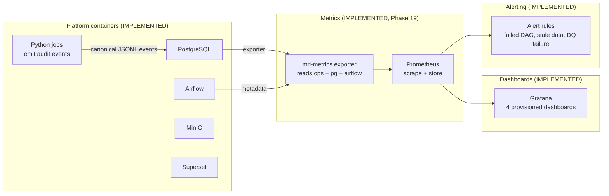

# Observability Architecture

> **Status: IMPLEMENTED.** The observability vision described here has been built:
> structured audit logging + an `ops` metrics schema (Phase 16) and a Prometheus
> + Grafana stack with a zero-dependency exporter (Phase 19).
>
> **What actually exists:**
> - Structured audit events: [`docs/observability/audit-logging.md`](../observability/audit-logging.md)
> - Prometheus exporter + Grafana dashboards:
>   [`docs/observability/prometheus-grafana.md`](../observability/prometheus-grafana.md)
> - Metric catalogue: [`docs/observability/metric-catalog.md`](../observability/metric-catalog.md)
> - Decisions: [`ADR-013`](../decisions/ADR-013-observability.md) ·
>   [`ADR-015`](../decisions/ADR-015-prometheus-grafana-observability.md)
>
> The design below is kept as the original target; the implemented metric names
> are the `mri_*` series documented in the metric catalogue (not the illustrative
> names shown here).

---

## Goals

Make pipeline health visible and answerable:

- Did yesterday's ingestion run, and how long did it take?
- How many rows were fetched, rejected and loaded per source?
- Did any data-quality expectation start failing?
- Is a container consuming an abnormal amount of memory/CPU?

---

## Implemented components



| Component | Responsibility |
|-----------|----------------|
| **mri-metrics exporter** | Translates `ops` views, PostgreSQL health and Airflow metadata into bounded Prometheus series |
| **Prometheus** | Scrapes and stores the exporter's time-series |
| **Grafana** | 4 provisioned dashboards: pipeline duration, row counts, rejection rates, platform/freshness |
| **Alert rules** | Failures of DAGs, stale partitions, failing expectation suites |

## Implemented metrics (exporter side)

The exporter emits `mri_*` series derived from the `ops` schema (see the metric
catalogue for the full list and semantics), for example run facts, pipeline
durations, row/rejection counts, freshness and Airflow task/run states.

## Enabling the stack

The monitoring stack is an **optional** compose profile and is never required by
the core data pipeline:

```powershell
docker compose --env-file .env -f infrastructure/docker/docker-compose.yml `
  -f infrastructure/docker/docker-compose.observability.yml --profile observability up -d
```

Prometheus `:9090`, Grafana `:3001`, exporter `:9245`.
