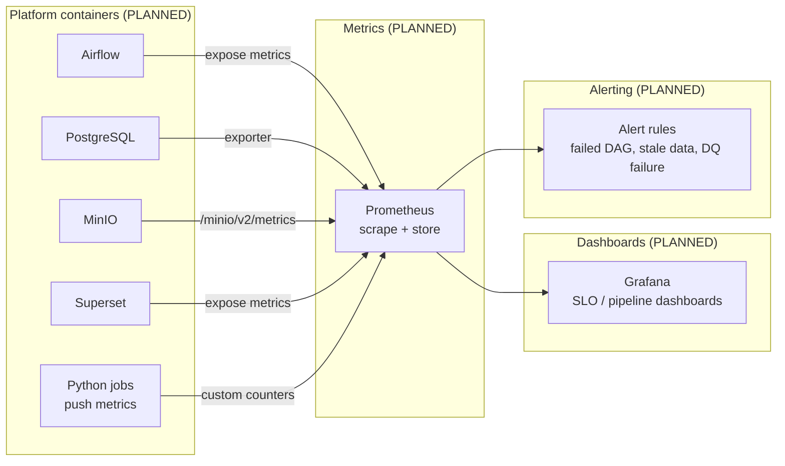

# Observability Architecture (Future)

> **Status: FUTURE / PLANNED — nothing in this document is implemented.**
> `monitoring/prometheus/` and `monitoring/grafana/` exist as reserved directories only.

---

## Goals

Make pipeline health visible and answerable:

- Did yesterday's ingestion run, and how long did it take?
- How many rows were fetched, rejected and loaded per source?
- Did any data-quality expectation start failing?
- Is a container consuming an abnormal amount of memory/CPU?

---

## Planned components

| Component | Responsibility |
|-----------|----------------|
| **Prometheus** | Scrapes and stores time-series metrics from containers and custom job counters |
| **Grafana** | Dashboards: pipeline duration, row counts, rejection rates, resource usage |
| **Alert rules** | Failures of DAGs, stale partitions, failing expectation suites |

## Planned custom metrics (Python side)

| Metric | Type | Meaning |
|--------|------|---------|
| `ingest_rows_fetched_total` | counter | rows/payloads read from a source |
| `ingest_rows_written_total` | counter | rows written to MinIO/Postgres |
| `ingest_rows_rejected_total` | counter | rows failing contract/validation (**no silent loss**) |
| `ingest_duration_seconds` | histogram | ingestion run duration |
| `dq_validation_failures_total` | counter | failing Great Expectations validations |

## Prerequisites before this can start

1. Full container stack running (Postgres, MinIO, Airflow, Superset).
2. Custom metrics endpoint exposed by the Python jobs.
3. RAM headroom on the host (currently ~7.8 GiB total — see
   [`../development-environment.md`](../development-environment.md)).

Until then, **Airflow task logs + pytest/GE/dbt reports are the observability surface.**
