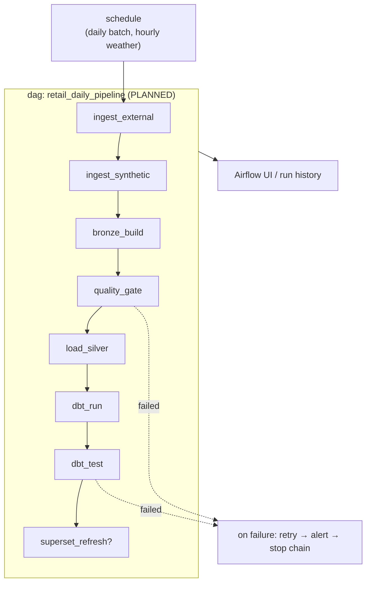
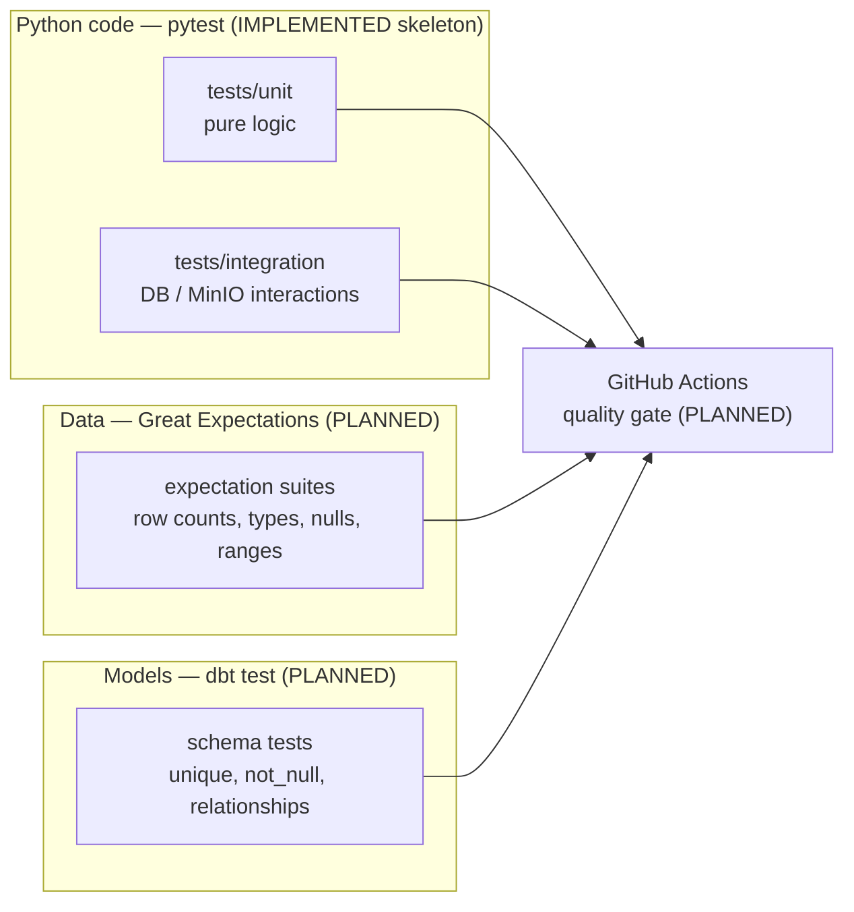
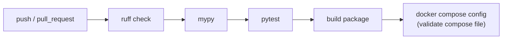

# Orchestration, Testing & CI/CD Architecture

> **Status: PLANNED.** No Airflow DAG and no GitHub Actions workflow exists yet.

---

## 1. Orchestration architecture (Apache Airflow)

Airflow schedules and monitors the platform. It **coordinates only** — it never
contains business logic.

### Orchestration decisions (designed)

| Decision | Detail |
|----------|--------|
| Deployment | Official container image `apache/airflow:3.3.2` via Docker Compose (**PLANNED**) |
| Constraint files | If Airflow is ever installed with pip/uv, official constraints files are mandatory |
| Tasks are thin | Each task calls one Python entry point or one `dbt` command |
| Idempotent tasks | Re-running any task is safe |
| Dependencies are explicit | Data intervals and `depends_on_past` are avoided except where needed |
| Secrets | Delivered via environment variables, never hardcoded in DAGs |

---

## 2. Testing architecture

Three test levels, each with a clear owner:

| Level | Tool | Examples |
|-------|------|----------|
| Unit | pytest | parsing helpers, contract validation, seed determinism |
| Integration | pytest | load into Postgres, MinIO read/write (containers via compose) |
| Data quality | Great Expectations | freshness, ranges, allowed values, referential presence |
| Model | dbt test | uniqueness of keys, not-null foreign keys, relationship integrity |
| Static | ruff + mypy | lint/format and type safety |

Commands available now: `uv run pytest`, `uv run ruff check .`, `uv run mypy`
(see `Makefile`).

---

## 3. CI/CD architecture (GitHub Actions)

**PLANNED** — `.github/workflows/` is reserved but empty on purpose.

Planned pipeline (not yet created):

| Stage | Tool | Blocking? |
|-------|------|-----------|
| Lint | ruff | yes |
| Type check | mypy | yes |
| Unit tests | pytest | yes |
| Data/dbt tests | GE + dbt test (when stack exists) | yes |
| Compose validation | `docker compose config` | yes |
