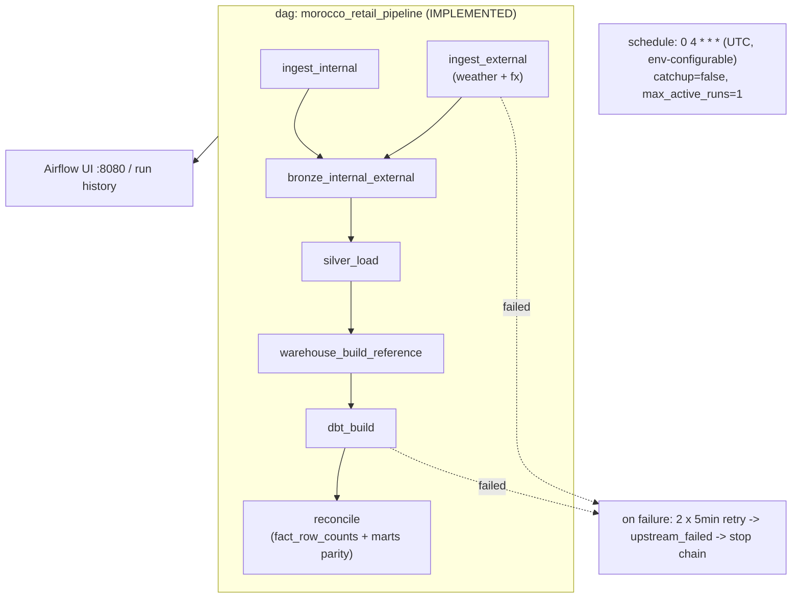
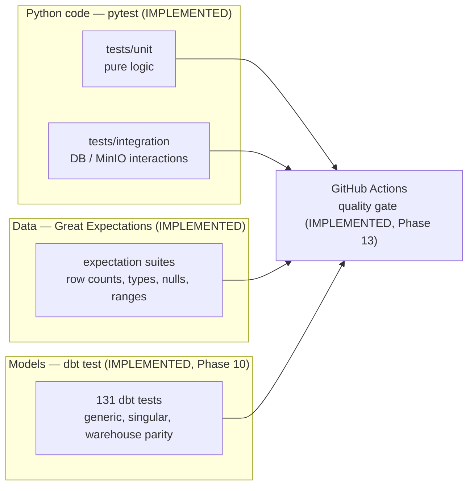
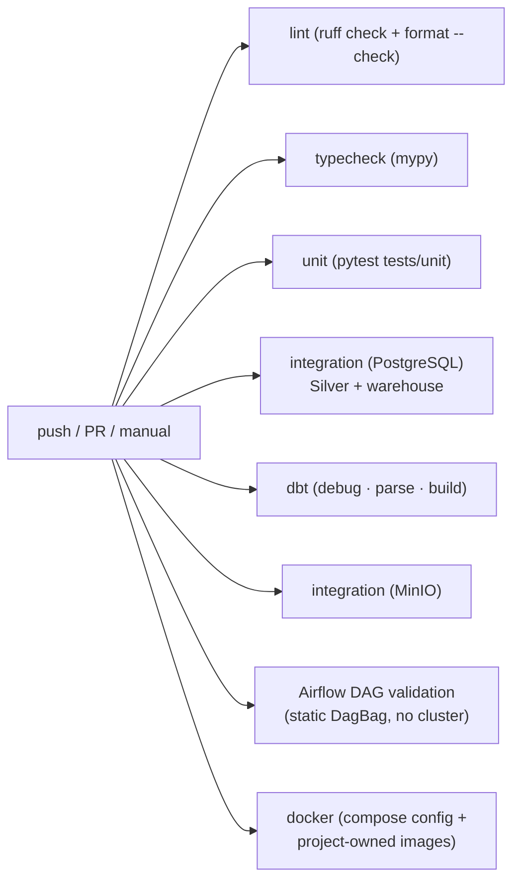

# Orchestration, Testing & CI/CD Architecture

> **Status: orchestration IMPLEMENTED (Phase 11) — CI/CD IMPLEMENTED (Phase 13).**
> One Airflow DAG runs the whole pipeline; no GitHub Actions workflow exists yet.

---

## 1. Orchestration architecture (Apache Airflow)

Airflow schedules and monitors the platform. It **coordinates only** — it never
contains business logic. Full operational guide:
[`docs/orchestration/airflow.md`](../orchestration/airflow.md) · decision:
[`ADR-009`](../decisions/ADR-009-airflow-orchestration.md).

### Orchestration decisions

| Decision | Detail |
|----------|--------|
| Deployment | Official containers `apache/airflow:3.3.2-python3.12` + custom `mri-airflow:3.3.2` (isolated `/opt/venv`), Docker Compose overlay `docker-compose.airflow.yml` |
| Executor | `LocalExecutor` — lightest official topology (no Redis/Celery/triggerer/flower), ~1.1 GiB observed |
| Metadata | Dedicated `airflow-postgres` database and volume — never the retail warehouse |
| Tasks are thin | Each task is one `BashOperator` calling an existing CLI (`apps.ingestion`, `apps.warehouse`, `apps.dbt`) |
| Idempotent tasks | Re-running any task is safe — delegated to existing layers, proven by back-to-back runs |
| Dependencies are explicit | Parallel ingests → bronze → silver → warehouse → dbt → reconcile; `depends_on_past` avoided |
| Secrets | Delivered via environment variables, never hardcoded in DAGs |
| Constraints files | Not needed — Airflow is never installed into the project Python runtime |

---

## 2. Testing architecture

Three test levels, each with a clear owner:

| Level | Tool | Examples |
|-------|------|----------|
| Unit | pytest | parsing helpers, contract validation, seed determinism, dbt CLI wrapper |
| Integration | pytest | load into Postgres, MinIO read/write (containers via compose), dbt build + SCD2 round-trip |
| Data quality | Great Expectations | freshness, ranges, allowed values, referential presence |
| Model | dbt test | uniqueness of keys, not-null foreign keys, relationship integrity, SCD2 invariants, warehouse parity |
| Static | ruff + mypy | lint/format and type safety |

Commands available now: `uv run pytest`, `uv run ruff check .`, `uv run mypy`,
`python -m apps.dbt build`, plus the Airflow DAG check
(`docker compose … exec -T airflow-scheduler python …/validate_dag.py`, see
`make airflow-validate`). See `Makefile`.

---

## 3. CI/CD architecture (GitHub Actions)

**IMPLEMENTED (Phase 13)** — `.github/workflows/ci.yml`. Every push/PR to
`main` runs the pipeline below (plus `workflow_dispatch` for manual runs):

| Job | What it runs | Environment |
|-----|--------------|-------------|
| `lint` | `ruff check .`, `ruff format --check .` | none (offline) |
| `typecheck` | `mypy` | none (offline) |
| `unit` | `pytest tests/unit` | none (offline, in-memory object store) |
| `integration-postgres` | Silver + warehouse integration tests | disposable `postgres:16-alpine` service container |
| `dbt` | `dbt debug` · `dbt parse` · full `dbt build`+`dbt test`+source freshness (integration harness) | disposable `postgres:16-alpine` service container |
| `minio-integration` | ingestion / bronze / external MinIO tests | disposable pinned MinIO service container |
| `airflow-dag` | `validate_dag.py` in the official `apache/airflow:3.3.2-python3.12` image | `docker run`, no cluster |
| `docker` | `docker compose … config -q` (3 file combos) + builds of `mri-airflow` / `mri-superset` | placeholder env from `.env.example` |

Decisions:

- **Reproducibility** — Python is pinned by `.python-version` (3.12) and every
  job installs dependencies with `uv sync --frozen`: an outdated `uv.lock` fails
  the build instead of resolving fresh.
- **Caching** — `astral-sh/setup-uv` caches the uv toolchain and wheel cache.
  This is safe because each job re-runs `uv sync --frozen`, so a cached
  dependency can never hide a lockfile change.
- **No secrets in Git** — every service container uses disposable inline dummy
  credentials; the repository declares no GitHub Secrets and never commits the
  real `.env`.
- **MinIO** — unit tests exercise the in-memory store (offline), while the real
  object store is validated once per run by the dedicated `minio-integration`
  job; MinIO is never started on the cheap unit/lint/typecheck jobs.
- **Airflow** — the DAG is statically validated with the real Airflow DagBag in
  the same official image used at runtime, without ever starting a scheduler;
  full-stack acceptance runs stay manual/local.
- **Docker** — compose syntax is validated for the base, base+Airflow and
  base+Superset stacks; images are built only for the two project-owned images.

Local equivalents: `make check` (lint + typecheck + test), `make docker-config`,
`make airflow-validate`. Full compose/image and seeded runs remain local
acceptance steps.
