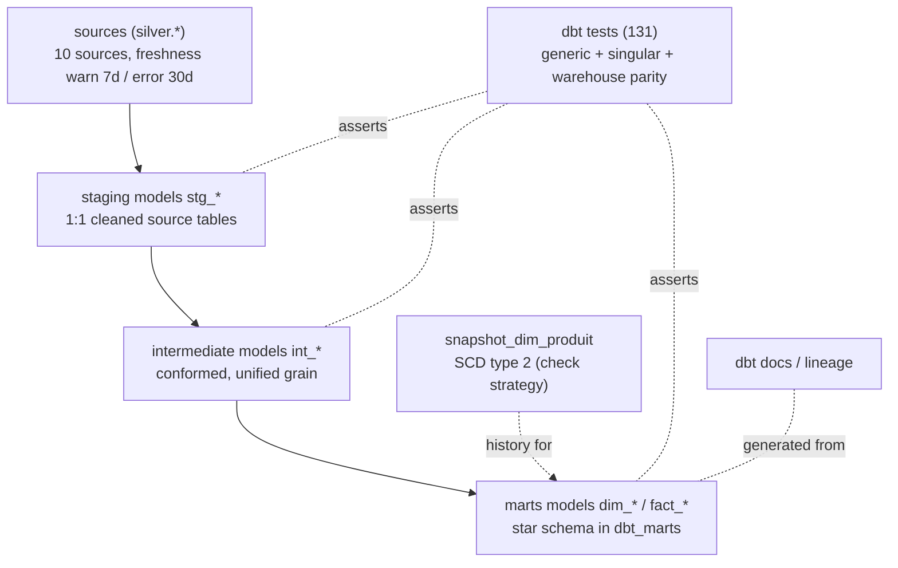
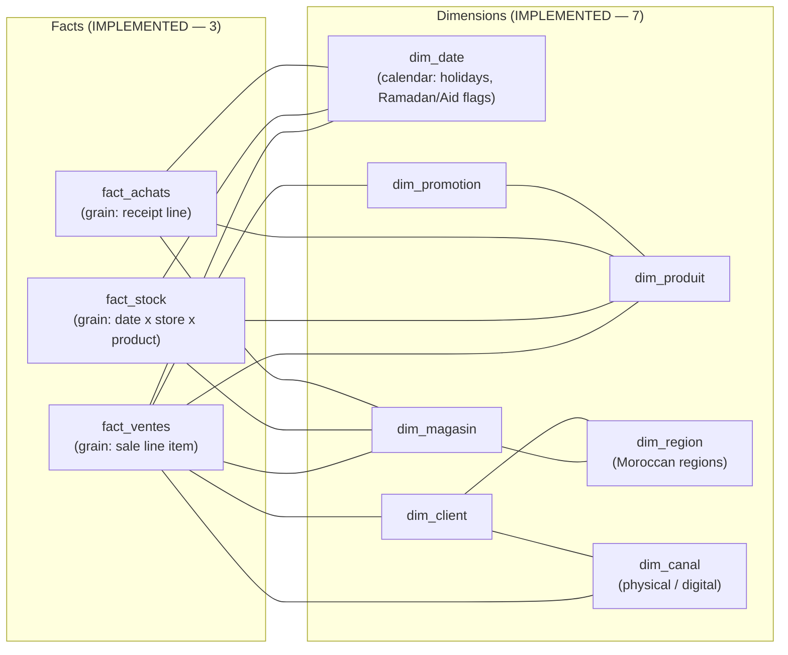

# Transformation & Warehouse Architecture

> **Status: IMPLEMENTED.** The dbt project (Section 1) is **implemented**
> (Phase 10 — 26 models `stg_*`/`int_*`/`dim_*`/`fact_*`, SCD type 2
> `dim_produit` snapshot, 131 dbt tests, run through `python -m apps.dbt`).
> The warehouse star schema (Section 2) is **implemented** (Phase 09 — Python
> builder `mri.warehouse`, 7 dimensions + 3 facts, reconciliation); dbt
> re-expresses it as marts models and a guarded parity test proves the two
> agree.

---

## 1. Transformation architecture (dbt) — IMPLEMENTED (Phase 10)

dbt owns **all analytics-shaped SQL** after data is trusted in PostgreSQL staging.
Python never writes business logic that dbt should own; dbt never fetches external data.



### dbt project layout (as implemented)

```
dbt/
├── dbt_project.yml            # project + model configuration (schemas, vars)
├── profiles.yml               # connection (env-driven, never committed secrets)
├── models/
│   ├── sources.yml            # 10 sources + freshness policy
│   ├── staging/               # 10 stg_* models + schema.yml (tests)
│   ├── intermediate/          # 6 int_* models + schema.yml
│   └── marts/                 # 10 dim_*/fact_* models + schema.yml
├── macros/                    # generate_schema_name, text_hash_sk
├── tests/                     # 7 singular tests (SCD2, grain, parity, ranges)
├── snapshots/                 # snapshot_dim_produit (SCD type 2)
└── target/                    # run_results.json, catalog.json (git-ignored)
```

### Transformation rules (as implemented)

| Rule | Detail |
|------|--------|
| Layer discipline | Staging never joins other entities; marts never re-clean raw strings. |
| Naming | `stg_<entity>`, `int_<entity>`, `dim_<entity>` / `fact_<entity>`. |
| Tests are mandatory | Every mart ships with unique/not-null/relationships/accepted_values tests plus 7 singular data tests. |
| Incremental where it pays | *Deferred* — current volumes fit a full `dbt build` (~seconds); revisit for large facts (Phase 11+). |
| Deterministic | No `now()`-dependent logic in model definitions; as-of dates come from the event rows themselves (SCD2 join), snapshot boundaries from `dbt built-ins`. |
| Schema isolation | `generate_schema_name` honours `--vars schema_suffix` so integration tests build into isolated schemas. |

---

## 2. Warehouse architecture (PostgreSQL star schema) — IMPLEMENTED (Phase 09)

The serving model is a **dimensional star schema** in PostgreSQL, in the
`warehouse` schema of the existing PostgreSQL 16 container, consumed (later)
by Superset. It is built by the Python package `mri.warehouse`
(`python -m apps.warehouse build`) directly from live Silver; dbt re-expresses
the same star schema as marts models in `dbt_marts`
(`python -m apps.dbt build`), and a guarded parity test row-compares the two.

Full reference: [`docs/data-model/star-schema.md`](../data-model/star-schema.md)
· [`facts-and-dimensions.md`](../data-model/facts-and-dimensions.md) ·
[`ADR-007`](../decisions/ADR-007-star-schema.md).



| Decision | Rationale |
|----------|-----------|
| Star schema (not snowflake) | BI-friendly, matches Superset's implicit join model, simpler for dashboards. |
| Conformed dimensions | `dim_date`, `dim_magasin`, `dim_produit` shared by all three facts. |
| Postgres as warehouse | Single relational engine for staging + serving keeps the local stack small; swap-ready for a bigger engine later. |
| Surrogate keys | `IDENTITY` integer keys generated in the database, deterministic across rebuilds (insert `ORDER BY` business key); source natural keys kept as `UNIQUE` attributes. |
| Python builder + dbt models | Phase 09 owns the warehouse end-to-end in Python; Phase 10 hands the defined schema to dbt models. Both coexist deliberately: Python is the reference implementation of the contract, dbt is the analytics layer, and `assert_marts_match_warehouse` proves they agree row for row whenever both schemas are present. |
| Rebuild semantics | `TRUNCATE … RESTART IDENTITY` + reload + reconciliation per build — warehouse is a pure function of Silver. |

`dim_weather` / `dim_exchange_rate` from the original design are deferred:
no required fact joins them yet (the Silver data is already stored).

### Separation of duties

```
Python  → moves & types data        (ingestion)
GE      → certifies data quality    (gate)
mri.wh  → builds star schema        (warehouse, Phase 09 reference)
dbt     → models & tests            (analytics, Phase 10 — stg/int/marts + SCD2)
Postgres→ stores & serves           (system of record for BI)
Superset→ visualizes                (consumption)
```
