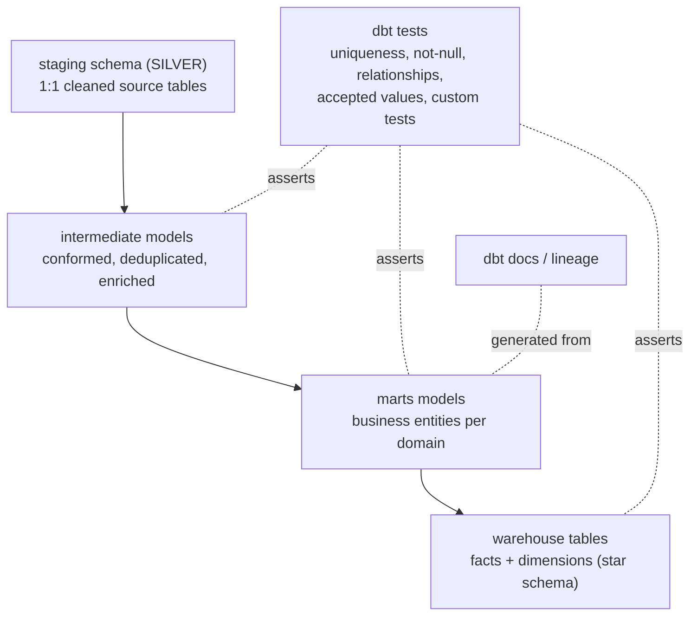
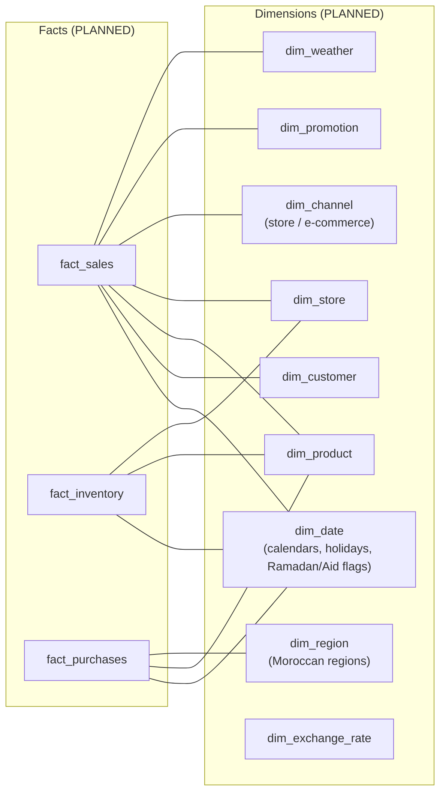

# Transformation & Warehouse Architecture

> **Status: PLANNED.** No dbt project, model, test or warehouse table exists yet.

---

## 1. Transformation architecture (dbt)

dbt owns **all analytics-shaped SQL** after data is trusted in PostgreSQL staging.
Python never writes business logic that dbt should own; dbt never fetches external data.



### Planned dbt project layout

```
dbt/
├── dbt_project.yml            # project + model configuration
├── profiles.yml               # connection (env-driven, never committed secrets)
├── models/
│   ├── staging/               # 1:1 with sources, thin cleanup only
│   ├── intermediate/          # reusable conformed logic
│   └── marts/                 # business marts (sales, inventory, customer, ...)
├── seeds/                     # small static CSV (calendar, regions, holidays)
├── macros/                    # shared SQL helpers
├── tests/                     # singular (data) tests
└── snapshots/                 # slowly changing dimension captures
```

### Transformation rules (designed)

| Rule | Detail |
|------|--------|
| Layer discipline | Staging never joins other entities; marts never re-clean raw strings. |
| Naming | `stg_<entity>`, `int_<verb>_<entity>`, `<domain>_<grain>` (fct_/dim_). |
| Tests are mandatory | Every mart ships with not-null/unique/relationship tests. |
| Incremental where it pays | Large fact models use incremental materialization keyed on a load timestamp. |
| Deterministic | No `now()`-dependent logic in model definitions; as-of dates passed as variables. |

---

## 2. Warehouse architecture (PostgreSQL star schema)

The final serving model is a **dimensional star schema** in PostgreSQL, consumed by
Superset.



| Decision | Rationale |
|----------|-----------|
| Star schema (not snowflake) | BI-friendly, matches Superset's implicit join model, simpler for dashboards. |
| Conformed dimensions | `dim_date`, `dim_product`, `dim_store` shared across all marts. |
| Postgres as warehouse | Single relational engine for staging + serving keeps the local stack small; swap-ready for a bigger engine later. |
| Surrogate keys | Integer keys generated in dbt; source natural keys kept as attributes. |
| Schema management | `warehouse/migrations/` holds ordered SQL migrations; `warehouse/schemas/` documents the target DDL. |

### Separation of duties

```
Python  → moves & types data        (ingestion)
GE      → certifies data quality    (gate)
dbt     → models & tests            (analytics)
Postgres→ stores & serves           (system of record for BI)
Superset→ visualizes                (consumption)
```
