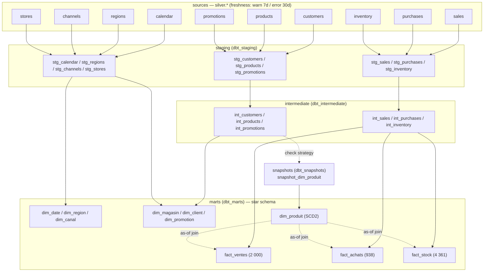

# dbt Analytics Layer

> **Status: IMPLEMENTED (Phase 10).** The dbt project (`dbt/`, project `mri`)
> is the authoritative analytics transformation layer: 10 Silver sources →
> **26 models** (`stg_*` → `int_*` → `dim_*`/`fact_*`) + **1 SCD type 2
> snapshot** (`snapshot_dim_produit`) + **140 dbt tests**, built and tested by
> `python -m apps.dbt build`. On dev: **167/167 build nodes PASS**,
> **10/10 source freshness PASS**, docs generated.

---

## 1. How it runs — the `python -m apps.dbt` wrapper

dbt is never invoked bare from an arbitrary working directory. The repository
wrapper (`apps/dbt/`) is the single entry point:

```bash
python -m apps.dbt debug                    # connection + profile checks
python -m apps.dbt build                    # compile + run + test all nodes
python -m apps.dbt build --vars '{schema_suffix: _it1}'   # isolated schemas
python -m apps.dbt source freshness         # 10 sources, warn 7d / error 30d
python -m apps.dbt docs generate            # docs + target/catalog.json
python -m apps.dbt test                     # tests only
python -m apps.dbt build --no-partial-parse # force full re-parse (tests)
```

What the wrapper guarantees:

| Concern | Behaviour |
|---------|-----------|
| Credentials | Injects `DBT_TARGET_HOST/PORT/DB/USER/PASSWORD/SSLMODE` from the same `Settings.from_env()` every other entry point uses — **never overriding** variables already set (tests assert this). |
| Project location | Appends `--project-dir dbt --profiles-dir dbt` after the caller's argv unless already present, so the command works from any working directory. |
| Executable | Resolves `dbt` next to the active Python interpreter first (uv venv), falls back to `PATH`, otherwise raises `FileNotFoundError` with the install hint. |
| Missing password | Exits `1` with `MISSING_PASSWORD_MESSAGE` before spawning dbt (no stack trace for a config error). |
| Exit codes | dbt's exit code is forwarded untouched, so shell/CI callers can rely on `0`/`1`. |

Unit tests: `tests/unit/test_dbt_cli.py` (env injection, no-override,
command assembly, executable resolution, missing password, exit forwarding).

---

## 2. Project layout

```
dbt/
├── dbt_project.yml            # name mri, vars, per-layer schema config
├── profiles.yml               # mri → dev target, env-var credentials
├── models/
│   ├── sources.yml            # 10 sources + freshness policy + ownership
│   ├── staging/               # 10 × stg_* + schema.yml
│   ├── intermediate/          # 6 × int_* + schema.yml
│   └── marts/                 # 7 × dim_* + 3 × fact_* + schema.yml
├── macros/
│   ├── generate_schema_name.sql   # honours --vars schema_suffix
│   └── text_hash_sk.sql           # deterministic 64-bit signed hash SK
├── snapshots/
│   └── snapshot_dim_produit.sql   # SCD type 2 (check strategy)
├── tests/                     # 7 singular tests (SCD2, grain, parity…)
├── target/                    # run_results.json, catalog.json (git-ignored)
└── logs/                      # dbt logs (git-ignored)
```

Configuration highlights (`dbt_project.yml`):

- `require-dbt-version: [">=1.12.0", "<2.0.0"]` — pinned dev dependency
  `dbt-postgres==1.12.5` / adapter `1.11.0`.
- Vars: `silver_schema` (source schema), `warehouse_schema` (Phase 09
  reference schema for the parity test), `schema_suffix` (isolated test
  schemas).
- Layer schemas: `dbt_staging`, `dbt_intermediate`, `dbt_marts`,
  `dbt_snapshots` (via `generate_schema_name`, which appends `schema_suffix`).
- `models: +persist_docs: [relation, columns]` so `docs generate` fills the
  catalog for BI/lineage consumers.

---

## 3. Lineage



---

## 4. Model inventory (26)

| Layer | Model | Grain / purpose |
|-------|-------|-----------------|
| staging | `stg_sales` | sale line, cleaned ids (`nullif(trim(...))`), explicit casts, keeps `batch_id` + `ingestion_timestamp` |
| staging | `stg_purchases` | receipt line, same treatment |
| staging | `stg_inventory` | date × store × product snapshot |
| staging | `stg_customers` | customer master |
| staging | `stg_products` | product master (SCD2 source) |
| staging | `stg_promotions` | promotion master |
| staging | `stg_calendar` | calendar days (weekday, holiday, Ramadan/Aïd flags) |
| staging | `stg_regions` | Moroccan regions |
| staging | `stg_channels` | physical / digital channels |
| staging | `stg_stores` | store master |
| intermediate | `int_sales` | unified `event_date`, provenance dropped, no fabricated columns |
| intermediate | `int_purchases` | same, per receipt line |
| intermediate | `int_inventory` | same, per stock snapshot |
| intermediate | `int_customers` | conformed customer attributes |
| intermediate | `int_products` | conformed product attributes (snapshot source) |
| intermediate | `int_promotions` | conformed promotion attributes |
| marts | `dim_date` | calendar dimension (1 461 days), `date_sk` identity |
| marts | `dim_region` | 12 regions |
| marts | `dim_canal` | 3 channels |
| marts | `dim_magasin` | 4 stores |
| marts | `dim_client` | 200 customers |
| marts | `dim_promotion` | 20 promotions |
| marts | `dim_produit` | **SCD2** product versions (60 rows / 46 products on dev) |
| marts | `fact_ventes` | sale line item — 2 000 rows |
| marts | `fact_achats` | receipt line — 938 rows |
| marts | `fact_stock` | date × store × product — 4 361 rows |

Non-`dim_produit` dimensions use `row_number() OVER (ORDER BY business key)`
surrogate keys, which reproduces the Phase 09 Python builder's identity keys
exactly (the Python loads insert `ORDER BY` business key) — this is what makes
row-level parity possible.

---

## 5. Sources and freshness (`models/sources.yml`)

All 10 Silver tables are declared as sources with
`loaded_at_field: ingestion_timestamp` and a two-tier freshness policy:

- **warn** after **7 days**, **error** after **30 days**.
- `source freshness` on dev: **10/10 PASS** (freshness metadata is carried
  through Bronze → Silver by the loader).
- Each source carries `owner`/`tags` metadata for docs.

---

## 6. Tests (131 = 124 generic + 7 singular)

### Generic (declared in `schema.yml` per layer)

- `unique` — every dimension PK + business key, every fact's degenerate grain
  key (`sale_id`, `purchase_id`), intermediate business keys.
- `not_null` — every key column through staging/intermediate, every fact FK.
- `relationships` — 13 tests: all fact FKs → dimension SKs
  (`fact_ventes` ×6, `fact_stock` ×3, `fact_achats` ×3) plus
  `dim_client.region_sk/canal_sk` → `dim_region`/`dim_canal`.
- `accepted_values` — enumerated columns (channel type, weekday, season,
  promotion type, …).

dbt 1.12 requires generic-test arguments under `arguments:` — the project is
written to the current syntax (0 parse deprecation warnings).

### Singular (7 in `dbt/tests/`)

| Test | Asserts |
|------|---------|
| `assert_scd2_single_current` | exactly one row with `valid_to is null` per `product_id` |
| `assert_scd2_contiguous_versions` | each version's `valid_to` equals the next version's `valid_from` |
| `assert_dim_date_consistency` | weekday (0=Mon…6=Sun), `is_weekend ⇔ weekday ≥ 5`, weekend name, 4 seasons, holiday flags consistent per day |
| `assert_fact_stock_grain_unique` | `(date_sk, magasin_sk, produit_sk)` unique — inventory grain holds |
| `assert_fact_measure_ranges` | `quantity ≥ 1`, `0 ≤ discount ≤ 1`, `net_amount_mad ≥ 0`, `margin_mad ≥ 0`, `qoh ≥ 0` |
| `assert_fact_row_counts` | all 10 marts' row counts equal their Silver sources (fact rows, current dim rows) |
| `assert_marts_match_warehouse` | **guarded Phase 09 parity** (below) |

### The guarded warehouse parity test

`assert_marts_match_warehouse` proves the dbt marts and the Phase 09 Python
`warehouse` schema are the same model:

- Uses `adapter.get_relation(namespace=..., identifier=...)` to detect each of
  the 10 warehouse relations at **compile time**; if the schema is absent the
  test compiles to a `where false` empty query and **passes trivially** (dbt
  alone must always build).
- When present (it is, inside `python -m apps.warehouse build`, and in the
  integration test's shared fixture): row-compares `fact_ventes` **row by
  row including `product_id`** (joined through both dimension variants) and
  row-count-compares the remaining 9 marts (`dim_produit` compared
  current-rows-only, since the Python build is current-state).
- The file carries `-- depends_on: {{ ref(...) }}` hints for all 10 marts so
  dbt can build the graph from refs used only inside conditionals.

---

## 7. Schema isolation for tests

`macros/generate_schema_name.sql` appends the `schema_suffix` var to every
generated schema name:

```bash
python -m apps.dbt build --no-partial-parse --vars '{schema_suffix: _it1}'
```

The integration test (`tests/integration/test_transform_postgres.py`) builds
into `dbt_staging_it<tag>`/`dbt_marts_it<tag>`… against a dedicated
`warehouse_dbt_it<tag>` reference schema and drops them on teardown — the dev
`dbt_*` schemas are never touched. `--no-partial-parse` is required because
partial parse caches state across runs with different `--vars`.

---

## 8. Validation evidence (dev, 2026-10-08)

| Command | Result |
|---------|--------|
| `python -m apps.dbt debug` | all checks passed (target, credentials, files) |
| `python -m apps.dbt parse` | clean — 26 models, 1 snapshot, 140 tests, 0 warnings (current counts) |
| `python -m apps.dbt build` | **167/167 nodes PASS** (26 models + 1 snapshot + 140 tests) |
| `python -m apps.dbt source freshness` | **10/10 PASS** |
| `python -m apps.dbt docs generate` | catalog written (`target/catalog.json`) |
| live SCD2 change scenario | see [`scd2.md`](scd2.md) — 61 versions, history kept, fact SKs stable, reverted |
| full gate | `ruff check` · `ruff format --check` · `mypy` · `pytest -q` → **344 passed, 3 skipped** |

---

## 9. Related documents

- [`scd2.md`](scd2.md) — SCD type 2 `dim_produit` in detail.
- [`star-schema.md`](star-schema.md) · [`facts-and-dimensions.md`](facts-and-dimensions.md)
  — the Phase 09 reference schema the marts mirror.
- [`../architecture/transformation.md`](../architecture/transformation.md)
  — transformation architecture (both implementations).
- [`../decisions/ADR-008-dbt-and-scd2.md`](../decisions/ADR-008-dbt-and-scd2.md)
  — why dbt owns analytics and why only `dim_produit` is SCD2.
