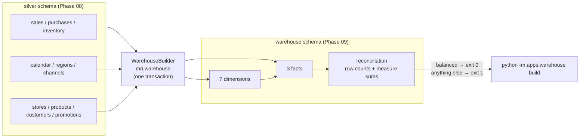

# Star Schema — PostgreSQL Analytical Warehouse

> **Status: IMPLEMENTED (Phase 09).** 7 dimensions + 3 facts in the PostgreSQL
> `warehouse` schema, built from Silver by `mri.warehouse` (set-based SQL, one
> transaction, deterministic surrogate keys, business reconciliation).
> Source of truth: [`src/mri/warehouse/schema.py`](../../src/mri/warehouse/schema.py).

---

## 1. Overview

The warehouse is a Kimball-style star schema served by the same PostgreSQL 16
container that holds Silver (Phase 03 stack, ADR-006). Every table is built
from live `silver.*` tables by **set-based `INSERT … SELECT` statements** —
no row-by-row processing, no fabricated values.



## 2. Conventions

| Concept | Convention | Example |
|---------|-----------|---------|
| **Table names** | French nouns (stack decision for the serving layer) | `dim_magasin`, `fact_ventes` |
| **Surrogate keys** | `<entity>_sk BIGINT GENERATED ALWAYS AS IDENTITY`, PK of every dimension | `magasin_sk` |
| **FK columns** | always a resolved `*_sk` pointing at a dimension PK | `fact_ventes.date_sk → dim_date.date_sk` |
| **Business columns / measures** | verbatim English source column names (lineage back to contracts) | `net_amount_mad`, `customer_id` |
| **Business key** | natural source identifier kept on the dimension, `UNIQUE`-constrained | `dim_client.customer_id` |
| **Derived columns** | exactly one: `dim_date.day = EXTRACT(DAY FROM date)` (declared in `DERIVED_COLUMNS`) | — |
| **No fabrication** | every column ⊆ contract columns ∪ `*_sk` keys ∪ `DERIVED_COLUMNS` — unit-tested | — |

## 3. Entity–relationship diagram

```mermaid
erDiagram
    dim_date ||--o{ fact_ventes : "date_sk"
    dim_magasin ||--o{ fact_ventes : "magasin_sk"
    dim_canal ||--o{ fact_ventes : "canal_sk"
    dim_client ||--o{ fact_ventes : "client_sk (nullable)"
    dim_produit ||--o{ fact_ventes : "produit_sk"
    dim_promotion ||--o{ fact_ventes : "promotion_sk (nullable)"

    dim_date ||--o{ fact_achats : "date_sk"
    dim_magasin ||--o{ fact_achats : "magasin_sk"
    dim_produit ||--o{ fact_achats : "produit_sk"

    dim_date ||--o{ fact_stock : "date_sk"
    dim_magasin ||--o{ fact_stock : "magasin_sk"
    dim_produit ||--o{ fact_stock : "produit_sk"

    dim_region ||--o{ dim_magasin : "region_sk"
    dim_region ||--o{ dim_client : "region_sk"
    dim_canal ||--o{ dim_client : "canal_sk"
    dim_produit ||--o{ dim_promotion : "produit_sk"
    dim_region ||--o{ dim_promotion : "region_sk (nullable)"
    dim_canal ||--o{ dim_promotion : "canal_sk (nullable)"

    dim_date {
        bigint date_sk PK
        date date UK
        bigint day
        text season
        bool is_holiday
        bool is_ramadan
    }
    dim_client {
        bigint client_sk PK
        text customer_id UK
        bigint region_sk FK
        bigint canal_sk FK
    }
    dim_produit {
        bigint produit_sk PK
        text product_id UK
        numeric unit_price_mad
    }
    dim_magasin {
        bigint magasin_sk PK
        text store_id UK
        bigint region_sk FK
    }
    dim_region {
        bigint region_sk PK
        text region_id UK
    }
    dim_canal {
        bigint canal_sk PK
        text channel_id UK
    }
    dim_promotion {
        bigint promotion_sk PK
        text promotion_id UK
        bigint produit_sk FK
    }
    fact_ventes {
        text sale_id PK
        bigint date_sk FK
        bigint magasin_sk FK
        bigint client_sk FK
        bigint quantity
        numeric net_amount_mad
        numeric margin_mad
    }
    fact_achats {
        text purchase_id PK
        bigint date_sk FK
        bigint quantity
        numeric total_cost_mad
    }
    fact_stock {
        bigint date_sk PK_FK
        bigint magasin_sk PK_FK
        bigint produit_sk PK_FK
        bigint quantity_on_hand
        numeric stock_value_mad
    }
```

## 4. Table inventory

| Table | Kind | Grain | Business key | Surrogate key | Silver source |
|-------|------|-------|--------------|---------------|---------------|
| `dim_region` | dimension | one row per Moroccan region | `region_id` | `region_sk` | `regions` |
| `dim_canal` | dimension | one row per sales channel | `channel_id` | `canal_sk` | `channels` |
| `dim_date` | dimension | one row per calendar date (2021-01-01 → 2024-12-31) | `date` | `date_sk` | `calendar` |
| `dim_magasin` | dimension | one row per retail store | `store_id` | `magasin_sk` | `stores` |
| `dim_client` | dimension | one row per customer | `customer_id` | `client_sk` | `customers` |
| `dim_produit` | dimension | one row per product | `product_id` | `produit_sk` | `products` |
| `dim_promotion` | dimension | one row per promotion | `promotion_id` | `promotion_sk` | `promotions` |
| `fact_ventes` | fact | **one row per sale line item** (one product line inside one transaction; `transaction_id` groups lines) | `sale_id` | — (business PK) | `sales` |
| `fact_achats` | fact | **one row per purchase receipt line** (one product received by one store on one date) | `purchase_id` | — (business PK) | `purchases` |
| `fact_stock` | fact | **one row per stock snapshot** (`date_sk × magasin_sk × produit_sk`) | composite grain key | — (composite PK = grain) | `inventory` |

Grains are derived from the source data itself (Phase 09 profiling):
`sale_id` is unique across all 2 000 Silver sales rows; `purchase_id` is
unique across all 938 receipts; the inventory snapshot key is unique across
all 4 361 rows and matches `(date, store_id, product_id)` exactly.

### Conformed dimensions

`dim_date`, `dim_magasin` and `dim_produit` are shared by **all three facts**;
`dim_client`, `dim_canal` and `dim_promotion` serve `fact_ventes` only.
Conformance guarantees that "store ST01 in 2024" is the same row in every fact.

### Optional (nullable) keys

| Column | Nulls (dev dataset) | Why |
|--------|--------------------|-----|
| `fact_ventes.client_sk` | 180 / 2 000 | Silver allows anonymous sales (`customer_id IS NULL`) — left join, never dropped |
| `fact_ventes.promotion_sk` | 1 997 / 2 000 | most sales run without an active promotion |

Required keys (`date_sk`, `magasin_sk`, `canal_sk`, `produit_sk`) are **inner**
joins: a missing required key would fail the row-count reconciliation loudly.

## 5. The date dimension

`dim_date` is loaded 1:1 from the project calendar (`silver.calendar`,
generated by the deterministic synthetic generator — no holiday is ever
invented). It provides: `date`, `day`, `iso_week`, `month`, `quarter`,
`year`, `weekday`, `weekday_name`, `is_weekend`, `is_holiday`, `holiday_name`
(nullable, constrained to be `NOT NULL` ⇔ `is_holiday`), `is_ramadan`,
`is_eid_al_fitr`, `is_eid_al_adha`, `season`.

Coverage is verified in tests: every fact date resolves to exactly one
`dim_date` row (0 orphans), the warehouse calendar equals the Silver calendar
row-for-row (`EXCEPT` both ways = 0), and `day`/`weekday`/`is_weekend`/`season`
are consistent with `date`.

`date_sk` is a uniform `IDENTITY` sequence, **not** `yyyymmdd`: an integer
date key would be deterministic but would encode a business rule in the key,
break the uniform key convention, and reject dates outside 1000-01-01…9999-12-31
for no benefit (documented in ADR-007).

## 6. Measures (verified against Silver)

Only numeric source columns become measures — every formula was verified on
live Silver data during Phase 09 profiling:

| Fact | Measure | Silver formula check (dev dataset) |
|------|---------|------------------------------------|
| `fact_ventes` | `quantity` | integer, ≥ 1 |
| `fact_ventes` | `unit_price_mad`, `discount_pct` | attributes (`0 ≤ discount ≤ 1`) |
| `fact_ventes` | `net_amount_mad` | `≈ quantity × unit_price × (1 − discount)` (max diff 0.001, source rounding) |
| `fact_ventes` | `cost_amount_mad`, `margin_mad` | `margin = net − cost` (exact to 3e-14) |
| `fact_achats` | `quantity`, `unit_cost_mad` | integers/positives |
| `fact_achats` | `total_cost_mad` | `= quantity × unit_cost` (max diff 1e-13) |
| `fact_stock` | `quantity_on_hand` | integer ≥ 0 |
| `fact_stock` | `stock_value_mad` | ≥ 0 (source-computed) |

No ratio, no margin *percentage*, no growth/velocity column is computed in the
warehouse — aggregable measures only; ratios belong to the BI layer/dbt (next
phase).

## 7. Constraints and indexes

Measured on the live `warehouse` schema: **71 constraints** —
10 PK, 7 UNIQUE, 18 FK, 36 CHECK — plus 11 secondary indexes.

| Constraint | Justification |
|-----------|---------------|
| PK on every table | identity of a row; fact PKs **are** the documented grain (integration test enforces uniqueness of grain) |
| `UNIQUE` business key on every dimension | makes duplicate dimension members unrepresentable; the builder orders inserts by this key for deterministic SKs |
| FK on every `*_sk` | referential integrity; orphan sweep in tests (`LEFT JOIN … IS NULL = 0` for all 18 FKs) |
| `NOT NULL` on required columns | Silver already enforces the same nullability; optional business keys (`client_sk`, `promotion_sk`, `dim_promotion.region_sk`/`canal_sk`) stay nullable — no legitimate row is rejected |
| CHECK on value ranges/enums | structural invariants shared with Silver: `quantity ≥ 1`, `0 ≤ discount_pct ≤ 1`, `margin ≥ 0`, enum sets (`stock_status`, `season`, `gender`, `segment`, …), `is_weekend = (weekday ≥ 5)`, `holiday_name` null ⇔ `is_holiday` |

| Index | Rows it must serve | Justification |
|-------|--------------------|---------------|
| `ix_fact_ventes_date_sk`, `ix_fact_achats_date_sk` | time-range filters on the most queried fact | FK columns are not indexed by the PK |
| `ix_fact_ventes_magasin_sk`, `ix_fact_achats_magasin_sk`, `ix_fact_stock_magasin_sk` | store-level dashboards | same |
| `ix_fact_ventes_canal_sk`, `ix_fact_ventes_client_sk`, `ix_fact_ventes_produit_sk`, `ix_fact_ventes_promotion_sk` | customer/product/promotion slicing on the main fact | same |
| `ix_fact_stock_produit_sk` | product availability views | same |
| *(none on `fact_stock.date_sk`)* | — | covered by the leading column of `PRIMARY KEY (date_sk, magasin_sk, produit_sk)` |
| *(no indexes on dimensions)* | — | dimensions are small and probed via their PK/UNIQUE indexes |

## 8. Build lifecycle

`WarehouseBuilder.build()` runs **one PostgreSQL transaction**:

1. `CREATE SCHEMA IF NOT EXISTS` + `CREATE TABLE IF NOT EXISTS` for the 10
   tables (columns, PKs, UNIQUEs, CHECKs) — all idempotent;
2. self-healing `DO $$ … pg_constraint` blocks for the 18 FKs;
3. `CREATE INDEX IF NOT EXISTS` for the 11 fact indexes;
4. `TRUNCATE … RESTART IDENTITY CASCADE` of all tables;
5. INSERT the 7 dimensions in dependency order
   (`dim_region → dim_canal → dim_date → dim_magasin → dim_client →
   dim_produit → dim_promotion`), each `ORDER BY` its business key — this is
   what makes surrogate keys **deterministic**: an identical Silver snapshot
   always yields identical `*_sk` values (verified by rebuild-and-compare);
6. INSERT the 3 facts in their grain order
   (`fact_ventes → fact_achats → fact_stock`);
7. reconcile (below). Any failure rolls the whole build back — the warehouse
   is never left half-built.

## 9. Business reconciliation

For every table: `silver rows == warehouse rows`. For every fact additionally:
`sum(measure)` compared per metric between Silver and warehouse —
money as `round(sum(x::numeric), 2)` (order-independent), integers exact.
Any imbalance → `WarehouseBuildResult.ok = False` → CLI exit 1.

Current development dataset (seed 42) reconciles exactly:

| Table | Rows | Reconciled measures |
|-------|------|--------------------|
| `fact_ventes` | 2 000 | qty 3 077 · net 86 404.90 · cost 66 552.10 · margin 19 852.80 |
| `fact_achats` | 938 | qty 3 387 · total cost 74 392.86 |
| `fact_stock` | 4 361 | qty 23 230 · value 591 858.73 |
| 7 dimensions | 12 / 3 / 1 461 / 4 / 200 / 60 / 20 | row counts vs Silver |

## 10. Running it

```bash
python -m apps.warehouse plan           # print all 51 statements, no DB connection
python -m apps.warehouse build          # rebuild + reconcile (exit 0/1)
python -m apps.warehouse --json build   # machine-readable result
python -m apps.warehouse --schema warehouse_it build   # alternate schema
```

Configuration: `PG_WAREHOUSE_SCHEMA` (default `warehouse`) in `.env`.

## 11. Tests

- `tests/unit/test_warehouse.py` (17 tests): required tables, grains/keys,
  no-fabrication against contracts, reconciliation metrics, DDL (PK/UNIQUE/
  CHECK/FK/identity/index set), load order, truncate statement, CLI plan/usage.
- `tests/integration/test_warehouse_postgres.py` (9 tests, live PostgreSQL):
  build reconciliation, dim key uniqueness, fact grain uniqueness, orphan sweep
  for all 18 FKs, exact constraint/index inventory, independent total sums,
  `dim_date` coverage/consistency, PostgreSQL rejection of invalid rows
  (UNIQUE/FK/CHECK/NOT NULL), rebuild determinism (SK stability).
