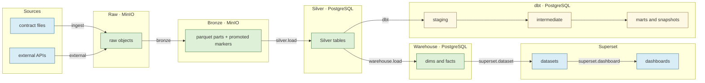

# Data lineage

Lineage answers two questions for every dataset in the platform: **where did it
come from** and **where does it go**. This document describes how the platform
derives that graph, what evidence each edge carries, how to reproduce it, and
why the OpenLineage backend was deferred.

- **Code:** [`src/mri/lineage/`](../../src/mri/lineage/) · **CLI:** `python -m apps.lineage`
- **Outputs:** `reports/lineage/lineage.json`, `reports/lineage/openlineage.jsonl`,
  `reports/lineage/lineage.mmd` (all gitignored operational artifacts)
- **Decision record:** [ADR-014](../decisions/ADR-014-data-lineage.md)

## Why two kinds of lineage

Some lineage is known before anything runs (the dbt graph, the warehouse load
SQL, the Superset seed, the Silver source routing). Some is only known once a
real run has happened (which file became which object, which batch was promoted,
which model actually executed). The platform keeps the two apart and labels
every edge, so it **never claims runtime lineage when only a design-time
declaration exists**.

| Kind | Meaning | Evidence |
| --- | --- | --- |
| `observed` | Both endpoints and the job were named by a real run. | `reports/observability/events.jsonl` + ingestion/Bronze manifests |
| `inferred` | The downstream dataset ran, the upstream was resolved from a declared mapping (dbt `parent_map`). | dbt `manifest.json` + executed nodes in `run_results.json` |
| `declared` | Exists in source-controlled configuration but was not exercised by the run. | `dbt/target/manifest.json`, `warehouse/schema.py`, `silver/ddl.py`, `dashboards/superset/seed.py` |
| `unavailable` | Referenced as an input, but no producing edge was found. | detected by `build.mark_unavailable` |

## Layers and namespaces

Datasets are addressed by `namespace:name`; the namespace encodes the system.

| Layer | Namespace | Example id |
| --- | --- | --- |
| source | `file` / `api` / `source` | `file:sales.csv`, `api:frankfurter_fx`, `source:sales` |
| raw | `minio` | `minio:retail-raw/raw/sales/sales__17b2…csv` |
| bronze | `minio` | `minio:retail-bronze/_promoted/sales/sales__17b2….json` |
| silver | `postgres` | `postgres:silver.sales` |
| dbt | `postgres` | `postgres:dbt_marts.fact_ventes` |
| warehouse | `postgres` | `postgres:warehouse.fact_ventes` |
| bi | `superset` | `superset:dataset.sales_analytics`, `superset:dashboard.Sales Performance` |

`file`/`api` are concrete run-time datasets (the actual file/endpoint); `source`
is the declared contract-level source *type* used for design-time routing.

## Where each edge comes from

| Transition | Job | Kind | Source of truth |
| --- | --- | --- | --- |
| source type → Silver table | `silver.load` | declared | `mri/silver/ddl.py:SOURCE_TABLES` |
| file → raw object | `ingest` | observed | ingestion manifest (`object_key`) |
| API → raw object | `external` | observed | `external` event `payload.object_key` |
| raw object → Bronze parts / promoted marker | `bronze` | observed | Bronze manifest (`part_keys`, `promoted_key`) |
| promoted marker → Silver table | `silver.load` | observed | `silver` event (`marker_key`, `target_table`) |
| Silver table → warehouse table / dim joins | `warehouse.load` | declared / observed | `render_load_statements` SQL; warehouse reconciliation events |
| Silver source → staging → intermediate → marts/snapshot | `dbt.<model>` | inferred (ran) / declared | dbt `manifest.json` `parent_map`; `run_results.json` |
| warehouse/audit table → Superset dataset | `superset.dataset` | declared | `dashboards/superset/seed.py` (parsed with `ast`) |
| Superset dataset → dashboard | `superset.dashboard` | declared | `dashboards/superset/seed.py` |

No edge is ever created by joining unrelated catalogs: the extractors read the
mapping that already exists (a manifest, a SQL statement, a `parent_map`).

## How the graph is built

```
Settings.from_env()
        │
        ├── declared:  SOURCE_TABLES ─ dbt manifest ─ warehouse load SQL ─ Superset seed
        ├── observed:  events.jsonl ─ ingestion/bronze manifests ─ dbt run_results
        │
        ▼
   promote dbt edges whose child ran      → inferred
   upgrade edges the run named end-to-end → observed   (strongest wins per key)
   flag referenced-but-unproduced inputs  → unavailable
        │
        ▼
   reports/lineage/{lineage.json, openlineage.jsonl, lineage.mmd}
```

Run ids, DAG run ids, batch ids, SHA-256 hashes and file/object keys are reused
verbatim from the existing audit surface — lineage is a *view*, not a second
tracking system.

## Reference diagram



The full per-dataset graph for a run is generated at
`reports/lineage/lineage.mmd` (thousands of nodes at `tiny` scale).

## Reproducing it

```powershell
# one real run, correlated under a single DAG run id
$dag = "dag__lineage_" + (Get-Date -Format "yyyyMMddTHHmmss")
uv run python -m apps.ingestion --dag-run-id $dag ingest --path data/generated/tiny --recursive
uv run python -m apps.ingestion --dag-run-id $dag external --source weather --source fx
uv run python -m apps.ingestion --dag-run-id $dag bronze --source all
uv run python -m apps.ingestion --dag-run-id $dag load --source all
uv run python -m apps.warehouse --dag-run-id $dag build
uv run python -m apps.dbt       --dag-run-id $dag build

# derive and inspect lineage
uv run python -m apps.lineage build --dag-run-id $dag
uv run python -m apps.lineage trace --dataset postgres:warehouse.fact_ventes --direction upstream
uv run python -m apps.lineage dags
```

## Real-run snapshot

The Phase 18 evidence run (`dag__lineage_20261010T182400`) produced:

| Metric | Value |
| --- | --- |
| datasets | 800 |
| edges | 782 |
| observed | 617 |
| inferred | 45 |
| declared | 56 |
| unavailable | 64 |
| layers (source/raw/bronze/silver/dbt/warehouse/bi) | 28 / 98 / 474 / 13 / 167 / 11 / 9 |
| OpenLineage RunEvents | 32 |
| dbt `build` | PASS=167 |

The 64 `unavailable` inputs are all honest partial-run gaps: 55 `raw_external`
and 8 `raw` objects were in Bronze (from earlier runs) but were not re-ingested
in this specific DAG run, plus `audit.load_audit` (the BI health source, which is
written by the Silver loader rather than a lineage-emitting job).

## OpenLineage evaluation

- `apache-airflow-providers-openlineage` (v2.14.0) requires
  `apache-airflow>=2.11`; this project runs Airflow 3.3.2, so it is installable
  in principle. It also pulls `openlineage-integration-common`,
  `openlineage-python>=1.41.0` and common-sql/common-compat providers, and —
  critically — **a collection backend such as Marquez to be useful**.
- Marquez is a JVM service plus a database: an always-on high-memory component.
  The phase mandate is explicit: do **not** upgrade the whole stack to install
  a lineage integration, and do **not** make a new high-memory service
  mandatory without measuring and justifying it.
- **Decision:** defer the backend. `apps.lineage build` emits a minimal,
  spec-shaped OpenLineage `RunEvent` stream (`openlineage.jsonl`, schema
  `https://openlineage.io/spec/2-0-2/OpenLineage.json#/definitions/RunEvent`,
  one line per observed job run plus one per executed dbt node) with stable
  UUIDv5 run ids and `parent` facets linking back to the Airflow DAG run. A
   future Marquez deployment can consume this file (or the same emitter can POST
  to a collector) without re-instrumenting any pipeline code.

## Guarantees and limitations

- **Truthful.** An edge is only `observed` when a real event/manifest named both
  endpoints; dbt inputs come from `parent_map`, never invented.
- **Partial runs are partial graphs.** Re-ingesting a file that Bronze already
  holds does not fabricate an ingest edge — the gap shows up as `unavailable`.
- **Two granularities coexist by design.** Declared routing is at source-type
  level (`source:sales → postgres:silver.sales`); observed lineage is at
  concrete file/object level (`file:sales.csv → minio:… → …`). Neither is
  presented as the other.
- **Superset lineage is design-time.** The seed script describes the intended
  datasets/dashboards; there is no recorded dashboard query log, so those edges
  are always `declared`.
- **Lineage is read-only.** Building it never writes to Postgres, MinIO or dbt.
