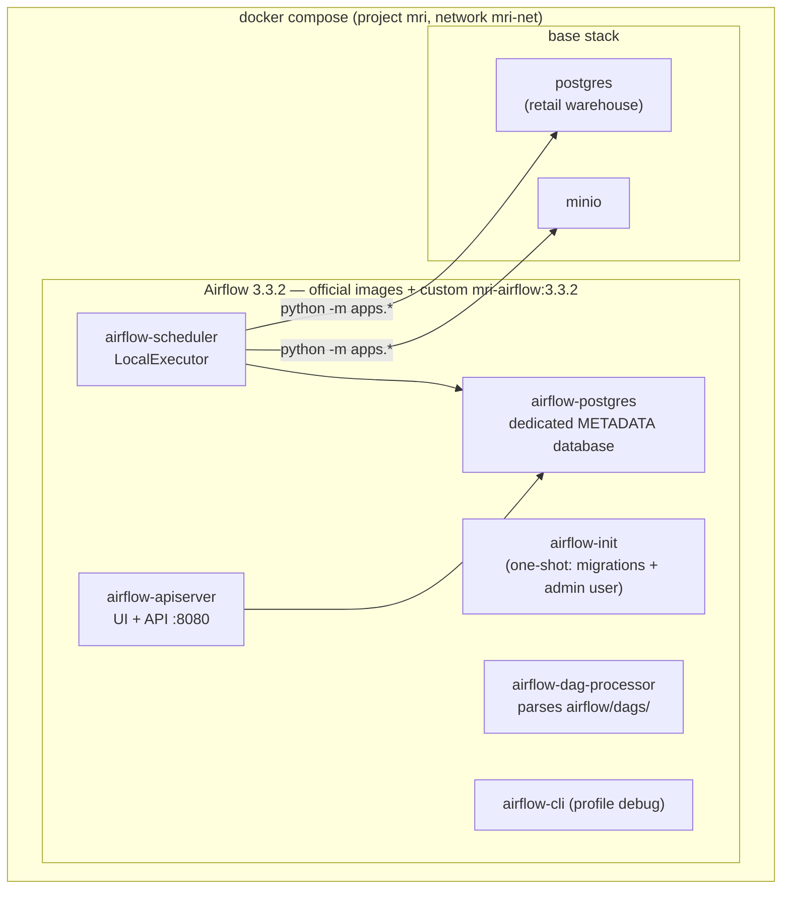
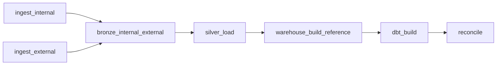

# Apache Airflow Orchestration (Phase 11)

> **Status: IMPLEMENTED.** Apache Airflow **3.3.2** (official containers,
> `LocalExecutor`) schedules and runs the end-to-end pipeline. The DAG contains
> **orchestration only** — every task shells out to an existing repository CLI,
> so all business logic stays in `src/mri/`, `apps/` and `dbt/`.

---

## 1. Architecture



| Service | Container | Role |
|---------|-----------|------|
| `airflow-init` | `mri-airflow-init-1` | one-shot: DB migrations + admin user, `exit 0` |
| `airflow-postgres` | `mri-airflow-postgres` | **dedicated** Airflow metadata DB (port 5434 on host) — never the retail warehouse |
| `airflow-apiserver` | `mri-airflow-apiserver` | Web UI + REST API on `http://localhost:8080` |
| `airflow-scheduler` | `mri-airflow-scheduler` | schedules **and executes** tasks in-process (`LocalExecutor`) |
| `airflow-dag-processor` | `mri-airflow-dag-processor` | parses `airflow/dags/*.py` |
| `airflow-cli` | `mri-airflow-cli` | on-demand CLI, `profiles: [debug]`, never auto-starts |

Deliberately **not** deployed: Redis, Celery worker, triggerer, flower — a
`LocalExecutor` deployment without deferrable operators needs none of them
(lightest official topology on a 7.8 GiB host).

**Images.** Airflow itself comes from the pinned official image
`apache/airflow:3.3.2-python3.12`. Pipeline tasks do **not** use Airflow's
Python: `infrastructure/docker/Dockerfile.airflow` extends the official image
with `ghcr.io/astral-sh/uv:0.12.1` and installs the project's locked
dependencies into an isolated `/opt/venv` (`uv sync --frozen --no-dev`, from
`uv.lock`). Airflow and providers keep the versions pinned by the base image;
the project resolves exactly like `uv run` on the host. Airflow is **never**
installed into the project's own Python environment.

**Addressing.** Everything runs on the shared `mri-net` network and talks to
services by Docker service name (`postgres`, `minio`, `airflow-postgres`,
`airflow-apiserver:8080`). Container environments override the mounted root
`.env` (which points at `localhost` from the host's perspective):
`POSTGRES_HOST=postgres`, `POSTGRES_PORT=5432`,
`MINIO_ENDPOINT=http://minio:9000`.

**DNS.** The Airflow services set `dns: [8.8.8.8, 1.1.1.1]` explicitly —
Docker Desktop's embedded resolver suffered a transient outage during Phase 11
acceptance (every external lookup failed with `Errno -2` for ~70 minutes),
which is documented in §7 and in ADR-009.

---

## 2. Quickstart

```bash
# start base stack + Airflow (UI: http://localhost:8080, user/password from .env)
docker compose --env-file .env \
  -f infrastructure/docker/docker-compose.yml \
  -f infrastructure/docker/docker-compose.airflow.yml up -d

# trigger the pipeline
docker exec mri-airflow-scheduler airflow dags trigger morocco_retail_pipeline

# watch runs / task states
docker exec mri-airflow-scheduler airflow dags list-runs morocco_retail_pipeline
docker exec mri-airflow-scheduler airflow tasks states-for-dag-run \
  morocco_retail_pipeline <run_id> -o plain

# stop Airflow only (metadata database is kept)
docker compose --env-file .env \
  -f infrastructure/docker/docker-compose.yml \
  -f infrastructure/docker/docker-compose.airflow.yml stop
```

Equivalent `make` targets: `airflow-up`, `airflow-down`, `airflow-ps`,
`airflow-trigger`, `airflow-runs`, `airflow-validate`.

---

## 3. The DAG: `morocco_retail_pipeline`

File: `airflow/dags/morocco_retail_pipeline.py` (the only DAG).



| Task | Command (from repo root, `/opt/venv/bin/python`) | Timeout |
|------|--------------------------------------------------|---------|
| `ingest_internal` | `python -m apps.ingestion ingest --path data/generated/tiny --recursive` | 30 min |
| `ingest_external` | `python -m apps.ingestion external --source weather --source fx` | 60 min |
| `bronze_internal_external` | `python -m apps.ingestion bronze --source all` | 60 min |
| `silver_load` | `python -m apps.ingestion load --source all` | 60 min |
| `warehouse_build_reference` | `python -m apps.warehouse build` | 45 min |
| `dbt_build` | `python -m apps.dbt build` | 60 min |
| `reconcile` | `python -m apps.dbt test --select assert_fact_row_counts assert_marts_match_warehouse` | 20 min |

* **Dependencies (6 edges):** both ingest tasks run **in parallel** into
  `bronze_internal_external`, then a single chain
  `silver_load → warehouse_build_reference → dbt_build → reconcile`.
* **Retries:** `retries=2`, `retry_delay=5 min` (from
  `MRI_DAG_RETRIES` / `MRI_DAG_RETRY_DELAY_MINUTES`) — bounded, never
  infinite. A failed upstream leaves every downstream task
  `upstream_failed`; nothing downstream is ever reported successful.
* **Timeouts:** per-task `execution_timeout` (table above) plus
  `dagrun_timeout=6h`.
* **Scheduling:** `MRI_DAG_SCHEDULE` (default `0 4 * * *`, **UTC** — the
  scheduler and all default args use `timezone.utc`), `catchup=False`,
  `max_active_runs=1`, paused at creation
  (`AIRFLOW__CORE__DAGS_ARE_PAUSED_AT_CREATION=true`).
* **Idempotence is delegated** to the existing layers (content-addressed raw
  batches, `already_fetched` external marker, `load_audit` registry,
  truncate-and-rebuild warehouse, deterministic dbt models). The DAG adds no
  duplicate-work prevention of its own.
* **Tasks are thin:** `BashOperator` only; no Python business logic in DAG
  code. `PATH` is prefixed with the venv `bin` so console scripts (`dbt`) are
  discoverable, exactly like `uv run` on the host.

---

## 4. Configuration (environment)

| Variable | Default | Meaning |
|----------|---------|---------|
| `MRI_DAG_SCHEDULE` | `0 4 * * *` | cron schedule (UTC) |
| `MRI_DAG_RETRIES` | `2` | retries per task |
| `MRI_DAG_RETRY_DELAY_MINUTES` | `5` | delay between retries |
| `MRI_REPO_ROOT` | `/opt/airflow/mri` | repository mount in the container |
| `MRI_PYTHON` | `/opt/venv/bin/python` | project interpreter in the container |
| `AIRFLOW_ADMIN_USER` / `AIRFLOW_ADMIN_PASSWORD` | `airflow` / (see `.env`) | UI/API account created by `airflow-init` |
| `AIRFLOW_WEBSERVER_PORT` | `8080` | UI port on the host |
| `AIRFLOW__CORE__FERNET_KEY`, `AIRFLOW_JWT_SECRET` | (see `.env`) | encryption/JWT secrets, generated per install |

Secrets are delivered via environment variables only — never hardcoded in DAGs.

---

## 5. DAG tests (real Airflow, asserted from the host)

The host has **no** Airflow installation by design. The DAG is validated with
the real Airflow Python API **inside the scheduler container**:

* `tests/airflow/validate_dag.py` — loads the DAG with `airflow.models.DagBag`
  and checks: no import errors, exact 7 task IDs, exact 6 edges, no cycles
  (Kahn), all tasks are `BashOperator`, retries, execution timeouts,
  `catchup=False`, `max_active_runs=1`, configured schedule. Emits `--json`.
* `tests/integration/test_airflow_dag.py` — runs the validator via
  `docker compose exec -T airflow-scheduler python ... --json` and asserts the
  JSON strictly; it skips cleanly when Docker/the stack is unavailable.

```bash
uv run pytest tests/integration/test_airflow_dag.py -q    # host side
make airflow-validate                                      # same check, human-readable
```

---

## 6. Acceptance runs (2026-10-08)

| Run | Result | Wall time | Notes |
|-----|--------|-----------|-------|
| `manual__2026-10-08T14:40:57...` | failed | ~72 min | `ingest_external` failed 3× — Docker Desktop DNS outage (`Errno -2`); downstream correctly `upstream_failed`. Fixed by explicit `dns:` in compose. |
| `manual__2026-10-08T16:16:40...` | failed | ~12 min | 6/7 tasks green; `dbt_build` failed 3× because the task `PATH` lacked the venv `bin`; fixed in `_bash()` (PATH prefix), retried with bounded retries as designed. |
| `manual__2026-10-08T16:32:27...` | **success** | **2 min 05 s** | all 7 tasks green — the Phase 11 acceptance run |
| `manual__2026-10-08T16:38:34...` | **success** | 1 min 54 s | idempotence run: 23/24 tables bit-identical vs the acceptance run; only append-only `audit.load_audit` grew (+41 `skipped` entries) |

`reconcile` (dbt `assert_fact_row_counts` + `assert_marts_match_warehouse`)
passed inside both successful runs, and `dbt build` reports `PASS=167
WARN=0 ERROR=0` — the orchestrated result agrees with the CLI pipeline.

> **Phase 16 / 21 update.** The DAG was extended from **7 to 8 tasks** in Phase 16
> with the `audit_airflow_run` task (canonical audit event emission). The Phase 21
> final acceptance audit re-ran the DAG twice more, both `success` (8/8 tasks),
> and proved byte-level idempotency of all 36 data tables — see
> [`docs/reports/final-acceptance.md`](../reports/final-acceptance.md). The
> acceptance runs in the table above are the historical Phase 11 runs (7 tasks at
> the time).

---

## 7. Memory & resource impact (observed, Docker Desktop VM limit 3.73 GiB/container)

| Container | Idle | During run (peak) |
|-----------|------|-------------------|
| `mri-airflow-scheduler` | ~523 MiB | ~713 MiB (CPU ~100% while scheduling/executing) |
| `mri-airflow-apiserver` | ~311 MiB | ~310 MiB |
| `mri-airflow-dag-processor` | ~226 MiB | ~232 MiB |
| `mri-airflow-postgres` | ~52 MiB | ~51 MiB |
| **Airflow layer total** | **~1.11 GiB** | **~1.31 GiB** |
| full stack (incl. `mri-postgres` ~61 MiB, `mri-minio` ~193 MiB) | ~1.36 GiB | ~1.55 GiB |

The Airflow layer fits comfortably next to the existing stack on the 7.8 GiB
host; PostgreSQL and MinIO were unaffected throughout.

---

## 8. Troubleshooting

* **UI not reachable** — check `docker ps` (apiserver healthy), then
  `... exec airflow-apischeduler ...`; logs:
  `... logs airflow-apiserver` / `airflow-scheduler`.
* **Task fails with `Name or service not known`** — container DNS. The
  `dns: [8.8.8.8, 1.1.1.1]` override avoids Docker Desktop's embedded
  resolver; if it recurs, `docker restart` the affected container and re-run
  the task (`airflow tasks clear` or trigger a new run — runs are pinned to
  the DAG version at trigger time).
* **Task fails with `dbt executable not found`** — the venv `bin` is not on
  `PATH`; this is handled by `_bash()` in the DAG (prefix
  `PATH=/opt/venv/bin:$PATH`).
* **A run is pinned to an old DAG version** — Airflow 3 versions DAGs per
  run; edit + wait for the dag-processor re-parse (~30 s), then trigger a
  **new** run (in-progress/failed runs keep the code they started with).
* **Unpausing created a run for today's schedule** — observed behaviour when
  a cron time already passed on the day of unpausing; with `catchup=False` only
  that single interval fires, nothing older.
