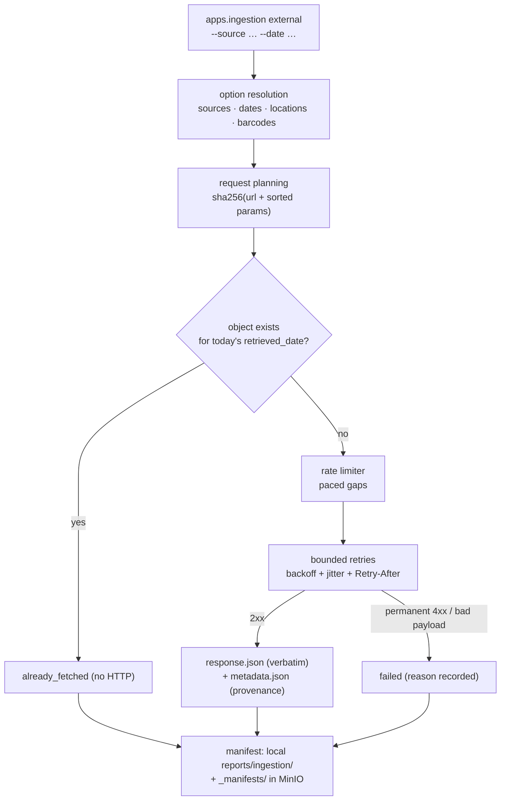

# External API Ingestion (Phase 05)

> **Status: IMPLEMENTED (Phase 05).** `src/mri/ingestion/clients/` +
> `src/mri/ingestion/external.py` + the `external` subcommand of
> `apps/ingestion` fetch **three keyless public APIs** (Open-Meteo, Frankfurter,
> Open Food Facts) and store their **verbatim JSON responses plus provenance
> metadata** in MinIO `raw_external/`. This phase stops at the raw layer — no
> normalization, no database, no warehouse. Normalizing these responses into
> Bronze landed in **Phase 07** ([`external-bronze.md`](external-bronze.md)).

---

## 1. What it does



1. **Plan** — resolve sources, dates, locations (or barcodes) into concrete
   requests; hash `URL + sorted query params` into a `request_hash`.
2. **Skip or fetch** — if `raw_external/.../request_hash=<hash>/response.json`
   already exists for today's `retrieved_date`, the record is
   `already_fetched` and no HTTP call is made.
3. **Fetch politely** — requests are paced by a rate limiter, retried with
   bounded exponential backoff, and `Retry-After` is honoured.
4. **Store verbatim** — the exact response bytes go to `response.json`;
   a `metadata.json` sidecar records provenance (endpoint, params, HTTP facts,
   sha256, auth mode, client behaviour, source-specific context).
5. **Record** — one manifest per run (local + uploaded), counts per outcome.

Outcomes: `fetched`, `already_fetched`, `failed`, `planned` (dry-run).

---

## 2. Sources

| Source id (`--source`) | Endpoint | Request | Why keyless |
|------------------------|----------|---------|-------------|
| `weather-history` (`open_meteo_history`) | `https://archive-api.open-meteo.com/v1/archive` | `latitude`, `longitude`, `start_date`, `end_date`, `daily=…`, `timezone=Africa/Casablanca` | Open-Meteo: free for non-commercial use |
| `weather-forecast` (`open_meteo_forecast`) | `https://api.open-meteo.com/v1/forecast` | `latitude`, `longitude`, `daily=…`, `forecast_days` (1–16), `timezone=Africa/Casablanca` | same |
| `fx` (`frankfurter_fx`) | `https://api.frankfurter.dev/v2/rates` | `base=EUR`, `quotes=MAD,USD,GBP`, `date` or `start_date`/`end_date` | ECB reference rates, no key |
| `products` (`openfoodfacts_products`) | `https://world.openfoodfacts.org/api/v3/product/<barcode>.json` | barcode in the path | open database, rate-limited |

Aliases: `all` = `weather` (history + forecast) + `fx` + `products`.

Details that shape the client code:

- **Open-Meteo** returns `{"error":true,"reason":…}` with HTTP 400 for invalid
  input; daily variables and `timezone` are requested explicitly, `timeformat=iso8601`.
  Historical and forecast are separate endpoints, hence two source ids.
- **Frankfurter v2** returns a list of `{date, base, quote, rate}` records;
  **MAD is listed** in `/v2/currencies`. An empty series is rejected.
- **Open Food Facts** caps product reads at **15 requests/min/IP** (search: 10/min),
  requires a **custom User-Agent carrying a contact address**, answers
  `{"code":…, "errors":[…], "product":null}` when a barcode is unknown, and may
  return `503` when globally rate-limited (retried).

Locations come from `src/mri/ingestion/clients/locations.py`: the 12 project
regions with their chief city's real WGS84 coordinates, kept consistent with the
synthetic generator's `CITIES`/`REGIONS`. Selectors accept region id (`R01`),
region name or city; default is all 12 regions.

---

## 3. Object layout

```
bucket: retail-raw
└── raw_external/
    └── source=<source>/                      # open_meteo_history | open_meteo_forecast
        └── retrieved_date=YYYY-MM-DD/        #      frankfurter_fx | openfoodfacts_products
            └── request_hash=<sha256>/
                ├── response.json             # verbatim provider bytes
                └── metadata.json             # provenance sidecar
```

`request_hash` = SHA-256 of the URL plus the **sorted query parameters** — it
identifies the *request*, not the response:

- same day + same request → `already_fetched` (no HTTP, no write);
- next day + same request → a fresh fetch under a new `retrieved_date`;
- any parameter change → a different hash and therefore a new object.

Raw responses are never rewritten; corrections happen downstream.

---

## 4. Retry & rate-limit policy

| Knob | Value |
|------|-------|
| Max attempts per request | 4 (`EXTERNAL_MAX_ATTEMPTS`) |
| Backoff | `0.5 · 2^(n-1)` s, capped at 30 s, ±25 % jitter |
| `Retry-After` | honoured on 429/503, capped at 60 s |
| Retryable statuses | `429, 500, 502, 503, 504` + Cloudflare origin errors `520–524` + timeouts/network errors |
| Never retried | any other 4xx, invalid JSON, unexpected/empty payloads |
| Per-client pacing | weather 1.0 s, Frankfurter 1.0 s, Open Food Facts 4.1 s (`OPEN_FOOD_FACTS_MIN_INTERVAL`, ≈14.6 req/min < 15 req/min cap) |
| Request timeout | 20 s (`EXTERNAL_TIMEOUT_SECONDS`) |
| Sleep/clock | injectable — unit tests never actually sleep |

Failures do not abort the run: a request that exhausts its retries becomes a
`failed` record with a reason (`http_503`, `timeout`, `invalid_json`, …) while
the remaining requests continue; the process exits `1` if anything failed.

---

## 5. Provenance metadata

`metadata.json` (schema_version `1.0.0`) contains:

| Field | Content |
|-------|---------|
| `kind` / `source` / `data_type` | `external_api_ingestion`, source id, payload type |
| `run_id` | ties the object to its run manifest |
| `endpoint`, `request` | full URL and sorted query parameters |
| `request_hash`, `response.sha256` | request identity and payload digest |
| `retrieved_at`, `retrieved_date` | UTC fetch timestamp (day = partition) |
| `http` | status, attempts, elapsed_ms, content-type |
| `auth` | `{"mode": "none", "api_key_required": false}` — proves no secrets are involved |
| `client` | library (`httpx`), timeout, retries, pacing, min interval |
| `context` | provider-specific notes (licence note, forecast horizon, `Africa/Casablanca`, …) |
| `result` | products only: `found` / `not_found` (unknown barcodes are *stored*, not skipped) |
| `mapping` | products only — see §7 |

---

## 6. CLI

```bash
# plan everything without network or writes (exit 0)
python -m apps.ingestion external --source all --dry-run --json

# weather: one region for one historical day + a 3-day forecast
python -m apps.ingestion external --source weather --location Casablanca \
    --date 2026-09-27 --forecast-days 3

# FX: a single day, or a date range
python -m apps.ingestion external --source fx --date 2026-10-06
python -m apps.ingestion external --source fx --start-date 2026-10-01 --end-date 2026-10-07

# products: explicit barcodes, a file, or an internal index for mapping
python -m apps.ingestion external --source products --barcode 3017620422003
python -m apps.ingestion external --source products --barcode-file barcodes.txt \
    --internal-products data/generated/tiny/products/products.csv

# everything, machine-readable
python -m apps.ingestion --json external --source all
```

| Option | Meaning |
|--------|---------|
| `--source NAME` | repeatable; `all` (default), `weather`, `weather-history`, `weather-forecast`, `fx`, `products` |
| `--date` / `--start-date` / `--end-date` | `YYYY-MM-DD`; `--date` = one day, range = multi-day (weather/FX) |
| `--location SEL` | repeatable region id/name/city (weather; default: all 12) |
| `--limit N` | cap the number of units (locations/barcodes) |
| `--barcode GTIN` / `--barcode-file PATH` | product barcodes (8–14 digits, one per line, `#` comments) |
| `--forecast-days N` | forecast horizon, 1–16 (default 7) |
| `--internal-products PATH` | CSV `barcode,product_id` used for exact mapping |
| `--dry-run` | plan requests only: no HTTP, no object writes, no manifest |
| `--json` (global) | machine-readable run report |

Exit codes: `0` ok · `1` at least one fetch failed · `2` usage error (unknown
source/location, malformed date, `--limit < 1`, `--source products` without any
barcode).

---

## 7. Product matching (exact, read-only)

Open Food Facts data is **enrichment only** — the internal product dimension is
never modified. Mapping is **exact barcode equality** (never fuzzy):

| Situation | `mapping_status` |
|-----------|------------------|
| Barcode found and present in `--internal-products` | `MATCHED` (carries `product_id`) |
| Barcode found, no internal index / no match | `NEW` |
| Barcode not found in Open Food Facts | `UNMATCHED` |

The mapping lives under `mapping` inside `metadata.json`, so the raw response
and its interpretation are always stored together. Without an
`barcode,product_id` index every found barcode is `NEW` — the internal
products carry `product_id` like `P000001` but **no barcode column** yet.

---

## 8. Configuration

| Variable | Default | Purpose |
|----------|---------|---------|
| `OPEN_METEO_BASE_URL` / `OPEN_METEO_ARCHIVE_BASE_URL` | provider URLs | override for tests/mirrors |
| `FRANKFURTER_BASE_URL` | `https://api.frankfurter.dev` | same |
| `OPEN_FOOD_FACTS_BASE_URL` | `https://world.openfoodfacts.org` | same (staging `world.openfoodfacts.net` unused) |
| `EXTERNAL_CONTACT_EMAIL` | — | contact embedded in the default User-Agent |
| `EXTERNAL_USER_AGENT` | `MoroccoRetailIntelligence/0.1.0 (<contact>)` | sent on every request |
| `EXTERNAL_RAW_PREFIX` | `raw_external` | object prefix inside the raw bucket |
| `EXTERNAL_TIMEOUT_SECONDS` | `20` | per-request timeout |
| `EXTERNAL_MAX_ATTEMPTS` | `4` | bounded retries |
| `OPEN_FOOD_FACTS_MIN_INTERVAL` | `4.1` | seconds between product reads |

**No API keys exist for any of the three providers** — `auth` in every metadata
file records `none`. Base URLs are overridable so tests and mirrors never
require code changes.

---

## 9. Testing

| Suite | Coverage |
|-------|----------|
| `tests/unit/test_external_clients.py` | request shapes per source, location resolution (consistency with the generator), success/timeout/429/5xx/Cloudflare/4xx paths, invalid JSON, unexpected & empty payloads, barcode validation, mapping rules, backoff/`Retry-After`/rate-limiter behaviour |
| `tests/unit/test_external_pipeline.py` | source aliases, hash stability, key layout, barcode/index loaders, dry-run (no HTTP, no writes), verbatim write + provenance assertions, same-day idempotence, failure-continues, manifest local + uploaded |
| `tests/unit/test_external_cli.py` | subcommand exit codes, usage errors (exit 2), human/JSON output, dry-run vs write paths (stubbed clients, in-memory store) |
| `tests/integration/test_external_minio.py` | real MinIO round-trip with stubbed HTTP; skips when MinIO is unreachable, cleans its test bucket |
| `tests/smoke/test_external_live.py` | **one tiny live call per provider**, in-memory only; skipped unless `MRI_LIVE_SMOKE=1` |

```bash
uv run pytest                                   # offline suite (network never needed)
MRI_LIVE_SMOKE=1 uv run pytest tests/smoke -q    # optional live smoke, or: make smoke-external
```

---

## 10. Explicitly out of scope (later phases)

Bronze normalization/Parquet, database loading, Great Expectations suites, dbt
models, Airflow orchestration, Superset dashboards and observability are **not**
part of Phase 05 — this phase ends at verbatim raw JSON in MinIO. (Bronze
normalization for these responses was implemented in Phase 07:
[`external-bronze.md`](external-bronze.md).)
