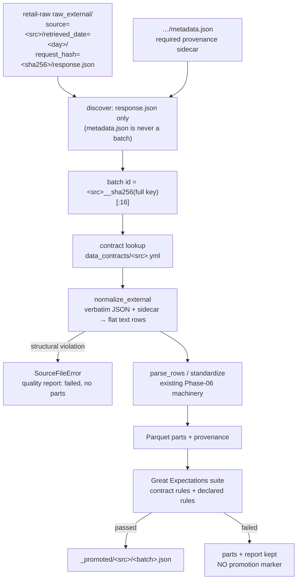

# External Bronze (Phase 07)

> **Status: IMPLEMENTED (Phase 07).** `src/mri/ingestion/external_bronze.py`
> plus contract-driven extensions to `bronze.py` and `quality.py` normalize the
> verbatim `raw_external/` responses fetched in Phase 05 into the same Bronze
> contract as internal sources: strictly typed Parquet with provenance, a Great
> Expectations gate per batch, marker-based promotion. RAW stays immutable and
> the metadata sidecar is a required input — a response without provenance
> never reaches Parquet.

---

## 1. What it does



For every `response.json` object the pipeline:

1. **Discovers** external keys under `raw_external/` alongside `raw/` — the
   sibling `metadata.json` is *never* discovered as a batch (it falls through
   the internal branch and is skipped as a non-contract key).
2. **Requires the sidecar.** A missing `metadata.json` is a
   `SourceFileError` (`missing metadata sidecar`): the batch fails with a
   quality report and no parts — provenance is not optional.
3. **Normalizes** the verbatim payload with its source-specific normalizer in
   `external_bronze.py` into flat, all-text rows whose keys are exactly the
   contract columns. Structural violations (wrong shape, array length
   mismatch, undeterminable keys, invalid `mapping_status`, empty result) are
   fatal for the batch.
4. **Feeds the existing machinery**: `parse_rows` → strict standardization →
   partitioned Parquet + provenance → the standard GX suite built from the
   contract's generic rules, its `quality.declared` rules and its
   referential checks (weather → `regions`).
5. **Promotes** only on a full pass: `_promoted/<src>/<batch>.json`.

Nothing in Phase 06 was rewritten — external handling was added around the
same gates (`docs/pipeline/bronze-layer.md` still describes the core).

---

## 2. Contracts

Four new YAML contracts (`data_contracts/`, all `version: 1.0.0`,
`owner: external-api`, `format.types: [json]`). The contract **id equals the
storage source id** — that is what the dispatcher looks up.

| Contract id | PK | Rows / batch | Declared rules (highlights) |
|-------------|----|--------------|------------------------------|
| `open_meteo_history` | `region_id`, `observation_date` | one row per daily observation | date window 1940…2100, lat −90…90 · lon −180…180 · temps −80…60 °C · `tmax ≥ tmin` · precipitation ≥ 0 · hours 0…24 · wind ≥ 0 · code 0…99 |
| `open_meteo_forecast` | `region_id`, `forecast_date` | one row per forecast day | identical measure rules, on `forecast_date` |
| `frankfurter_fx` | `date`, `base`, `quote` | one row per rate | `rate > 0` (strict), `base ∈ {EUR}`, `quote ∈ {GBP, MAD, USD}`, date window 1999…2100 |
| `openfoodfacts_products` | `external_product_id` | **one row per response** (one barcode per fetch) | barcode `^[0-9]{8,14}$`, `mapping_status ∈ {MATCHED, NEW, UNMATCHED}`, nova 1…4, energy 0…900 kcal, fat/sugars/proteins/salt 0…100 g/100 g |

Why not reuse the internal contracts (`products`, `weather_daily`, …): the
verbatim fetch payloads are *request-shaped*, not entity-shaped (daily weather
arrays, FX rate lists, one product + mapping sidecar), and their keys differ.
That deviation is recorded in [`ADR-005`](../decisions/ADR-005-external-bronze-contracts.md).

---

## 3. Normalization rules

`normalize_external(source, payload_bytes, metadata_bytes, contract)` is the
single entry point; each source has a dedicated private normalizer.

### Weather (history + forecast)

* Payload must be an object with a `daily.time` list plus each of the six
  canonical daily variables (`weather_code`, `temperature_2m_max`,
  `temperature_2m_min`, `precipitation_sum`, `precipitation_hours`,
  `wind_speed_10m_max`) as a list of **exactly `len(time)` values** — one row
  per index, variable → column 1:1.
* The date cell must be a string (anything else is fatal); which column it
  lands in is fixed by the source (`open_meteo_history` → `observation_date`,
  `open_meteo_forecast` → `forecast_date`).
* Required sidecar context: `context.location` (`region_id`, `region_name`,
  `city`, and coordinate fallback), `context.timezone` (fallback
  `payload.timezone`), `retrieved_at` → `retrieval_time`, and `data_type`
  carried through as its own column.
* Coordinates come from the payload first (`latitude`/`longitude`), falling
  back to the sidecar location; payload *and* sidecar without coordinates is
  fatal.
* Weather measures are **nullable** in the contract (`Float64` in Parquet);
  the pair rule `tmax ≥ tmin` skips rows where either side is null
  (`ignore_row_if="either_value_is_missing"`), so an incomplete day passes
  instead of failing the batch.

### FX

* Payload must be a non-empty list of objects; each becomes one row of
  `date`/`base`/`quote`/`rate`. `rate` must be numeric (`bool` excluded);
  a string, null or missing rate is structural and fatal for the batch.
* Rows derive from the payload only — the sidecar is mandatory for
  provenance but is never used to default cells: a missing `base`/`quote`
  reaches the standardizer as a null and fails the contract's not-null +
  `base in {EUR}` rules instead of being invented here.

### Open Food Facts

* Payload: `code` + `product` object. `external_product_id` resolves
  sidecar-first (`mapping.external_product_id`, then `payload.code`, then
  `product.code`); none present is fatal. `status: failure` / empty
  `product` is a valid *not-found* response: it normalizes to a single row
  with nullable measures and `mapping_status = UNMATCHED`.
* **`mapping_status` is read from the sidecar first**
  (`mapping.mapping_status`, validated against `{MATCHED, NEW, UNMATCHED}`);
  only when the sidecar omits it is it derived (`NEW` when
  `metadata.result == "found"` or the product object is non-empty,
  `UNMATCHED` otherwise).
* One response = one row: Bronze batches are per-response objects, so the
  product batch granularity is a single barcode.

### What is *not* normalized

Provenance and client facts (`retrieved_at`, retries, latency, `auth`, HTTP
status, resolution path, `source_hash` of the response, …) stay in
`metadata.json` at RAW and in the standard five provenance columns at Bronze;
they are never duplicated into contract columns.

---

## 4. Object layout

```
bucket: retail-raw                                    (read-only for Bronze)
└── raw_external/source=<src>/retrieved_date=<day>/request_hash=<sha256>/
    ├── response.json                                 immutable input (the batch)
    └── metadata.json                                 required sidecar (never a batch)

bucket: retail-bronze
├── bronze/<src>/part-<src>__<keyhash16>.parquet      unpartitioned (all 4 sources)
├── bronze/_quality/<run_id>/<src>/<batch>.json       machine-readable report
├── bronze/_promoted/<src>/<batch>.json               promotion marker (pass only)
└── bronze/_manifests/<run_id>.json                   audit trail per run
```

* **Batch id** = `<source>__sha256(full response key)[:16]` — the response key
  itself is content-derived (`request_hash` of the request), and hashing the
  full key keeps the "batch id = raw object stem" convention identical to
  internal sources. The same object always maps to the same part keys.
* **Provenance**: identical five columns as internal batches, with
  `source_file` = the full `raw_external/…/response.json` key, so every
  Parquet row traces back to the exact verbatim object *and* its sidecar.

---

## 5. Quality rules

Suite composition is unchanged (generic contract rules → declared rules →
referential checks); only the declared-rule table grew:

| Source | Declared expectations (GX) |
|--------|----------------------------|
| `open_meteo_history` / `open_meteo_forecast` | `<date> between 1940-01-01 and 2100-12-31` (as `datetime` bounds) · lat −90…90 · lon −180…180 · temps −80…60 · `tmax ≥ tmin` (null-skipping pair) · precipitation ≥ 0 · precip hours 0…24 · wind ≥ 0 · weather code 0…99 |
| `frankfurter_fx` | `date between 1999-01-01 and 2100-12-31` · `base ∈ {EUR}` · `quote ∈ {GBP, MAD, USD}` · `rate > 0` (`strict_min`) |
| `openfoodfacts_products` | `external_product_id matches ^[0-9]{8,14}$` · `mapping_status ∈ {MATCHED, NEW, UNMATCHED}` · nova 1…4 · energy 0…900 · fat/sugars/proteins/salt 0…100 |

Weather also runs the **referential check** `region_id → regions.region_id`
(skipped with a note when the dimension is absent, exactly like internal
sources). Every `quality.declared` line in the four YAMLs maps 1:1 onto one
of these expectations — the string in the contract is the same string passed
to `add()` in `quality.py`.

---

## 6. Failure handling

| Situation | Parts | Quality report | Promotion marker |
|-----------|-------|----------------|------------------|
| Normalization + GX pass, no rejected rows | written | `status: passed` | `_promoted/…` ✅ |
| Missing `metadata.json` sidecar | none | `failed` — `missing metadata sidecar` | absent |
| Structural payload violation (shape, length, key, rate type, …) | none | `failed` — `SourceFileError` reason | absent |
| Conversion rejected a row (e.g. null date) | written | `failed` — `N row(s) rejected` | absent |
| GX rule fails (e.g. `rate > 0`) | written (debugging) | `failed` + failed expectations | absent |
| `--dry-run` | none | none | none |

Same contract as Phase 06: never promote, never discard, RAW untouched
byte-for-byte (asserted by unit and integration tests).

---

## 7. CLI

No new subcommand — the existing `bronze` command discovers both families:

```bash
python -m apps.ingestion bronze --source all                    # internal + external
python -m apps.ingestion bronze --source open_meteo_history \
    --source frankfurter_fx                                      # external only
python -m apps.ingestion --json bronze --source openfoodfacts_products --dry-run
```

`--source all` (default) runs everything; explicitly naming a source with no
objects is still a usage error (`no raw objects for source(s)`). Exit codes
are unchanged: `0` ok · `1` any batch failed · `2` usage.

---

## 8. Idempotence

Identical mechanism to internal batches: the batch id is content-derived, so a
rerun finds existing parts → outcome `already_bronzed`, the GX suite is
re-evaluated every run, and the marker is rewritten with the new `run_id`.
Live-validated: the second run reported `bronzed=0 already_bronzed=5`, and a
full `--source all` run reported `already_bronzed=16` (11 internal + 5
external).

---

## 9. Tests

* `tests/unit/test_external_bronze.py` — contract shapes; normalization of all
  four sources (including not-found products and mapping-sidecar authority);
  six structural-failure modes → `SourceFileError`; key helpers and batch-id
  stability; full in-memory promotion of all five real-shaped batches with
  provenance/quality/markers/raw-immutability; `metadata.json` never
  discovered; failed declared rule blocks promotion; rejected row blocks
  promotion; missing sidecar blocks promotion; idempotent rerun; dry-run
  planning; nullable weather pair promotion; internal + external
  co-discovery.
* `tests/integration/test_external_bronze_minio.py` — live MinIO: isolated
  bucket pair, verbatim seeded responses, full round-trip (Parquet readable,
  raw bytes identical before/after, markers written), failure case keeps
  report + parts without a marker; skips when MinIO is unreachable.
* Contract-count assertions in `tests/unit/test_ingestion.py` and
  `tests/unit/test_ingestion_cli.py` updated to 14 contracts.

---

## 10. Live validation (2026-10-07)

```bash
python -m apps.ingestion bronze --source open_meteo_history \
  --source open_meteo_forecast --source frankfurter_fx --source openfoodfacts_products
# run 1: bronzed=5 failed=0 quality passed=5 promoted=5
# run 2: bronzed=0 already_bronzed=5 (idempotent)
python -m apps.ingestion bronze --source all
# already_bronzed=16 (11 internal + 5 external)
```

Reports: fx `14/0`, weather `37/0` each, products `34/0` + `33/0`
expectations passed/failed, zero skipped expectations, zero rejected rows.

---

See also: [`bronze-layer.md`](bronze-layer.md) ·
[`data-quality.md`](data-quality.md) ·
[`external-apis.md`](external-apis.md) ·
[`ADR-005`](../decisions/ADR-005-external-bronze-contracts.md)
