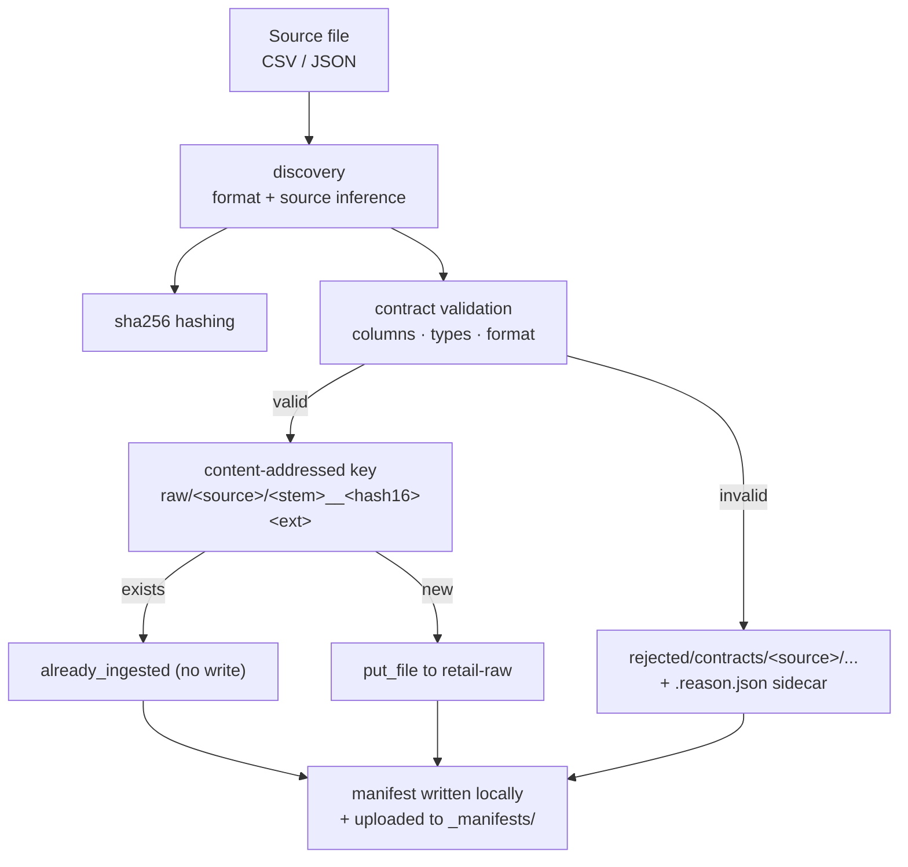

# File Ingestion (Phase 04)

> **Status: IMPLEMENTED (Phase 04).** `src/mri/ingestion/` + `apps/ingestion`
> ingest CSV/JSON source files into MinIO `raw/` storage under versioned
> source contracts, with validation, rejection handling, content-addressed
> idempotence and per-run manifests.

---

## 1. What it does



1. **Discover** — a file or directory of `.csv` / `.json` files. The source id
   is explicit (`--source sales`) or inferred from the filename (`sales.csv`,
   `sales_2021.csv` → `sales`). Files that cannot be attributed (e.g. the
   generator's `manifest.json`) are skipped.
2. **Hash** — a streaming SHA-256 of the file content.
3. **Validate** — against the contract in `data_contracts/<source>.yml`.
4. **Route** — valid files are uploaded under a content-addressed key; invalid
   files are uploaded to the rejected area with a machine-readable reason.
5. **Record** — one manifest per run: counts, per-file outcome, hashes, keys.

---

## 2. Object layout

```
bucket: retail-raw
├── raw/<source>/<stem>__<sha256[:16]><ext>          immutable source data
├── rejected/contracts/<source>/<stem>__<hash><ext>   quarantined files
│   └── <same>.reason.json                            why they were rejected
└── _manifests/<run_id>.json                          audit trail per run
```

`<stem>` keeps the original filename stem (sanitised), and the hash suffix makes
the key **content-addressed** — the same bytes always map to the same key, so
re-ingesting is a no-op (`already_ingested`) and a *different* payload for the
same name lands under a different key instead of silently overwriting the raw
object. This satisfies the raw-data rule *never mutate what is already stored*.

---

## 3. Validation scope

Enforced in Phase 04:

| Check | Issue code |
|-------|-----------|
| Format allowed by the contract | `FORMAT_NOT_ALLOWED` |
| Required columns present | `MISSING_COLUMN` |
| Null in a non-nullable column | `MISSING_VALUE` |
| Value matches its declared type | `TYPE_MISMATCH` |
| Unreadable / malformed file | `SourceFileError` (throws) |

Type checks run against a bounded sample (first 1000 data rows for CSV); the row
count is always a full stream count. Uniqueness, ranges and referential
integrity are **declared** in each contract under `quality.declared` but are
enforced later by Great Expectations, not here.

Value typing: `string`, `integer`, `number`, `boolean`, `date` (ISO-8601).
`integer`/`number` reject booleans; `date` accepts `YYYY-MM-DD`.

---

## 4. CLI

```bash
# list loaded contracts
python -m apps.ingestion contracts [--json]

# validate without uploading (exit code 1 when anything is invalid)
python -m apps.ingestion validate --source sales --path data/generated/tiny
python -m apps.ingestion validate --path data/generated/tiny --recursive

# ingest (upload + manifest + rejection handling)
python -m apps.ingestion ingest --source sales --path data/generated/tiny/sales/sales.csv
python -m apps.ingestion ingest --path data/generated/tiny --recursive

# plan only: validate + compute keys, touch nothing
python -m apps.ingestion ingest --source sales --path sales.csv --dry-run

# inspect local run manifests
python -m apps.ingestion manifest --list
python -m apps.ingestion manifest --run-id <run_id> [--json]
```

Global flags: `--json` for machine-readable output, `--contracts-dir` to point
at another contract directory, `--expect-version 1.0.0` to assert a contract
version.

Exit codes: `0` success, `1` one or more files invalid/rejected, `2` usage or
configuration error (missing contract, missing MinIO credentials, bad path).

---

## 5. Configuration

| Variable | Default | Purpose |
|----------|---------|---------|
| `MINIO_ENDPOINT` | `http://localhost:9000` | scheme selects secure/insecure |
| `MINIO_ACCESS_KEY` / `MINIO_SECRET_KEY` | — | required for non-dry-run ingestion |
| `MINIO_BUCKET_RAW` | `retail-raw` | raw + rejected + manifest bucket |
| `MINIO_BUCKET_BRONZE` | `retail-bronze` | reserved for the next phase |
| `data_contracts/` | `<repo>/data_contracts` | contract directory |
| `reports/ingestion/` | `<repo>/reports/ingestion` | local manifests (gitignored) |

Values are resolved as: process environment → repository `.env` → default.
Credentials are never printed.

---

## 6. Idempotence & determinism

- The same file bytes ⇒ same SHA-256 ⇒ same key ⇒ `already_ingested` on re-run.
- A rejected file always produces a record with `outcome="rejected"`; the reason
  sidecar names the contract version and every issue found.
- Run ids are `<UTC timestamp>-<8 hex>`, so manifests sort chronologically and
  never collide.
- `--dry-run` performs discovery, hashing and validation but performs **no**
  storage writes and does not write a manifest.

---

## 7. Testing

| Suite | Coverage |
|-------|----------|
| `tests/unit/test_ingestion.py` | contract loading, source inference, validation rules, pipeline ingest/idempotence/rejection/dry-run |
| `tests/unit/test_ingestion_cli.py` | CLI exit codes and human/JSON output |
| `tests/integration/test_ingestion_minio.py` | real MinIO round-trip; skips when MinIO is unreachable, cleans its test bucket |

```bash
uv run pytest
```

---

## 8. Explicitly out of scope (later phases)

External REST API connectors, Airflow orchestration, dbt models, the final
warehouse schema, Superset dashboards, Prometheus/Grafana observability, and
Great Expectations quality gates are **not** part of Phase 04.