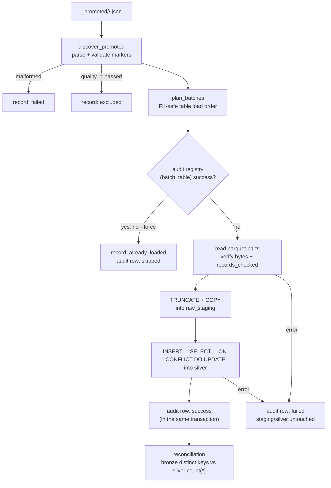

# The Silver Layer (Phase 08)

> **Status: IMPLEMENTED (Phase 08).**
> `src/mri/silver/` + `apps.ingestion load` load **only promoted** Bronze
> batches from MinIO into PostgreSQL 16 through three schemas —
> `raw_staging` (bulk `COPY` landing), `silver` (contract keys, foreign keys,
> structural checks) and `audit` (`load_audit` registry + per-batch log) —
> with transactional per-batch upserts, reconciliation against Bronze,
> idempotent reruns and a live-tested failure story. RAW and BRONZE objects
> are never written by this layer.

---

## 1. What it does



For every promoted batch the loader:

1. **Discovers** `_promoted/<source>/<batch>.json` markers and validates them
   structurally (parts, sizes, quality block) — a malformed marker is a
   `failed` record, never a crash.
2. **Plans** in FK-safe order: dimensions before facts
   (`regions → channels → calendar → stores → products → customers →
   promotions → sales → purchases → inventory → weather → fx_rates →
   external_products`).
3. **Skips** batches already registered `success` in `audit.load_audit`
   (unless `--force`).
4. **Reads** the Parquet parts, checking byte sizes and `records_checked`
   against the marker.
5. **Stages** into `raw_staging.<table>` (`TRUNCATE` + text-mode `COPY`,
   values converted to the target PostgreSQL types — unconvertible values
   fail loudly, never coerce).
6. **Upserts** into `silver.<table>` with a source-specific
   `ON CONFLICT ... DO UPDATE`, all inside one transaction together with the
   `success` audit row.
7. **Reconciles** every fully-loaded table: distinct Bronze conflict keys vs
   `count(*)` in Silver.

---

## 2. Schemas and tables

| Schema | Default | Contents | Constraints |
|--------|---------|----------|-------------|
| `raw_staging` | `PG_STAGING_SCHEMA` | 13 heap tables, one `TRUNCATE`-reuse landing per table | none (fast `COPY`) |
| `silver` | `PG_SILVER_SCHEMA` | 13 business tables, contract columns + 6 provenance columns | `PRIMARY KEY`, `FOREIGN KEY`, `CHECK` |
| `audit` | `PG_AUDIT_SCHEMA` | `load_audit` | status `CHECK`, partial unique success registry, `run_id`/`target_table` indexes |

* **14 sources → 13 tables.** Columns are *derived from the contracts*,
  never invented: business columns = contract columns (union-merged for
  `weather`), plus provenance `source`, `source_file`, `source_hash`,
  `batch_id`, `ingestion_run_id`, `ingestion_timestamp`. A contract column
  clashing with provenance is a build-time error.
* **Primary keys come from the contracts** (e.g. `sales.sale_id`,
  `inventory (snapshot_date, store_id, product_id)`), except:
  * `weather` merges `open_meteo_history` + `open_meteo_forecast` with
    conflicting/nullable date keys → **no PK**; uniqueness is enforced by one
    partial unique index per source (`ux_weather_open_meteo_history`
    `(region_id, observation_date) WHERE observation_date IS NOT NULL`,
    likewise for forecasts) and `ck_weather_dates` requires at least one of
    the two dates.
  * `fx_rates` PK `(date, base, quote)`; the other natural-key tables follow
    their contract.
* **Foreign keys** (10 relations: `stores→regions`, `sales→stores/channels/
  customers/products/promotions`, `weather→regions`, …) are added through
  self-healing `DO $$ … IF NOT EXISTS (pg_constraint) … ADD CONSTRAINT` blocks,
  so pre-existing constraints from other tooling are respected.
* **Type mapping** (`string→TEXT`, `integer→BIGINT`, `number→DOUBLE
  PRECISION`, `boolean→BOOLEAN`, `date→DATE`; provenance
  `ingestion_timestamp→TIMESTAMPTZ`) is fixed in `ddl.PG_TYPES`.
* Columns that only some sources of a merged table declare become nullable —
  merged `weather` dates are the live example.

---

## 3. Loading strategy

One batch = one transaction:

```sql
TRUNCATE raw_staging.<table>;
COPY raw_staging.<table> (cols) FROM STDIN;            -- psycopg COPY, converted rows
INSERT INTO silver.<table> (cols)
SELECT cols FROM raw_staging.<table>
ON CONFLICT (pk…) DO UPDATE SET col = EXCLUDED.col;    -- or per-source conflict keys
INSERT INTO audit.load_audit (… status='success' …);   -- same transaction
```

* **Staging is a heap** — no keys to maintain during `COPY`; the loader
  verifies `COPY` rowcount == frame rows and upsert rowcount == staged rows,
  any mismatch fails the batch.
* **Upsert semantics:** contract PK tables conflict on the PK; the merged
  `weather` table conflicts per source on its natural key with the
  `IS NOT NULL` predicate shared with the partial unique index (so an
  observation row and a forecast row for the same day coexist, while a
  duplicate of either is upserted).
* **Per-batch atomicity:** a read error, conversion error, FK/CHECK/unique
  violation or rowcount mismatch rolls back the whole batch — staging and
  silver are left exactly as before — and an `audit.load_audit` row with
  `status='failed'` + `error_message` is written in a separate transaction.
  The run continues with the next batch.
* **Registry:** a partial unique index
  `ux_load_audit_success (batch_id, target_table) WHERE status='success'`
  doubles as the load registry; success audit rows are upserted against it
  (re-runs refresh `run_id`/timings/counts instead of duplicating).
* **Reconciliation** runs on the same connection after loading, only for
  tables whose *every* passed batch is registry-success:
  `bronze_distinct_keys` (per source: distinct conflict keys across the
  batch frames, re-read from Parquet) vs `silver_rows` (`count(*)`). Each
  table gets a `{target_table, bronze_distinct_keys, silver_rows, balanced}`
  manifest entry; any `balanced: false` (or an entry `error`) fails the run.

---

## 4. Audit and manifests

`audit.load_audit` — one row per batch attempt:

| Column | Meaning |
|--------|---------|
| `load_id` | identity PK |
| `run_id`, `batch_id`, `source`, `target_table` | what was attempted |
| `started_at`, `finished_at` | wall clock of the attempt |
| `status` | `success` / `failed` / `skipped` (CHECK-constrained) |
| `rows_read`, `rows_inserted`, `rows_rejected` | row accounting (rejected is 0 — Bronze already gated) |
| `error_message` | failure text, `NULL` on success |

* `skipped` rows are written when the registry already holds the batch
  (outcome `already_loaded` in the manifest).
* `failed` rows accumulate across runs (history); `success` rows are unique
  per `(batch_id, target_table)`.

Run manifests are written locally to `reports/silver/<run_id>.json` with
`schemas`, `counts` (`loaded / already_loaded / failed / planned / excluded`),
per-table `tables` stats, per-batch `records`, `timing`
(`schema_seconds`, `read_seconds`, `db_seconds`, `reconcile_seconds`,
`total_seconds`) and `reconciliation` + `reconciliation_balanced`.

---

## 5. Failure handling (never half-loaded)

| Situation | Silver | Staging | Audit row | Manifest outcome |
|-----------|--------|---------|-----------|------------------|
| Batch reads/converts/upserts cleanly | upserted | truncated next batch | `success` | `loaded` |
| Already registered (no `--force`) | untouched | untouched | `skipped` | `already_loaded` |
| Parquet read / part-size / row-count mismatch | untouched | untouched | `failed` | `failed` |
| FK, CHECK, unique or rowcount violation | batch rolled back | rolled back | `failed` + error | `failed` |
| Malformed `_promoted/` marker | untouched | untouched | — | `failed` (`invalid promotion marker`) |
| Marker quality != `passed` | untouched | untouched | — | `excluded` |
| `--dry-run` | untouched | untouched | — | `planned` (no DB connection at all) |

* `--force` bypasses the registry — every planned batch is re-read and
  upserted (idempotent refresh of both data and registry rows).
* Tables are loaded in FK order, so a fact batch can never outrun its
  dimensions within a run; a batch that violates an FK anyway (e.g. a
  hand-crafted marker referencing a missing product) fails cleanly and the
  previously loaded rows stay intact — verified live by the integration
  suite.
* Exit code `1` is raised if **any record failed** or **any reconciliation
  entry is unbalanced**; usage errors (unknown `--source`) exit `2`.

---

## 6. CLI

```bash
python -m apps.ingestion load --source all                       # everything promoted
python -m apps.ingestion load --source sales --source regions
python -m apps.ingestion load --source all --dry-run             # plan only, no PostgreSQL
python -m apps.ingestion load --source all --force               # reload registered batches
python -m apps.ingestion --json load --source all                # manifest JSON on stdout
```

Exit codes: `0` all batches loaded/skipped and reconciliation balanced,
`1` at least one batch failed or a table is unbalanced, `2` usage error
(unknown source). Connection/settings come from `.env`
(`POSTGRES_HOST/PORT/DB/USER/PASSWORD/SSLMODE`, `PG_STAGING_SCHEMA`,
`PG_SILVER_SCHEMA`, `PG_AUDIT_SCHEMA`).

---

## 7. Idempotence

* The registry key is content-derived: `(batch_id, target_table)` where
  `batch_id` is the raw filename stem — the same promoted batch always maps
  to the same registry row, so reruns are `already_loaded` (outcome) /
  `skipped` (audit) and do no work.
* When a batch *is* reloaded (`--force`, or a batch with a refreshed
  marker), the upsert overwrites rows by conflict key — reloading the
  overlapping `regions` batches (R01/R02 share rows) converges instead of
  duplicating.
* `TRUNCATE` + `COPY` staging reuse means no staging bloat between batches.
* Schemas/DDL are `CREATE … IF NOT EXISTS` + self-healing FK blocks, so the
  loader can be pointed at an existing database without clobbering it.

---

## 8. Benchmarks

`benchmarks/silver_benchmark.py` (results appended to
`benchmarks/silver/results.json`); isolated bench buckets
`retail-bench-raw-<scale>` / `retail-bench-bronze-<scale>` and bench schemas
`raw_staging_bench` / `silver_bench` / `audit_bench` (dropped `CASCADE`
before each run → cold load):

```bash
uv run python benchmarks/silver_benchmark.py --scale small
uv run python benchmarks/silver_benchmark.py --scale medium --skip-ingest --skip-bronze
```

Measured on the development host (10 batches, all sources, balanced
reconciliation):

| Scale | Rows | Bronze in | Elapsed | Throughput | Timing (read/db/reconcile) | Schema bytes (staging/silver) |
|-------|------|-----------|---------|------------|----------------------------|-------------------------------|
| small | 126 348 | 3.8 MB | 56.1 s | ~2 250 rows/s | 4.9 s / 43.6 s / 6.4 s | 38.5 MB / 42.8 MB |
| medium | 1 397 019 | 23.6 MB | 605.9 s | ~2 310 rows/s | 11.3 s / 580.2 s / 12.2 s | 410 MB / 482 MB |

Database size after the medium run: ~901 MB (whole `retail` database).
Bulk time is dominated by the constrained upsert + index maintenance
(`db_seconds`); marker/Parquet reads and reconciliation stay comparatively
cheap.

---

## 9. Tests

* `tests/unit/test_silver_convert.py` — value/converter semantics per
  PostgreSQL type, missing-value → `NULL`, dtype fast paths, row tuple
  shaping.
* `tests/unit/test_silver.py` — DDL (staging heaps, silver keys/FKs/checks,
  audit registry), contract-driven specs (14→13 mapping, merged `weather`),
  marker parsing/defects, planning + load order, dry-run without a database,
  manifests, CLI parser/summary, connection-string rendering.
* `tests/integration/test_silver_postgres.py` — live PostgreSQL 16 in
  throwaway schemas: happy load (counts, provenance, reconciliation),
  idempotent rerun (`skipped`), drift + `--force` repair, quality-failed
  batch exclusion, constraint behaviour (PK/NOT NULL/FK/CHECK/partial
  unique/audit CHECK) via direct SQL, and an FK-violating crafted batch
  proving per-batch rollback + `failed` audit.

---

See also: [`bronze-layer.md`](bronze-layer.md) ·
[`data-quality.md`](data-quality.md) ·
[`ADR-006`](../decisions/ADR-006-postgresql-silver.md) ·
[`../architecture/ingestion.md`](../architecture/ingestion.md)
